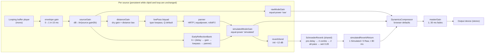
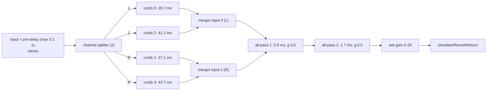

# 04 — Audio engine and audio assets

This section specifies everything audible: the audio engine's lifecycle and state machine, the exact signal graph, how accepted acoustic results become audio parameters, every smoothing and fade time, Raw/Simulated and HRTF/equal-power behaviour, the built-in sounds, the local user-audio library, and the offline-render checks. It also lists the Web Audio behaviours the current code depends on, so a native engine can reproduce them without Web Audio.

It does not define how acoustic values are computed: `dryGainDb`, `lowpassHz`, `effectiveDistanceM`, virtual positions, reflection taps and room RT60 come from the *Classic acoustics* and *Hybrid 3D acoustics* sections. Frame scheduling, coalescing and acceptance (which frame is "accepted", and when a frame is "pose-lagging") are in *Calculation runtime pipeline*. The project model, reducer actions, revisions, projections and persistence are in *Domain model*. Layout and widgets are in *Frontend UI*. Test tooling is in *Backend/AI/infra/tests*.

Terms used below:

- **Audio clock**: the engine's sample clock in seconds (`currentTime`). It stops while the output is suspended. All parameter automation is scheduled on it.
- **Wall clock**: ordinary timers. They are used only for deferred cleanup and for waiting on fades.
- **τ (tau)**: the time constant of an exponential approach (`setTargetAtTime`, §14.6).
- Classification tags: **[phys]** physical relation, **[approx]** numerical or geometric approximation, **[perc]** perceptual or engineering tuning (no physical meaning), **[eng]** engineering bound or safety rule.

---

## 1. Units, coordinates and shared helpers

| Quantity | Unit | Notes |
| --- | --- | --- |
| Time | seconds on the audio clock; `delayMs` fields are milliseconds | `delaySeconds = delayMs / 1000` |
| Gain in data | dB (amplitude dB, `20·log10`) | converted with `dbToLinear` |
| Gain on nodes | linear amplitude | |
| Frequency | Hz | |
| Position | metres | Classic: plan `(x, y)`. Hybrid: `(x, y = height, z)`. Classic plan `y` equals Hybrid/authoring `z`. |
| Heading | degrees | listener `headingDeg` |

**Helpers (used everywhere below):**

```text
clampFinite(v, lo, hi, fallback) = fallback            if v is NaN or ±Infinity
                                 = min(hi, max(lo, v))  otherwise
dbToLinear(db)   = 10 ^ (clampFinite(db, -160, 24, 0) / 20)
linearToDb(x)    = 20 · log10(clampFinite(x, 1e-8, 16, 1))
distanceAttenuation(d) with r = 1, ρ = 1, dmax = 50:
    r' = clampFinite(r, 0.1, 50, 1); ρ' = clampFinite(ρ, 0, 4, 1); dmax' = clampFinite(dmax, r', 50, 50)
    d' = clampFinite(d, 0, dmax', r')
    return r' / (r' + ρ' · max(d' - r', 0))          → equals 1 / max(min(d, 50), 1) for finite d ≥ 0
equalPowerCrossfade(mix):  m = clampFinite(mix, 0, 1, 0); a = m · π/2
    raw       = 0 if |m - 1| < ε else cos(a)          (ε = 2.22e-16, machine epsilon)
    simulated = 0 if m < ε       else sin(a)
```

`distanceAttenuation` is the inverse-distance law **[phys]** with a 1 m reference and a 50 m clamp **[eng]**. Note the fallback behaviour: any non-finite dB maps to 0 dB (gain 1) and any non-finite distance maps to gain 1 (see Review finding V6).

**Panner coordinate mapping.** The listener always sits at the origin of the panning space. All positions are written as listener-relative vectors:

| Data | Panner `(X, Y, Z)` |
| --- | --- |
| Classic point `p = (px, py)`, listener `l = (lx, ly)` | `(px − lx, 0, −(py − ly))` |
| Hybrid point `p = (px, py, pz)`, listener `l = (lx, ly, lz)` | `(px − lx, py − ly, −(pz − lz))` (a zero `Z` is written as `+0`) |

**Listener orientation.** `h = headingDeg · π / 180`. Listener position = `(0, 0, 0)`, forward = `(sin h, 0, −cos h)`, up = `(0, 1, 0)`. With the right-vector rule of §14.4 (`right = forward × up`), at `h = 0` the listener faces plan `+y` (Hybrid `+z`, "north") and plan `+x` is to the listener's right; at `h = 90°` the listener faces `+x`. Heading only yaws the listener; there is no pitch or roll. In Hybrid mode the heading comes from the same active listener (the Classic projection carries `headingDeg`).

Source: `src/audio/math.ts`, `src/audio/SourceGraph.ts`, `src/audio/EarlyReflectionBank.ts`, `src/audio/AudioEngine.ts`, `src/domain/workspace/projections.ts`

---

## 2. Graph overview

One engine owns one output context, one master bus and one shared late reverb. Each scene source owns one persistent source graph containing a direct path, a Raw path and a fixed six-tap early-reflection bank.



Fixed node counts: engine = compressor + master gain + reverb return + 32 reverb nodes (35). Per source = 1 player + 6 gains + 1 biquad + 1 panner + 6 × 4 tap nodes (33). With the 4-source limit: at most 4 committed graphs, plus graphs that are fading out (§5.6).

Facts a reimplementation must not "fix" silently (each changes the sound):

1. The direct path has **no propagation delay**. Only reflection taps are delayed.
2. The Raw path is the **mono** source after `sourceGain` only. It is up-mixed to both output channels at equal level (§14.10). It has no distance gain, filter, panning, reflections or reverb.
3. Reflection taps are fed from `sourceGain` (before distance gain and obstruction filter) and are summed into `simulatedModeGain`, so they are crossfaded with the direct path and they also feed the reverb.
4. The reverb send is taken **after** `simulatedModeGain` (direct + reflections), and the reverb return has its own Raw/Simulated gain.
5. The crossfade is per source (`rawModeGain` / `simulatedModeGain`), not on the master bus.
6. There is no limiter. The master bus has a dynamics compressor with the browser's default settings (§4, §14.9).

Source: `src/audio/AudioEngine.ts`, `src/audio/SourceGraph.ts`, `src/audio/EarlyReflectionBank.ts`, `src/audio/SchroederReverb.ts`, `tests/unit/audio-engine.test.ts`

---

## 3. AudioEngine lifecycle and state machine

### 3.1 Ownership

- The workspace creates **one** `AudioEngine` when it mounts and keeps it for its lifetime. Classic and Hybrid views both receive the same instance, so switching modes never creates a second output context (E2E: `data-audio-contexts` stays `1`).
- The engine is lazy. Construction creates nothing audible. The output context and the master chain are created on the first `start()`, which is only called from the Play button handler (the user gesture).
- When the workspace unmounts, disposal is deferred by a 0 ms timer. A remount before the timer fires cancels it.
- The engine accepts injected dependencies, used by tests: `createContext`, `fetchArrayBuffer`, `resolveAudioAsset(clipId) → bytes | null` (the local library, §12), and `schedule(callback, delayMs)` (wall-clock timer).

The audio scene passed to the engine is the **Classic projection of the active project**, in both modes, with every source whose `clipId` is in the project's `missingAudioAssetIds` removed. Disabled entities are already dropped by the projection, and only the active listener is present.

Source: `src/components/workspace/UnifiedWorkspace.tsx`, `src/hooks/useAudioEngine.ts`, `src/audio/AudioEngine.ts`

### 3.2 Engine state

| Field | Initial | Meaning |
| --- | --- | --- |
| `status` | `idle` | `idle`, `starting`, `running`, `suspended`, `error` or `disposed` |
| `mode` | `raw` | Preview mode `raw` or `simulated`. The UI sets `simulated` on mount, before any context exists. |
| `desiredRunning` | false | User intent to play |
| `runIntentGeneration` | 0 | Incremented by every `start`, `stop` and `dispose`. A failed start only records its error if it is still the latest intent. |
| `desiredScene`, `sceneVersion` | null, 0 | Latest requested scene. The version increments on every request. |
| `hasSuccessfullyStarted` | false | Set by the first reconcile that reaches `running` |
| `sourceGraphs` | empty | sourceId → committed graph |
| `retiringGraphs` | empty | Graphs that are fading out and wait for deferred disposal |
| `bufferCache` | empty | clipId → pending or finished decode |
| `latestAcousticFrame` + `latestAcousticFrameListener` | null | Last accepted Classic frame, and the scene listener at the moment it was accepted |
| `hybridDirectState`, `hybridReflectionState` | null | Last accepted Hybrid states |
| `masterMuted` | false | True after a stop fade, until the next fade-in |
| operation queue | resolved | Strict FIFO of `reconcile` and stop operations. A failed operation does not block later ones. |

Source: `src/audio/AudioEngine.ts`

### 3.3 Operations

**`start(scene)`**
1. If disposed: throw `"Audio engine has been disposed."`.
2. `intent = ++runIntentGeneration`; `desiredRunning = true`; request the scene (`desiredScene = scene`, `sceneVersion++`); `status = starting`; `error = null`.
3. Enqueue `reconcile` and await it.
4. On failure: if not disposed and `intent` is still the latest, set `desiredRunning = false`, `status = error` and `error` = the error message (fallback `"Audio failed to start."`). Always rethrow to the caller.

**`applyScene(scene)`** (called on every scene change)
1. If disposed: return. Request the scene (always recorded).
2. Return without work if there is no context, or `desiredRunning` is false, or (`hasSuccessfullyStarted` is false and `status ≠ starting`). So after a failed first start, scene updates are inert until an explicit retry.
3. Enqueue `reconcile` and await it; on success `applyCount++`. On failure: `status = error`, `error` = message (fallback `"Audio scene update failed."`), rethrow. `desiredRunning` stays true, so the next scene update retries.

**`stop()`**
1. `runIntentGeneration++`; `desiredRunning = false`.
2. If there is no context or the engine is disposed: return (status is not changed; see finding V9).
3. `status = suspended` (immediately, before the fade finishes).
4. Enqueue: if `context.state == running`: master fade-out (§3.5) and wait for it; if a newer `start` arrived meanwhile (`desiredRunning` is true again), return without suspending, because that start's reconcile fades back in. Then, if the context is neither `closed` nor `suspended`, call `suspend()`. Finally set `status = suspended` if still not running.

**`dispose()`** (idempotent, terminal, not queued)
1. `disposed = true`; `runIntentGeneration++`; `desiredRunning = false`; `desiredScene = null`; `sceneVersion++`; `status = disposed`; `error = null`.
2. Detach all committed and retiring graphs, clear the buffer cache, detach reverb, reverb return, compressor and master gain, detach the context.
3. If the context is running: fade the master to 0 over 30 ms and wait (§3.5).
4. Dispose every graph (stop players, disconnect), dispose the reverb, disconnect the remaining master nodes (errors ignored), close the context.

Any in-flight `reconcile` checks `disposed` after each await and stops. A late decode completion after dispose creates nothing.

**`setMode(mode)`**: stores the mode and, if a context exists, applies it (§9.1). Synchronous.

**`applyAcousticFrame(frame, {lagging})`**, **`applyHybridDirectState(state)`**, **`applyHybridReflectionState(state)`**: synchronous, see §8.

**`getDiagnostics()`**: `{status, mode, graphCount, sourceStarts, applyCount, contextCreations, sourceGraphIds (sourceId → graph identity number), error, acousticFallbackNotice: null}`.

Source: `src/audio/AudioEngine.ts`, `tests/unit/audio-engine.test.ts`

### 3.4 Reconcile (the only place graphs are created or removed)

```text
reconcile():
  while not disposed:
    if not desiredRunning: if context exists: status = suspended; return
    scene = desiredScene; if scene is null: return
    version = sceneVersion
    context = ensureContext()                       # may throw (§4)
    committed = await syncSourceGraphs(scene, version, context)   # may throw
    if disposed: return
    if not desiredRunning: status = suspended; return
    if not committed or version != sceneVersion: continue        # a newer scene arrived; redo
    applyListener(scene)                             # §9.3
    applySourceParameters(scene)                     # §8.4
    applyMode()                                      # §9.1
    error = null
    if not desiredRunning: status = suspended; return
    if context.state != running: await context.resume()           # may throw
    if disposed: return
    if not desiredRunning: status = suspended; return
    fadeMasterIn()                                   # only if masterMuted (§3.5)
    if version != sceneVersion: continue
    status = running; hasSuccessfullyStarted = true; return

syncSourceGraphs(scene, version, context):
  additions = sources s where no committed graph for s.id, or graph.clipId != s.clipId, or graph.loop != s.loop
  buffers = await all(loadBuffer(s.clipId) for s in additions)   # all-or-nothing; any failure rejects
  if stale(): return false        # disposed, !desiredRunning, version changed, context or master replaced
  staged = {}
  for s in additions: staged[s.id] = new SourceGraph(..., buffers[i], mode, scene.settings.hrtfEnabled); sourceStarts++
      on any construction failure: dispose every staged graph, rethrow
  if stale(): dispose staged; return false
  for each committed (id, g): if id not in scene.sources or id in staged: retireGraph(g); remove
  commit staged
  return true
```

Properties: graph changes are transactional. If any required buffer fails to load or any graph fails to build, the committed graphs stay untouched and keep playing. Failed decodes are evicted from the cache, so a retry reloads them. Concurrent `start` calls coalesce into one context and one graph per source. A stop issued while a start waits for decoding wins: no resume, no graphs, status `suspended`.

Source: `src/audio/AudioEngine.ts`, `tests/unit/audio-engine.test.ts` ("coalesces concurrent start requests…", "keeps committed graphs intact when replacement loading fails…", "honors stop requested while start is waiting…")

### 3.5 Master fades

| Action | Automation on `masterGain.gain` | Wait |
| --- | --- | --- |
| Fade-out (stop, dispose) | `cancelAndHold(now)`; linear ramp to 0 at `now + 0.030` | wall clock `30 + 10` ms |
| Fade-in (reconcile, only when `masterMuted`) | `cancelAndHold(now)`; linear ramp to 1 at `now + 0.030` | none |

`masterMuted` becomes true only when a stop fade ran (the context was running). The very first start does not fade the master in: the master is already at 1, and each new source fades in over 15 ms instead. **[perc]**

Source: `src/audio/AudioEngine.ts`, `src/audio/parameter-smoothing.ts`

### 3.6 State machine

```mermaid
stateDiagram-v2
  [*] --> idle
  idle --> starting: start()
  starting --> running: reconcile completes
  starting --> error: reconcile throws (latest intent)
  starting --> suspended: stop() while context exists
  running --> suspended: stop() (status set at call; fade + suspend queued)
  running --> error: applyScene reconcile throws
  error --> running: next applyScene succeeds (only if hasSuccessfullyStarted)
  error --> starting: start() (Retry)
  suspended --> starting: start()
  idle --> disposed: dispose()
  starting --> disposed: dispose()
  running --> disposed: dispose()
  suspended --> disposed: dispose()
  error --> disposed: dispose()
  disposed --> [*]
```



Edge case kept for fidelity: `stop()` called before the first reconcile has created the context leaves `status = starting` (finding V9). The UI never shows this state, because the Play button ignores clicks while an action is pending.

Source: `src/audio/AudioEngine.ts`

### 3.7 Errors

| Message (exact) | Cause |
| --- | --- |
| `Audio can only start in a browser after a user gesture.` | context creation outside a browser |
| `Web Audio is not supported by this browser.` | no `AudioContext` constructor |
| (constructor's own message, e.g. "audio denied") | context construction threw |
| `Audio assets must use the local registry.` | built-in URL not starting with `/audio/`, or containing `://` |
| `Unable to load local audio asset (<HTTP status>).` | built-in fetch not OK |
| `Unknown local audio asset: <clipId>` | not resolved by the local library and not a built-in |
| `Audio asset <clipId> must decode as mono.` | decoded channel count ≠ 1 |
| (decoder's own message) | decode failure |
| `Audio engine has been disposed.` | start after dispose |
| `Audio failed to start.` / `Audio scene update failed.` | fallbacks when a non-Error is thrown |

Node creation failures inside a graph, the reverb or the master chain roll back every node created so far (disconnect in reverse order; a partly built context is closed) and rethrow.

Source: `src/audio/AudioEngine.ts`, `src/audio/SourceGraph.ts`, `src/audio/SchroederReverb.ts`, `src/audio/EarlyReflectionBank.ts`

### 3.8 What the UI sees

- Toolbar Play button: label `Play`, `Stop`, `Starting…` or `Stopping…`, from the UI's own `playing` flag and a pending flag (not from engine status). `aria-pressed = playing`, `aria-busy` while pending. Clicks while pending are ignored.
- Click: if playing, `stop()`, else `start(currentAudioScene)`. On success `playing` flips. On failure the toast region shows a `role="alert"` error with the error message (fallback `Audio is unavailable.`) and a **Retry** button that repeats the same toggle. Scene editing stays available.
- Preview-mode control: two buttons, `Simulated` and `Raw`, with `aria-pressed`. Default `Simulated`. It works while stopped (stored and applied at start).
- There is no HRTF toggle in the UI. `scene.settings.hrtfEnabled` changes only when the scene is replaced, for example by importing an edited project (the manual protocol does this). All presets set it to `true`.
- The workspace root exposes `data-audio-contexts` (contexts created) and `data-audio-graphs` (committed graphs) for tests.
- Engine `status` and `error` from **scene updates** are never shown (finding V5).

Source: `src/components/workspace/UnifiedWorkspace.tsx`, `src/components/workspace/WorkspaceToolbar.tsx`, `tests/e2e/workspace-failures.spec.ts`, `tests/e2e/workspace.spec.ts`

### 3.9 Context states, interruption and devices

- The context is created with default options: device default sample rate, default latency hint, default output device. No device selection.
- Before resuming, the engine checks only `state != running`. It does **not** listen for state changes or device errors. If the platform suspends or interrupts the context (device loss, OS interruption, sleep), `status` stays `running` and the toolbar still says Stop; the user recovers with Stop then Play. A Stop on a context that is not running skips the fade and calls `suspend()` unless it is already suspended or closed; the master is then not marked muted, so the next start has no master fade-in.
- While the context is not running, the audio clock is frozen. Code that depends on fades completing therefore switches to immediate values: retired graphs are disposed at once (§5.6) and reflection taps snap (§6.4).

Source: `src/audio/AudioEngine.ts`, `src/audio/SourceGraph.ts`, `docs/testing/browser-listening.md`

---

## 4. Master bus

Created once per context by `ensureContext()`:

1. `compressor` = dynamics compressor, **parameters never set** (browser defaults: threshold −24 dB, knee 30 dB, ratio 12, attack 0.003 s, release 0.25 s; behaviour in §14.9).
2. `masterGain` gain 1. `compressor → masterGain → destination`.
3. `simulatedReverbReturn` gain = 1 if mode is `simulated`, else 0. `simulatedReverbReturn → compressor`.
4. Shared `SchroederReverb` whose output goes to `simulatedReverbReturn` (§7).
5. Nine smoothed listener parameters (position XYZ, forward XYZ, up XYZ).

Inputs summed at the compressor: every graph's `rawModeGain` (mono), every graph's `simulatedModeGain` (stereo), and the reverb return (stereo).

Source: `src/audio/AudioEngine.ts`

---

## 5. Per-source graph (`SourceGraph`)

### 5.1 Nodes and fixed configuration

| Node | Type | Fixed configuration | Initial value | Driven by |
| --- | --- | --- | --- | --- |
| `sourceNode` | looping buffer player | `buffer` = decoded mono clip; `loop = source.loop`; whole buffer loops; rate 1 | — | started once at construction |
| `envelope` | gain | — | 0, then linear ramp to 1 over 15 ms | lifecycle |
| `sourceGain` | gain | — | `dbToLinear(source.gainDb)` | authoring (§8.1) |
| `rawModeGain` | gain | — | `equalPowerCrossfade(mode == simulated ? 1 : 0).raw` | mode (§9.1) |
| `distanceGain` | gain | — | `distanceAttenuation(planar distance source↔listener)` | simulation |
| `lowPass` | biquad | type lowpass; Q, detune, gain left at defaults | frequency 20 000 Hz | simulation |
| `panner` | panner | `panningModel = HRTF` if `hrtfEnabled` else `equalpower`; `distanceModel = inverse`; `refDistance = 1`; `maxDistance = 50`; `rolloffFactor = 0`; cone defaults | position `(px − lx, 0, −(py − ly))` | simulation |
| `simulatedModeGain` | gain | — | `equalPowerCrossfade(mode == simulated ? 1 : 0).simulated` | mode |
| `reverbSend` | gain | — | `dbToLinear(−12)` = 0.2512 | simulation (Classic only) |
| `earlyReflectionBank` | 6 taps (§6) | input `sourceGain`, output `simulatedModeGain` | all taps silent | simulation |

Connections: `sourceNode → envelope → sourceGain`; `sourceGain → rawModeGain → master`; `sourceGain → distanceGain → lowPass → panner → simulatedModeGain`; `simulatedModeGain → master`; `simulatedModeGain → reverbSend → reverb input`; taps as in §6.

`rolloffFactor = 0` makes the panner's own distance gain exactly 1 (§14.3). The panner supplies direction only; distance loss is applied once, in `distanceGain`. **[eng]**

Source: `src/audio/SourceGraph.ts`

### 5.2 Construction order

1. Create all nodes (any failure: roll back as in §3.7).
2. Configure them as in §5.1 and connect them.
3. Write initial values with direct assignment (no automation).
4. `sourceNode.start()` at the current audio time. Then `envelope.gain.setValueAtTime(0, now)` and `linearRampToValueAtTime(1, now + 0.015)`. **[perc]**

Each graph starts its loop at its own creation time, so loops of different sources are not phase-aligned. Suspending and resuming the context continues the loop where it stopped.

A non-looping source (`loop = false`, Inspector checkbox) plays once from its creation time and then stays silent. It replays only if its graph is rebuilt (clip or loop change, re-enable, removal and re-add). Stop/Play does not restart it.

Source: `src/audio/SourceGraph.ts`

### 5.3 Identity and reuse

A committed graph is kept as long as the scene has a source with the same `id`, the same `clipId` and the same `loop`. Moving a source, editing gain, changing HRTF, accepting frames or switching Raw/Simulated never rebuilds a graph or allocates nodes. Switching Classic/Hybrid swaps the audio scene to the other mode's project, so a graph survives only where that project has a source with the same `id`, `clipId` and `loop`. The two default projects do, so the E2E graph count stays constant. Changing `clipId` or `loop` builds a new graph and retires the old one; both overlap for 25 ms (new fades in over 15 ms, old fades out over 25 ms; plain linear, not equal-power).

Source: `src/audio/SourceGraph.ts`, `src/audio/AudioEngine.ts`

### 5.4 Parameter ownership

- **Authoring parameters** follow the scene on every reconcile in both modes: `sourceGain` (from `gainDb`) and the panning model of the direct panner and all six tap panners.
- **Simulation parameters** are written only from accepted acoustic data: `distanceGain`, `lowPass.frequency`, panner position, `reverbSend`, and the taps. Between accepted frames they hold their last targets. They are not re-derived from the scene pose.
- A graph that has never received acoustic data (`hasSimulation = false`) follows the **free-field estimate** on every reconcile:
  ```text
  d = hypot(sx − lx, sy − ly)            # planar, from the Classic scene
  distanceGain → distanceAttenuation(d)
  panner      → (sx − lx, 0, −(sy − ly))
  ```
  `lowPass` (20 kHz), `reverbSend` (−12 dB) and the taps (silent) are left as they are. **[approx]**
- `hasSimulation` becomes true on the first `applyFrame`, `applySpatialDirect` or `applySpatialReflections` and never resets for that graph.
- Graphs that are retiring ignore all parameter writes.

Source: `src/audio/SourceGraph.ts`, `src/audio/AudioEngine.ts`

### 5.5 Smoothing

Every authoring and simulation write goes through a smoothed-parameter wrapper (§8.6): `setTargetAtTime(target, now, τ = 0.08 s)`, skipped if the target and τ are identical to the last scheduled ones. **[perc]**

Source: `src/audio/parameter-smoothing.ts`, `src/audio/SourceGraph.ts`

### 5.6 Retirement and disposal

```text
retire(now):                                    # idempotent; returns the time after which disposal is safe
  envelope: cancelAndHold(now); linear ramp to 0 at now + 0.025
  sourceNode.stop(now + 0.025)                  # failures ignored
  retiredUntil = now + 0.025 + 0.25             # 0.25 s for reflection-tap tails (max tap delay 0.2 s)

engine.retireGraph(g):
  if context.state != running: g.dispose(); return       # clock frozen; nothing audible
  releasedAt = g.retire(now); add g to retiringGraphs
  after wall-clock max(0, (releasedAt − now)·1000) + 10 ms  (≈ 285 ms): if still retiring: g.dispose()

dispose(): stop the player if it was not stopped yet; disconnect all 9 nodes and the 24 tap nodes (errors ignored)
```

The shared reverb keeps ringing after a graph is disconnected; only that graph's input to it stops.

Source: `src/audio/SourceGraph.ts`, `src/audio/AudioEngine.ts`, `src/audio/parameter-smoothing.ts`, `tests/unit/audio-engine.test.ts` ("lifecycle envelopes (#20)")

---

## 6. Early-reflection bank (six taps)

### 6.1 Nodes

Six identical taps, created once per graph:

```text
sourceGain → delay (max 0.2 s) → gain (init 0) → lowpass biquad (init 20 000 Hz, Q default) → panner → simulatedModeGain
```

Tap panner configuration equals the direct panner's (§5.1), including the HRTF/equal-power choice, which follows the scene on every reconcile. Each tap keeps smoothed wrappers for delay time, level, frequency and position X/Y/Z, plus a slot state `{ key: string | null, busyUntil: audio time }` (initially `null`, −∞).

Source: `src/audio/EarlyReflectionBank.ts`

### 6.2 Targets

The bank receives an ordered reflection list. It keeps the first six entries (the acoustic model's ranking), converts them, and keeps the first entry per key:

| Field | Classic reflection | Hybrid reflection |
| --- | --- | --- |
| `key` | `wallIds.join(">")` if present, else `wallId` | `id` |
| `delaySeconds` | `clamp(delayMs / 1000, 0, 0.2)`; non-finite → 0 | same |
| `gain` (linear) | `dbToLinear(gainDb)` | same |
| `lowpassHz` | `clamp(lowpassHz, 80, 20 000)`; non-finite → 20 000 | same |
| position | `(rx − lx, 0, −(ry − ly))` from `reflectionPoint` (second order: the listener-side bounce) and the graph's current listener position | `(px − lx, py − ly, −(pz − lz))` from `position` and the state's listener |

The tap delay is applied relative to the **undelayed** direct sound. Classic `delayMs` is the excess path delay over the direct route; Hybrid `delayMs` is the absolute path delay (finding V2).

Source: `src/audio/EarlyReflectionBank.ts`, `src/audio/reflection-slots.ts`, `src/acoustics/compute-frame.ts`, `src/acoustics/hybrid3d/reflections.ts`

### 6.3 Slot assignment

A path keeps its tap while it stays among the audible six, so a delay line never glides from one path to another.

```text
assignSlots(previousKeys[6], rankedKeys, quiet[6]):     # quiet[i] = previousKeys[i] == null and now >= busyUntil[i]
  wanted = first 6 distinct keys of rankedKeys
  assignment[i] = previousKeys[i] if previousKeys[i] ∈ wanted (first occurrence only), else null
  free slots = slots with assignment null, sorted by cost then index:
      cost 0: previously empty and quiet
      cost 1: previously empty but still fading (busy)
      cost 2: previously carried a path that is no longer wanted
  place each unplaced wanted key, in rank order, into the next free slot
```

Source: `src/audio/reflection-slots.ts`, `src/audio/EarlyReflectionBank.ts`

### 6.4 Per-tap scheduling

For each tap `i` with new key `k` (or null) and target `T`. `immediate` is true when the context is not running.

| Case | Action |
| --- | --- |
| `immediate` | **Snap**: level target = `T.gain` or 0; if it differs from the remembered level or the tap is busy: `cancelScheduledValues(now)`, `setValueAtTime(level, now)`. If `T` exists: for each of delay, frequency, X, Y, Z whose remembered value differs: `cancelScheduledValues(now)`, `setValueAtTime(value, now)`. Slot = `{k, now}`. |
| `k == null`, slot had a key | **Release**: level `cancelAndHold(now)`, linear ramp to exactly 0 at `now + 0.020`. Slot = `{null, now + 0.020}`. |
| `k == slot.key` | **Smooth** (only if `now ≥ busyUntil`; otherwise ignored, the next frame supersedes): all six parameters `setTargetAtTime(·, now, 0.08)` with dedupe. A moving path's delay glide produces a Doppler-like pitch change. **[perc]** |
| slot empty and quiet | **Enter**: at `now` set delay, frequency, X, Y, Z exactly (`cancelScheduledValues(now)` + `setValueAtTime(·, now)`), then level `setTargetAtTime(T.gain, now, 0.08)` from its current 0. Slot = `{k, now}`. |
| otherwise (slot carries another path, or is still fading) | **Retune**: `s = now + 0.020`. Level: `cancelAndHold(now)`, linear ramp to 0 at `s`, `setTargetAtTime(T.gain, s, 0.08)`. Delay, frequency, X, Y, Z: `cancelScheduledValues(now)`, `setValueAtTime(value, s)`. Slot = `{k, s}`. A second retune before `s` cancels the pending values and starts a new 20 ms fade from the held level. |

So a new or moved path fades in exponentially (τ 80 ms) and a removed path fades out linearly in 20 ms. **[perc]**

Source: `src/audio/EarlyReflectionBank.ts`, `src/audio/reflection-slots.ts`, `tests/unit/early-reflection-bank.test.ts`, `tests/unit/reflection-slots.test.ts`

---

## 7. Shared late reverb (`SchroederReverb`)

### 7.1 Topology and constants



Each comb (all delays max 0.1 s):

```text
u[n] = x[n] + g · y[n]               # x: one split channel
d[n] = u[n − N]                       # delay N = comb delay (fixed)
y[n] = LP(d)[n]                       # damping biquad lowpass, Q default
comb output = y                       # tapped after the damping filter
```

Each all-pass (stereo, channels independent), built from gains: `delayIn = in + 0.5·delayOut`; `out = −0.5·in + 0.75·delayOut`. This equals the standard Schroeder all-pass `H(z) = (−g + z^−D) / (1 − g·z^−D)` with `g = 0.5`. **[approx]**

The left output is `AP2(AP1(comb0(L) + comb2(L)))` and the right output is `AP2(AP1(comb1(R) + comb3(R)))`. The two comb sets are different, which decorrelates the channels. **[perc]**

| Constant | Value | Class |
| --- | --- | --- |
| Comb delays | 0.0297, 0.0371, 0.0411, 0.0437 s | [perc] |
| All-pass delays | 0.005, 0.0017 s (see §14.7: the 1.7 ms loop is raised to one 128-frame block) | [perc] |
| All-pass coefficient | 0.5 (feedback +0.5, feed-forward −0.5, delayed branch 0.75) | [approx] |
| Wet gain | 0.28 fixed ("master-safe") | [perc] |
| RT60 clamp | 0.12–4 s | [eng] |
| Initial state | feedback for RT60 0.8 s (0.7738, 0.7259, 0.7013, 0.6857), damping 20 000 Hz, **pre-delay 0 s** until the first room is applied | — |

Source: `src/audio/SchroederReverb.ts`

### 7.2 Room → reverb mapping (on every accepted Classic frame)

```text
mid'  = clampFinite(room.rt60S.mid, 0.12, 4, 0.8)
high' = clampFinite(room.rt60S.high, 0.12, 4, mid')
ratio = clampFinite(high' / mid', 0.05, 1, 1)
preDelay   → clampFinite(room.preDelayMs / 1000, 0.005, 0.08, 0.02)      τ 0.08
feedback_i → 10 ^ (−3 · D_i / mid')     (D_i clamped to [0.0001, 0.2], fallback 0.03)   τ 0.08
damping_i  → 700 · (20 000 / 700) ^ ratio      (same cutoff for all four combs)         τ 0.08
```

- `g = 10^(−3D/RT60)` makes each comb loop lose 60 dB in RT60 seconds, ignoring the damping filter **[phys]** applied to a Schroeder structure **[approx]**.
- The damping cutoff is a heuristic **[perc]**: 20 kHz when the high band decays at least as slowly as the mid band, falling exponentially to 827.7 Hz at `ratio = 0.05`. Example: `ratio = 0.5` → 3 742 Hz.
- The low band (`rt60S.low`) and the room volume and surface are not used.
- Feedback range: RT60 4 s → 0.9500, 0.9379, 0.9315, 0.9273. RT60 0.12 s → 0.181, 0.118, 0.094, 0.081.

**Hybrid mode never calls this mapping** (finding V1). The reverb keeps the last Classic room, or the initial state if no Classic frame was ever accepted in this session.

Source: `src/audio/SchroederReverb.ts`, `src/audio/AudioEngine.ts`, `tests/unit/schroeder-reverb.test.ts`

---

## 8. From accepted acoustic data to audio parameters

Acceptance (current revision, or pose-lagging under ADR 0008) is decided upstream; see *Calculation runtime pipeline*. The engine adds one check for Classic frames only: a frame whose `revision` differs from the engine's latest requested scene revision is ignored unless the caller passes `lagging: true`. Hybrid states are applied without a revision check, because the Hybrid view only forwards accepted states.

### 8.1 Authoring parameters (every reconcile)

| Parameter | Value |
| --- | --- |
| `sourceGain` | `dbToLinear(source.gainDb)` (schema range −36…+6 dB) |
| direct and tap `panningModel` | `HRTF` if `scene.settings.hrtfEnabled` else `equalpower`, switched in place |

Source: `src/audio/SourceGraph.ts`, `src/audio/EarlyReflectionBank.ts`, `src/domain/scene/schema.ts`

### 8.2 Classic `AcousticFrame`

Applied immediately to every graph whose `sourceId` appears in `frame.sources`, at `now`. The listener `l` is the **engine's current scene listener** at the moment the frame is accepted, even for a lagging frame.

| Parameter | Target |
| --- | --- |
| `distanceGain` | `dbToLinear(dryGainDb) · distanceAttenuation(effectiveDistanceM)` |
| `lowPass.frequency` | `lowpassHz`, **not clamped** here |
| panner X, Y, Z | `(virtualPosition.x − lx, 0, −(virtualPosition.y − ly))` (portal route: listener-facing portal; otherwise as the Classic section defines) |
| `reverbSend` | `dbToLinear(reverbSendDb)`; the Classic model always emits 0 dB, so this becomes 1.0 |
| taps | §6 with `earlyReflections` (Classic mapping) |
| reverb | §7.2 with `frame.room` |

On acceptance the engine stores the frame and that listener, and **drops any held Hybrid state**.

Source: `src/audio/AudioEngine.ts`, `src/audio/SourceGraph.ts`, `src/acoustics/compute-frame.ts`, `src/components/workspace/ClassicViewportAdapter.tsx`

### 8.3 Hybrid states

`HybridDirectAudioState = { listenerPosition: {x,y,z}, sourceStates: { [sourceId]: { position, effectiveDistanceM, dryGainDb, lowpassHz, routeType } } }`. For each scene source with an entry:

| Parameter | Target |
| --- | --- |
| `distanceGain` | `dbToLinear(dryGainDb) · distanceAttenuation(effectiveDistanceM)` |
| `lowPass.frequency` | `lowpassHz`, not clamped |
| panner X, Y, Z | `(px − lx, py − ly, −(pz − lz))` from `position` (the virtual position: source, or listener-facing portal) |
| `reverbSend`, reverb | **unchanged** |

`routeType` is not used for audio.

`HybridReflectionAudioState = { listenerPosition, reflectionsBySource: { [sourceId]: HybridEarlyReflectionTap[] } }`, with taps `{ id, order?, position, delayMs, gainDb, lowpassHz }` already ranked and limited to six. For every scene source, the taps are applied with §6 (Hybrid mapping); a source missing from the map gets an empty list, which releases its taps.

Accepting either Hybrid state **drops the held Classic frame**.

Source: `src/audio/types.ts`, `src/audio/AudioEngine.ts`, `src/audio/SourceGraph.ts`, `src/acoustics/hybrid3d/audible-direct.ts`, `src/acoustics/hybrid3d/reflection-rendering.ts`, `src/components/workspace/HybridViewportAdapter.tsx`

### 8.4 Held state on reconcile

```text
applySourceParameters(scene):
  for each scene source s with graph g:
    g.applyAuthoring(s, hrtfEnabled)
    if g.hasSimulation: continue                       # hold last accepted targets
    if held Classic frame has an entry for s.id:
        g.applyFrame(entry, heldFrameListener)         # §8.2
    else:
        if held Hybrid direct state has s.id: g.applySpatialDirect(...)
        if held Hybrid reflection state exists: g.applySpatialReflections(listener, taps[s.id] or [])
    if not g.hasSimulation: g.applyFreeField(s, scene.listener)
  if held Classic frame: reverb.apply(frame.room)
```

So a rebuilt graph (clip or loop change) adopts the held state for its source instead of a free-field estimate.

Source: `src/audio/AudioEngine.ts`

### 8.5 Sources added, removed, disabled, missing

| Event | Audio result |
| --- | --- |
| Source added or re-enabled | New graph: decode (cached by clipId), 15 ms fade-in, held state for its id or free-field estimate |
| Source removed, disabled, or its asset marked missing | Graph retired: 25 ms fade-out, stop, disconnect after ≈ 285 ms |
| Clip or loop changed | Rebuild (§5.3) |
| Pose edit without a new frame | Simulation parameters hold. Listener orientation (§9.3) and authoring gain update at once. |
| Edits while stopped | Recorded only. Graphs are synced at the next start. Frames and Hybrid states are still applied to existing graphs (taps snap). |

Source: `src/audio/AudioEngine.ts`, `src/audio/SourceGraph.ts`, `src/components/workspace/UnifiedWorkspace.tsx`

### 8.6 Smoothed-parameter wrapper

```text
SmoothedParam { lastTarget = null, lastTau = null }
smooth(target, now, tau = 0.08):
   if lastTarget != null and identical(lastTarget, target) and lastTau == tau: return    # exact identity, sign of zero counts
   param.setTargetAtTime(target, now, tau); remember (target, tau)
setAt(v, t):        param.setValueAtTime(v, t); remember (v, 0.08)
markScheduled(v):   remember (v, 0.08)               # after writing automation directly
invalidate():       forget
```

There is no tolerance: any numeric change reschedules. Re-applying an identical frame or an unchanged scene schedules nothing (unit test "automation dedupe (#25)").

Source: `src/audio/AudioEngine.ts`, `src/audio/SourceGraph.ts`, `src/audio/parameter-smoothing.ts`, `src/audio/types.ts`, `src/components/workspace/ClassicViewportAdapter.tsx`, `src/components/workspace/HybridViewportAdapter.tsx`, `src/acoustics/hybrid3d/audible-direct.ts`, `src/acoustics/hybrid3d/reflection-rendering.ts`, `src/acoustics/compute-frame.ts`, `tests/unit/audio-engine.test.ts`

---

## 9. Raw/Simulated, HRTF/equal-power, listener

### 9.1 Raw ↔ Simulated

Per graph, when the mode changes (no-op if equal):

```text
toAngle   = π/2 if simulated else 0
fromAngle = current angle:
            no transition yet → (mode == simulated ? π/2 : 0)
            else from + (to − from) · clamp((now − start) / 0.08, 0, 1)    # of the last transition
curves (33 points, i = 0..32):  θ_i = fromAngle + (toAngle − fromAngle) · i/32
            raw_i = equalPowerCrossfade(θ_i/(π/2)).raw ; sim_i = equalPowerCrossfade(θ_i/(π/2)).simulated
rawModeGain.gain:       cancelAndHold(now); setValueCurveAtTime(raw_i, now, 0.08)
simulatedModeGain.gain: cancelAndHold(now); setValueCurveAtTime(sim_i, now, 0.08)
remember transition {fromAngle, start = now, toAngle}
```

The curve is equal-power (`raw² + sim² = 1` at every point) and lasts 80 ms **[perc]**. Reversing mid-way starts from the held mix, so curves never overlap and there is no step (E2E: maximum sample step ≤ 1 % of peak).

Engine-level, at the same time: `simulatedReverbReturn.gain → 1 or 0` with `setTargetAtTime(τ 0.08)` (exponential, not equal-power). New graphs start at the end-state gains of the current mode. Mode is independent of play state and of Classic/Hybrid.

Level consequence **[perc]**: Raw sends the mono clip at `sourceGain` to both channels. Simulated sends it through distance gain and the panner; a centred equal-power source gets `cos(π/4) = 0.707` per channel. Raw is therefore about 3 dB louder than a centred Simulated source at ≤ 1 m, and louder still at distance.

Source: `src/audio/SourceGraph.ts`, `src/audio/parameter-smoothing.ts`, `src/audio/math.ts`, `src/audio/AudioEngine.ts`

### 9.2 HRTF ↔ equal-power

`scene.settings.hrtfEnabled` selects `panningModel` on all seven panners of every graph. Changes are applied in place on the next reconcile, without crossfade and without rebuilding. The HRTF is the browser's built-in, unspecified HRIR set; no named dataset is loaded.

Source: `src/audio/SourceGraph.ts`, `src/audio/EarlyReflectionBank.ts`

### 9.3 Listener

On every reconcile: position `(0, 0, 0)`, forward `(sin h, 0, −cos h)`, up `(0, 1, 0)`, each component via `setTargetAtTime(τ 0.08)` with dedupe. A heading change therefore schedules only forward X and Z. The forward components are smoothed separately, so a large turn does not follow a constant angular rate, and a 180° turn passes briefly through a near-zero forward vector (finding S5). Listener position changes act only through the listener-relative source and tap positions, which are simulation parameters (held until the next accepted frame).

Source: `src/audio/SourceGraph.ts`, `src/audio/parameter-smoothing.ts`, `src/audio/AudioEngine.ts`, `tests/unit/audio-engine.test.ts`

---

## 10. Timing constants

| Constant | Value | Curve | Class | Used for |
| --- | --- | --- | --- | --- |
| Parameter smoothing | τ = 0.08 s | exponential (`setTargetAtTime`) | [perc] | every gain, filter, position, delay, listener, reverb target |
| Mode crossfade | 0.08 s, 33 points | equal-power value curve | [perc] | raw/simulated gains |
| Reverb return mode change | τ = 0.08 s | exponential | [perc] | `simulatedReverbReturn` |
| Source fade-in | 0.015 s | linear | [perc] | new graph envelope |
| Source fade-out | 0.025 s | linear, then stop | [perc] | retired graph envelope |
| Retire tail | 0.25 s after fade-out | — | [eng] | deferred disconnect |
| Master fade | 0.030 s | linear | [perc] | stop, dispose, resume |
| Tap retune or release | 0.020 s | linear to 0 | [perc] | §6.4 |
| Tap fade-in | τ = 0.08 s | exponential | [perc] | enter or retune |
| Wall-clock margin | 10 ms | — | [eng] | waits and deferred disposal |

Source: `src/audio/parameter-smoothing.ts`, `src/audio/SourceGraph.ts`, `src/audio/AudioEngine.ts`

---

## 11. Built-in sounds

### 11.1 Registry

| ID | Label | File | Seed | Peak | RMS |
| --- | --- | --- | --- | --- | --- |
| `radio_loop` | Radio loop | `/audio/radio-loop.wav` | `0xEC001` | −10.7 dBFS | −16.6 dBFS |
| `rain_loop` | Rain loop | `/audio/rain-loop.wav` | `0xEC002` | −17.4 dBFS | −23.9 dBFS |
| `voice_loop` | Voice loop | `/audio/voice-loop.wav` | `0xEC003` | −12.9 dBFS | −18.4 dBFS |
| `water_loop` | Water loop | `/audio/water-loop.wav` | `0xEC004` | −14.7 dBFS | −22.1 dBFS |

Every entry also has `channels: 1`, `loop: true`, `license: "Self-authored procedural audio"` and `attribution: "Echo Canvas procedural generator, 2026"`. These fields are not used at runtime; the scene's `source.loop` decides looping. Registry URLs must start with `/audio/` and must not contain `://` (checked when the registry is defined and again before fetching). Every file is mono, 48 000 Hz, signed 16-bit PCM, 96 000 frames (2.000 s), 192 044 bytes, canonical 44-byte header. Peak and RMS were measured from the shipped files for this spec.

Source: `src/domain/audio-assets/registry.ts`, `public/audio/*.wav`, `tests/unit/audio-assets.test.ts`

### 11.2 Generator (reproduces the shipped files byte for byte; verified for this spec)

```text
fs = 48000; N = 96000; t = i / fs
noise: state = seed (uint32); per sample: state = (1664525·state + 1013904223) mod 2^32; n = state / 4294967295 · 2 − 1
       (one draw per sample for every clip, including voice, which does not use it)
radio = 0.19·sin(2π·220t) + 0.09·sin(2π·330t) + 0.025·n
rain  = 0.11·n + 0.025·sin(2π·137t)·n
voice = 0.15·c + 0.08·sin(2π·236t) + 0.04·sin(2π·708t)·c,   c = sin(2π·118t)
water = 0.09·sin(2π·73t) + 0.06·sin(2π·181t) + 0.035·n
env(i) = i/1200 for i < 1200;  (N − 1 − i)/1200 for i ≥ N − 1200;  else 1      (1200 = round(0.025·fs))
sample = clamp(value · env, −1, 1);  int16 = round(sample · 32767)              (JS round: halves toward +∞)
WAV: "RIFF", 36+192000, "WAVE", "fmt ", 16, format 1, channels 1, 48000, 96000 B/s, block 2, 16 bit, "data", 192000
```

Arithmetic in IEEE double. Run as `node scripts/generate-audio-assets.mjs` from the repository root; it writes `public/audio/`. There is no package script for it.

The envelope fades each clip out over its last 25 ms and in over its first 25 ms, so looped playback has a 50 ms V-shaped dip every 2 s (finding V10).

Source: `scripts/generate-audio-assets.mjs`

### 11.3 License

`public/audio/LICENSE.md`: original procedural signals generated by the script, with no third-party recordings. Copyright 2026 Echo Canvas contributors; usable and redistributable with the project under the project's terms (the repository is MIT). Attribution text: "Echo Canvas procedural generator, 2026." Described as prototype fixtures.

Source: `scripts/generate-audio-assets.mjs`, `public/audio/LICENSE.md`, `LICENSE`

---

## 12. Local user audio library

### 12.1 Import validation

| Check | Rule | Message |
| --- | --- | --- |
| Type | `blob.type` lower-cased ∈ {`audio/wav`, `audio/x-wav`, `audio/mpeg`, `audio/mp3`, `audio/ogg`}. The file picker's `accept` is `audio/wav,audio/mpeg,audio/ogg`. No extension or content sniffing. | `Choose a WAV, MP3, or Ogg audio file.` |
| Per file | size ≤ 25 × 1024 × 1024 bytes | `Local audio files must be 25 MB or smaller.` |
| Library total | existing bytes + new size ≤ 100 × 1024 × 1024 (relink excludes the record it replaces) | `The local audio library is limited to 100 MB.` |
| Decodable | fully decoded once with a temporary context, which is then closed | `This audio file could not be decoded by the browser.` |
| Mono | decoded channel count = 1 (no downmix) | `Local point-source audio must be mono.` |

There is no count limit on library entries (the scene still allows at most 4 sources). There is no limit on decoded PCM size.

Source: `src/domain/audio-assets/local-library.ts`, `src/components/workspace/AudioAssetPicker.tsx`

### 12.2 Record and storage

`LocalAudioRecord = { id, name, mimeType, size, blob, createdAt }`.

- `id = "local_" + randomUUID()` with `-` replaced by `_` (42 characters). Scene validation accepts a clip ID that is a built-in ID or matches `^local_[a-zA-Z0-9_]{1,57}$`.
- `name` = file name truncated to 120 characters; `mimeType` = `blob.type`; `size` in bytes; `createdAt` = epoch milliseconds.
- IndexedDB database `echo-canvas-audio`, version 1, object store `assets`, `keyPath: "id"`, no indexes. A record is the whole object, blob included.
- Writes resolve only when the transaction completes. They reject on request error, transaction error or abort.
- `list()` returns all records sorted by `createdAt`, newest first.
- **Fallback store**: IndexedDB is wrapped with an in-memory mirror. Successful list and put results are mirrored. The first failure of any operation switches the store permanently to memory-only for the tab and reports it once. If `indexedDB` is missing or throws on access, the library is memory-only from the start.
- UI warnings: `Local audio will last only for this tab.` (no IndexedDB at start), `IndexedDB is unavailable. Local audio will last only for this tab.` (after a fallback), `Local audio storage is unavailable.` (list failed). They appear in the "Memory-only warning" banner and in the audio picker.
- `resolveArrayBuffer(id)` lists the store and returns the record's bytes or null. The engine calls it for every clip ID before falling back to the built-in registry.

Source: `src/domain/audio-assets/local-library.ts`, `src/hooks/useLocalAudioLibrary.ts`, `src/domain/scene/validate.ts`

### 12.3 Adding a local source

Picker: built-in buttons, then "On this device" records with their size in MB to one decimal, then the import input. A successful import immediately adds a source using it: `gainDb −6`, `loop true`, position (0.7·room width, 0.5·room depth), height 1.5 m, name = file name without extension. The project stores the metadata `{id, name, mimeType, size, createdAt}` in `localAudioMetadata` (not recorded in undo history).

Source: `src/components/workspace/AudioAssetPicker.tsx`, `src/components/workspace/UnifiedWorkspace.tsx`

### 12.4 Export and import (metadata only)

- Export file `<scene-name-slug>.authoring.json`: `{ format: "echo-canvas-authoring-project", version: "1.0", project, localAssets: [metadata…] }`. `localAssets` is the union of the project's `localAudioMetadata` and **every record in the local library** (finding V7). No audio bytes and no blobs are ever exported.
- Import validates `localAssets` entries strictly: `{ id: non-empty, name: 1–120 chars, mimeType: non-empty, size: integer ≥ 0, createdAt: finite }`, no other keys. Then `missingAudioAssetIds` = distinct source `clipId`s that are neither built-in nor in the "available" set. The available set is the IDs of the current project's metadata plus the library records (finding V4). The imported metadata is merged into `localAudioMetadata`.
- Status: `Authoring project imported; <n> audio asset requires relinking.` or `Authoring project imported.`.

Source: `src/components/workspace/WorkspaceProjectTools.tsx`, `src/domain/workspace/transfer.ts`

### 12.5 Missing, relink, remove, clear

- A source whose `clipId` is missing stays in the scene and in the acoustic calculation, but it is removed from the audio scene, so it is silent. The Inspector shows `Relink required`.
- **Relink audio** is offered when the source's clip has local metadata or is missing. It validates the new file (§12.1), revokes any cached object URL, and stores the new file **under the same ID**, keeping the original `createdAt` if the record existed. The project then gets the new metadata, and `SET_AUDIO_ASSET_MISSING(false)` makes the source audible again with its transform unchanged.
- **Remove local audio** (with confirmation) deletes the record and dispatches `SET_AUDIO_ASSET_MISSING(true)`. The source stays in place, silent, until relinked. This action bumps the project revision and **is recorded in undo history** (finding V11).
- **Clear all local data** deletes every record and resets both projects.
- Missing state is never re-checked against the library after load (finding V4).

Source: `src/components/workspace/ContextInspector.tsx`, `src/components/workspace/UnifiedWorkspace.tsx`, `src/domain/workspace/project-reducer.ts`, `src/domain/workspace/history.ts`

### 12.6 Loading into the engine

```text
loadBuffer(clipId):                      # cached per clipId for the engine's lifetime
  bytes = await resolveAudioAsset(clipId)                      # local library
  if bytes is null: if clipId is built-in: bytes = fetch(asset.url) else throw "Unknown local audio asset: <id>"
  buffer = decode(bytes)                                        # resampled to the context rate
  if buffer.channels != 1: throw "Audio asset <id> must decode as mono."
  on any failure: evict the cache entry (only if it is still this attempt), rethrow
```

The cache is never invalidated by relink or remove (finding V3). It is cleared only on dispose.

Source: `src/domain/audio-assets/local-library.ts`, `src/hooks/useLocalAudioLibrary.ts`, `src/components/workspace/AudioAssetPicker.tsx`, `src/components/workspace/ContextInspector.tsx`, `src/components/workspace/UnifiedWorkspace.tsx`, `src/components/workspace/WorkspaceProjectTools.tsx`, `src/domain/workspace/transfer.ts`, `src/domain/workspace/project-reducer.ts`, `src/domain/scene/validate.ts`, `src/audio/AudioEngine.ts`, `tests/unit/local-audio-library.test.ts`, `tests/e2e/local-audio-persistence.spec.ts`

---

## 13. Gate C offline-render validation

The workspace installs `window.__echoCanvasRenderGateCValidation()` on every page, production included. It renders four offline graphs at 48 kHz using the production `SchroederReverb`, `SourceGraph` and crossfade code. If offline rendering is unavailable it returns `available: false` with NaN fields. Thresholds live in the E2E specs.

| # | Render | Setup | Measured | Threshold (E2E) |
| --- | --- | --- | --- | --- |
| 1 | Reverb impulse | 2 channels, 4 s. One sample of 0.1 at t = 0.5 s into both inputs of the reverb. Room: RT60 0.8/0.8/0.8 s, pre-delay 20 ms, applied at t = 0. | Per-channel finite and peak. RT60 estimate: 20 ms windows (960 samples) of energy summed over channels; backward-integrated remaining energy; onset = first window with energy > 1e−14; RT60 = (first window where remaining ≤ 1e−6 × remaining[onset] − onset) × 0.02 s | 2 channels; each finite with 0 < peak ≤ 1; overall 0 < peak ≤ 1; 0.64 ≤ RT60 ≤ 0.96 s (±20 % of 0.8) |
| 2 | Mode transition | 1 channel, 0.5 s. Constant 0.1 into raw gain (1) and simulated gain (0), summed; equal-power crossfade 0 → π/2 at 0.25 s. | Max adjacent-sample difference in [0.25, 0.33) s; peak | 0 < peak ≤ 1; step/peak ≤ 0.01 |
| 3 | Source lifecycle | 2 channels, 0.5 s. Production graph, Raw mode, equal-power, constant 0.1 one-second looping buffer, source (1, 0), listener (0, 0), heading 0; retired at 0.25 s. Channel 0 analysed. | Max step over the whole render; peak; tail peak from 0.30 s | peak within 0.0005 of 0.1; step/peak ≤ 0.01; tail peak ≤ 1e−6 |
| 4 | Occlusion spectrum | 2 channels, 1 s. Concrete Partition preset, source `radio`, Portal `partition_door` open (direct) or closed (blocked); frame from the serial Classic calculation; production graph, Simulated, equal-power, `gainDb 0`, frame applied at t = 0 with no taps; reverb input left unconnected. Uniform white noise peak 0.25 (mulberry32, seed `0x6563686f`). | Over [0.6, 1.0) s: peak, mean square summed over channels (dB), Welch PSD (Hann 4096, hop 2048, one-sided) band energy for low [20, 500) Hz and high [4 000, 16 000) Hz | Routes `direct` and `blocked`; occluded dry gain and cutoff lower; all finite; 0 < peak ≤ 1; rmsDb < 0; direct rmsDb within ±1 dB of −32.42 (noise mean square 0.25²/3 at 1/6 gain for 6 m, fully on one channel); \|Δlow − Δdry\| ≤ 3 dB; Δhigh ≤ Δdry − 20 dB |

A second E2E repeats `available`, `finite` and step/peak ≤ 0.01. All of this is waveform and energy evidence only, not listening evidence. The reverb is only ever rendered at RT60 0.8 s with a 20 kHz damping cutoff (finding S1).

Source: `src/audio/gate-c-render-validation.ts`, `tests/e2e/audio-rendering.spec.ts`, `tests/e2e/workspace-paths.spec.ts`, `src/components/workspace/UnifiedWorkspace.tsx`

---

## 14. Web Audio semantics the native engine must reproduce

Each item states what the code relies on, with the standard formula. Where browsers differ or the specification leaves a choice to the implementation, the behaviour of Chromium (the only browser in CI) is named and marked.

### 14.1 Context and clock

- States `suspended`, `running`, `closed` (some platforms add `interrupted`). `resume()` starts rendering; `suspend()` freezes the clock (`currentTime` stops) and output; `close()` is terminal. Autoplay policy: rendering may start only after a user activation, so the engine creates and resumes the context from the Play gesture.
- `currentTime` counts rendered frames ÷ sample rate. It advances in render blocks of 128 frames. Automation scheduled "at `now`" takes effect from the next block.
- `decodeAudioData` decodes the container, resamples to the context rate, and keeps the file's channel count.
- Native: keep an explicit start gesture (Play) for parity. Implement an audio clock = frames rendered ÷ rate, frozen while stopped. Timestamp parameter events on that clock. Replace "suspend" with stop-the-stream-but-keep-state, so loops resume where they paused.

Source: `src/audio/AudioEngine.ts`, `src/audio/types.ts`, `src/domain/audio-assets/local-library.ts`

### 14.2 Buffer player

`loop = true` with default loop points plays the whole buffer repeatedly with no crossfade at the wrap. Rate 1. `start()` once, at the current time. `stop(when)` ends output at `when` and the node can never restart.

Source: `src/audio/SourceGraph.ts`

### 14.3 Panner: distance and cone

- Total panner gain = distance gain × cone gain. Inverse model: `g = ref / (ref + rolloff · (max(d, ref) − ref))`; with `rolloff = 0`, `g = 1` for every distance. `maxDistance` (50) has no effect on the inverse model.
- Cone defaults (inner 360°, outer 360°, outer gain 0) give cone gain 1. Panner orientation is irrelevant.
- So the native panner must apply **no distance loss and no cone**. Only direction matters.

Source: `src/audio/SourceGraph.ts`, `src/audio/EarlyReflectionBank.ts`

### 14.4 Azimuth and elevation (shared by both models)

With source position `s` (panner XYZ) and listener at the origin with forward `F` and up `U`:

```text
v = s − listenerPosition;  if |v| == 0: azimuth = elevation = 0
v = normalize(v)
R = F × U;  if |R| == 0: azimuth = elevation = 0            (degenerate orientation)
R = normalize(R); Fn = normalize(F); Up = R × Fn
proj = normalize(v − (v·Up)·Up)
az = degrees(acos(proj·R));  if proj·Fn < 0: az = 360 − az
az = (0 ≤ az ≤ 270) ? 90 − az : 450 − az                    # 0 = ahead, +90 = right
el = 90 − degrees(acos(v·Up));  if el > 90: el = 180 − el; if el < −90: el = −180 − el
```

Example: panner `(6, 0, 0)` at heading 0 → `az = +90` (right), `el = 0`.

Source: `src/audio/AudioEngine.ts` (listener vectors), `src/audio/SourceGraph.ts` (panner positions)

### 14.5 Panning models (mono input; all panner inputs here are mono)

- **equalpower**:
  ```text
  az = clamp(az, −180, 180);  if az < −90: az = −180 − az;  elif az > 90: az = 180 − az     # front/back folded
  x = (az + 90) / 180;  L = in · cos(x·π/2);  R = in · sin(x·π/2)                          # elevation ignored
  ```
  Centre gives 0.707 per channel; ±90° gives one channel only.
- **HRTF**: the browser convolves with a built-in HRIR pair chosen and interpolated by azimuth and elevation, including interaural delay. The dataset, interpolation, crossfade on direction changes, and processing latency are implementation-defined (UNVERIFIED values). The Raw path is not latency-compensated against it. The native engine must document its own HRIR set and must not claim to match the browser.
- `panningModel` changes take effect at the next block, without a crossfade.
- Both models output stereo. Automating position recomputes the direction at audio rate in Chromium (UNVERIFIED for other engines).

Source: `src/audio/SourceGraph.ts`, `src/audio/EarlyReflectionBank.ts`, `tests/e2e/audio-rendering.spec.ts`

### 14.6 Parameter automation (the timeline semantics used)

| Call | Value `v(t)` |
| --- | --- |
| `value = x` | before any automation: immediate. Otherwise equivalent to `setValueAtTime(x, currentTime)`. Used only for initial values. |
| `setValueAtTime(V, T)` | step to `V` at `T` |
| `linearRampToValueAtTime(V1, T1)` | from the previous event `(T0, V0)`: `V0 + (V1 − V0)(t − T0)/(T1 − T0)` for `T0 ≤ t < T1`, then `V1` |
| `setTargetAtTime(V1, T0, τ)` | `V1 + (V0 − V1)·e^(−(t − T0)/τ)` for `t ≥ T0`, `V0` = value at `T0`. Never reaches `V1` exactly. Per sample: `y[n] = y[n−1] + (V1 − y[n−1])·(1 − e^(−1/(τ·fs)))`. A new call simply starts a new approach from the current value. |
| `setValueCurveAtTime(V[0..N−1], T0, D)` | `k = floor((N−1)(t−T0)/D)`; `V[k] + (V[k+1] − V[k])·((N−1)(t−T0)/D − k)` for `T0 ≤ t < T0+D`, then `V[N−1]`. It may not overlap other events (hence the preceding `cancelAndHold`). |
| `cancelAndHoldAtTime(Tc)` | removes events after `Tc` and freezes the value the automation would have at `Tc` (an in-progress ramp, target or curve is truncated at `Tc`). Later ramps start from `(Tc, held value)`. |
| `cancelScheduledValues(Tc)` | removes events with time ≥ `Tc`. The specification also allows an in-progress automation that started before `Tc` to be cancelled, restoring its earlier value. The engine only calls this on silent taps, at a silent point, or on a context that is not rendering, so either reading is inaudible. |

Events are ordered by time, then by insertion order. Parameters are evaluated per sample (gain, delay, frequency, position, listener vectors). Exact sequences the native engine must support: envelope (set then ramp), hold then ramp (fades), hold then ramp then target (tap retune), cancel then set at a future time (tap shape), hold then curve (mode crossfade).

Source: `src/audio/parameter-smoothing.ts`, `src/audio/EarlyReflectionBank.ts`, `src/audio/SourceGraph.ts`, `src/audio/AudioEngine.ts`

### 14.7 Delay line

- `delayTime` is clamped to `[0, maxDelayTime]`: 0.2 s for taps, 0.1 s for the reverb.
- A delay inside a feedback cycle is clamped to **at least one render block (128 frames)**. This affects the reverb's second all-pass: 1.7 ms (82 frames at 48 kHz, 75 at 44.1 kHz) becomes 128 frames (2.667 ms at 48 kHz, 2.902 ms at 44.1 kHz). Per the specification; not verified by a render (finding S2). The comb delays (≥ 1 425 frames) and the 5 ms all-pass (240 frames at 48 kHz) are not affected.
- Fractional delays are interpolated. The specification does not fix the method. Chromium uses **linear interpolation between neighbouring samples**. This low-passes the comb loops near Nyquist and keeps the reverb stable for the shipped presets (§7, finding S1). A native engine must reproduce linear interpolation at the device rate, or otherwise guarantee a loop gain below 1.

Source: `src/audio/SchroederReverb.ts`, `src/audio/EarlyReflectionBank.ts`

### 14.8 Biquad lowpass

```text
w0 = 2π·f0/fs   (f0 clamped to [0, fs/2]; detune 0)
αQ = sin(w0) / (2 · 10^(Q/20))      # for lowpass, Q is in dB; default Q = 1 dB → Q_lin = 1.122
b0 = (1 − cos w0)/2; b1 = 1 − cos w0; b2 = b0; a0 = 1 + αQ; a1 = −2 cos w0; a2 = 1 − αQ   (divide by a0)
```

Because of the default Q there is a **+1.96 dB resonant peak** (|H|max = 1.2533) at roughly 0.78·f0 (frequency-warped), for every lowpass in the graph: direct obstruction filter, tap filters and comb damping. At `f0 = fs/2` the filter is a pass-through. `frequency` targets above Nyquist (e.g. 20 kHz on a 32 kHz device) are clamped to Nyquist.

Source: `src/audio/SourceGraph.ts`, `src/audio/EarlyReflectionBank.ts`, `src/audio/SchroederReverb.ts`

### 14.9 Dynamics compressor (master)

Defaults: threshold −24 dB, knee 30 dB, ratio 12, attack 0.003 s, release 0.25 s. The static curve and makeup follow the Web Audio processing model (Chromium implementation):

```text
linear below threshold; knee region (−24 … +6 dB): y = Lt + (1 − e^(−k(x − Lt)))/k with Lt = 10^(−24/20),
k chosen so the dB slope at the knee end is 1/ratio (k ≈ 1.937);
above the knee: y_dB = y_kneeEnd_dB + (x_dB − 6)/12
makeup = (1 / curve(1.0)) ^ 0.6 ≈ 1.524 (+3.66 dB)    # curve(1.0) ≈ 0.495 (−6.10 dB)
```

Computed for this spec, not rendered: static output with makeup ≈ −36.3 dB for a −40 dBFS input, −20.3 dB for −24, −9.5 dB for −12, −2.4 dB for 0 dBFS. Detector, attack/release shape and look-ahead are implementation-defined; Chromium adds a fixed look-ahead of about 6 ms (UNVERIFIED). This is audible: Raw playback of the built-ins at 0 dB gain sits above threshold, so it is compressed, while quiet signals get about +3.7 dB.

Source: `src/audio/AudioEngine.ts`

### 14.10 Channel mixing

- Inputs to a node are summed after up- or down-mixing to the node's channel count.
- Mono into a stereo node, "speakers" interpretation: `L = R = M` (no −3 dB). This is how Raw reaches both channels.
- The splitter outputs each input channel separately. Merger input `j` becomes output channel `j`.
- Gain and delay nodes carry as many channels as their input.

Source: `src/audio/types.ts` (the subset of Web Audio used), `src/audio/AudioEngine.ts`, `src/audio/SourceGraph.ts`, `src/audio/EarlyReflectionBank.ts`, `src/audio/SchroederReverb.ts`, `src/audio/parameter-smoothing.ts`, `src/domain/audio-assets/local-library.ts`

---

## 15. Audio tests (what they pin)

| File | Pins |
| --- | --- |
| `tests/unit/audio-engine.test.ts` (fake context) | laziness; one context; one graph per source; HRTF and rolloff 0; graph identity under movement and HRTF toggle; concurrent start coalescing; stale-start and stop races; transactional load and build failures with retry; mono rejection; Classic, Hybrid and lagging mappings (exact targets); held state between frames; free field for new graphs; held state for rebuilt graphs; Classic/Hybrid ownership; 80 ms equal-power curves and mid-way reversal; reverb gating by mode; fade envelopes (15/25/30 ms, ≥ 275 ms disposal delay); automation dedupe; heading schedules only forward X/Z |
| `tests/unit/early-reflection-bank.test.ts`, `tests/unit/reflection-slots.test.ts` | six-tap pool, no allocation, slot stability, retune event sequences, interrupted retune, immediate mode, no delay glide across paths on two presets |
| `tests/unit/schroeder-reverb.test.ts` | feedback formula and clamps, damping direction, all-pass structure, smoothing τ, no allocation, rollback, disposal |
| `tests/unit/audio-math.test.ts` | dB conversion, distance law, clamps, equal-power coefficients |
| `tests/unit/audio-assets.test.ts` | RIFF/WAVE, PCM, mono, 48 kHz, 16-bit, attribution |
| `tests/unit/local-audio-library.test.ts` | MIME and size limits, decode and mono checks, relink keeps the ID, URL revocation, IndexedDB commit/abort semantics, memory fallback |
| `tests/e2e/audio-rendering.spec.ts`, `tests/e2e/workspace-paths.spec.ts` | §13 thresholds (Chromium offline rendering) |
| `tests/e2e/workspace.spec.ts` | one context across mode switches and the stress scene; graph count 4; Play/Stop labels; Raw/Simulated pressed state |
| `tests/e2e/workspace-failures.spec.ts` | context constructor failure → alert, Retry, edits preserved; memory-only warning |
| `tests/e2e/local-audio-persistence.spec.ts` | real IndexedDB commit and delete; late abort → memory-only warning |
| `tests/e2e/audio-render-capacity.spec.ts` | opt-in benchmark (`ECHO_AUDIO_BENCHMARK=1`), not a gate |

Manual protocol (not automated, no recorded result implied): `docs/testing/browser-listening.md` covers left/centre/right, heading, height, an HRTF comparison through edited JSON, Raw/Simulated and Play/Stop repetition, device change, sleep/wake, local import, relink and remove.

Source: the files listed

---

## Review findings

### Verified (by reading the code; numbers computed where stated; not executed in a browser)

- **V1** `src/audio/AudioEngine.ts:448,512`, `src/audio/SourceGraph.ts:145,268`, `src/acoustics/compute-frame.ts:170`, `src/components/workspace/HybridViewportAdapter.tsx:210` — Hybrid mode never updates the late reverb or the reverb send. Hybrid reverb character depends on session history: initial 0.8 s, 20 kHz, 0 ms pre-delay and −12 dB send, or the last Classic room with a 0 dB send. Meanwhile the status bar shows a Hybrid RT60 that the audio does not use.
- **V2** `src/acoustics/hybrid3d/reflections.ts:98`, `src/acoustics/hybrid3d/second-order.ts:132` vs `src/acoustics/compute-frame.ts:165` — Hybrid tap delays are absolute path delays and Classic tap delays are excess over the direct path. The direct path has no delay, so Hybrid reflections arrive late by `d_direct/c`, and the 0.2 s clamp (`EarlyReflectionBank.ts:21`) applies to the total path.
- **V3** `src/audio/AudioEngine.ts:401-428`, `src/audio/SourceGraph.ts:197-199`, `src/domain/audio-assets/local-library.ts:202-224`, `src/components/workspace/ContextInspector.tsx:221` — the decoded-buffer cache is keyed by clip ID and never invalidated on relink or remove, and relink reuses the ID. A relinked file therefore keeps playing the old audio until reload, and a removed-then-relinked file plays the deleted audio.
- **V4** `src/domain/workspace/persistence.ts:247`, `src/components/workspace/WorkspaceProjectTools.tsx:46-49`, `src/components/workspace/UnifiedWorkspace.tsx:99-108` — missing assets are detected only at import, against metadata IDs rather than stored blobs, and never re-checked on load. One unresolved local ID makes `loadBuffer` throw `Unknown local audio asset` and fails the whole start (`AudioEngine.ts:337-339,407`). Reachable after a memory-only session, cleared storage, or removal from the other mode's project.
- **V5** `src/hooks/useAudioEngine.ts:44`, `src/components/workspace/UnifiedWorkspace.tsx:400-401` — scene-update failures are swallowed. The engine is in `error` while the toolbar still shows Stop and no message appears.
- **V6** `src/audio/math.ts:15,19-21,29-39` — non-finite input falls back to unity: `dbToLinear(−∞) = 1`, `distanceAttenuation(∞) = 1`. Intended silence becomes full level. Untested.
- **V7** `src/components/workspace/WorkspaceProjectTools.tsx:33-35`, `src/components/workspace/UnifiedWorkspace.tsx:99-108` — export includes metadata (including file names) of every library record, not only those the project uses.
- **V8** `src/audio/AudioEngine.ts` (no state-change or error listener) — external suspension, interruption or device loss is not detected; status stays `running`.
- **V9** `src/audio/AudioEngine.ts:184,591-593` — `stop()` before the context exists leaves `status = starting`.
- **V10** `scripts/generate-audio-assets.mjs:16-21` — the "loop" assets fade to zero at both ends, giving a 50 ms dip every 2 s when looped. Not seamless.
- **V11** `src/domain/workspace/history.ts:202`, `src/domain/workspace/project-reducer.ts:227-236` — `SET_AUDIO_ASSET_MISSING` is undoable. Undo after "Remove local audio" marks a deleted blob as available, which leads to V3 or V4.
- **V12** Dead or unused code: `smoothParameter` (`src/audio/parameter-smoothing.ts:18`); `resolveObjectUrl` used only by tests (`local-library.ts:240`); `useAudioEngine` `acousticFrame` and `acousticFallbackNotice` parameters and returned `applyHybrid*` (`useAudioEngine.ts:23-24,47-53,80-88`; the caller passes `null`); `acousticFallbackNotice: null` (`AudioEngine.ts:257`); registry `loop`, `channels` and `license` unused at runtime (`registry.ts:1-9`); `RELINK_SOURCE` never dispatched (`project-reducer.ts:213`); tap `order` and direct `routeType` unused by audio (`types.ts:103-125`).
- **V13** `src/components/workspace/UnifiedWorkspace.tsx:126` — the test hook is installed in production builds.
- **V14** `docs/testing/browser-listening.md` step 1 says the toolbar button names the mode it will switch to; the toolbar is a two-button segmented control (`WorkspaceToolbar.tsx:84-86`). `docs/ACOUSTICS.md` §12 lists "wet/dry controls"; the wet gain is a fixed 0.28 with no control.
- **V15** Missing tests: reverb rendered at other RT60s or with high < mid; cache invalidation on relink; missing-asset reconciliation on reload; surfacing of scene-update errors; non-finite dB; Hybrid reverb. Unit tests use fakes only, e.g. `audio-engine.test.ts:575` applies RT60 {mid 1.4, high 0.5}, which S1 predicts is unstable, without rendering it.

### Suspected (needs a render, a listening check or another browser)

- **S1** `src/audio/SchroederReverb.ts:99-109` — comb self-oscillation. With the default Q of 1 dB (+1.96 dB peak) inside the loop and Chromium-style linear-interpolated delays, the computed peak loop gain exceeds 1 when RT60_mid is long and high/mid ≲ 0.6: 1.07 at 4.9 kHz for (2.0, 1.33) s, 1.11 at 2.9 kHz for (2.0, 1.0) s. The shipped presets compute 0.92–0.94. With integer-sample delays the default Concrete Partition preset would be 1.15 at 18.9 kHz.
- **S2** `src/audio/SchroederReverb.ts:16` — the 1.7 ms all-pass lies inside a cycle, so per the specification it is clamped to 128 frames. The designed delay is not the rendered one.
- **S3** Firefox: historically no `AudioListener` position/forward/up AudioParams and no `cancelAndHoldAtTime`. The engine would fail on start or on mode switch. CI is Chromium-only. UNVERIFIED.
- **S4** `src/components/workspace/ClassicViewportAdapter.tsx:56`, `HybridViewportAdapter.tsx:202-206`, `SourceGraph.ts:264-267,287-290` — synchronous automation calls inside React effects are not caught. A non-finite target (direct cutoff and positions are not clamped) would throw and crash the view.
- **S5** `src/audio/AudioEngine.ts:522-527` — smoothing the forward components separately produces a near-zero forward vector during a 180° turn (degenerate orientation, azimuth 0 for that instant).
- **S6** React effect order: the child adapter's `applyAcousticFrame` runs before the parent's `applyScene` in the same commit, so the revision check and the frame listener use the previous scene. Low impact.
- **S7** Decoded PCM is unbounded and never evicted: 100 MiB compressed can decode to several hundred MiB of float32. Every import is decoded twice (validation and engine).
- **S8** The Raw path has no latency; the HRTF path has implementation-defined latency. The 80 ms crossfade may comb-filter. UNVERIFIED.

### Do not copy into the rewrite

Silent unity fallback for non-finite values (V6); a cache without invalidation (V3); missing-asset state that is not reconciled with storage (V4, V11); swallowed update errors (V5); a resonant biquad inside a feedback loop without a loop-gain guard (S1); a test hook in release builds (V13).

---

## Rewrite notes

**Preserve for audible and behavioural parity**

1. Topology of §2 exactly: no direct-path delay; mono Raw path up-mixed L = R; taps fed from `sourceGain` into the simulated bus; reverb send after the simulated gain; separate reverb-return mode gain; per-source equal-power crossfade; compressor, then master gain. This differs from the sketch in *Target architecture* §7.1: there is no propagation delay, Raw is not stereo, and there is no limiter.
2. All formulas in §1 and §7–§9, with their clamps and fallbacks (decide deliberately whether to keep the V6 fallbacks), and the constants in §7.1 and §10.
3. Automation semantics in §14.6, including the exact event sequences, the dedupe rule (§8.6), and the "context not running → snap" rules.
4. Ownership rules (§5.4, §8.4): authoring vs simulation parameters, held state between frames, mutually exclusive Classic/Hybrid held state, free field only before the first data, rebuilt graphs adopt held state.
5. Slot assignment and tap scheduling (§6.3–§6.4) and stable path keys.
6. Lifecycle: lazy start from an explicit Play action, one persistent engine across modes, transactional graph sync, intent generations, stop/start races, deferred disposal, all error messages and the Retry UX.
7. Panning: §14.4 direction math and §14.5 equal-power law exactly; rolloff 0; listener at the origin with forward `(sin h, 0, −cos h)`.
8. Biquad per §14.8 (Q = 1 dB). Linear-interpolated fractional delays per §14.7, or an explicit, documented loop-gain guard (S1); with integer-sample delays the default preset may self-oscillate.
9. The compressor's static curve and makeup (§14.9), with attack 3 ms and release 250 ms. Record the detector design as an approximation.
10. Built-in assets byte-identical (ship the WAVs, or regenerate with §11.2), with the license and attribution text.
11. Local-library rules: MIME set (or equivalent extensions), 25 MiB per file and 100 MiB total, decodable and mono, `local_` IDs, metadata fields, metadata-only export, relink under the same ID, remove keeps the source silent.
12. The Gate C checks (§13) as offline renders of the native DSP, with the same thresholds. Add renders for the S1 cases.

**Incidental to the browser (replace freely)**

- IndexedDB, Blob and object URLs (use files plus an index). MIME-based type checks. The temporary decode context. `fetch` of `/audio/` URLs.
- The user-activation requirement itself (keep the Play gesture as UX), and `suspend`/`resume` mechanics (any stream pause that freezes the audio clock).
- The 128-frame block (but note S2 if matching the rendered all-pass delay), wall-clock waits (use sample-clock events), the node object model, and React effect wiring (fix S6 by applying the scene before frames).
- The browser's HRTF (unspecified dataset; ship a documented HRIR set). Chromium compressor internals beyond §14.9. The `window` test hook.
- Diagnostics data attributes. Keep equivalent counters for tests.
