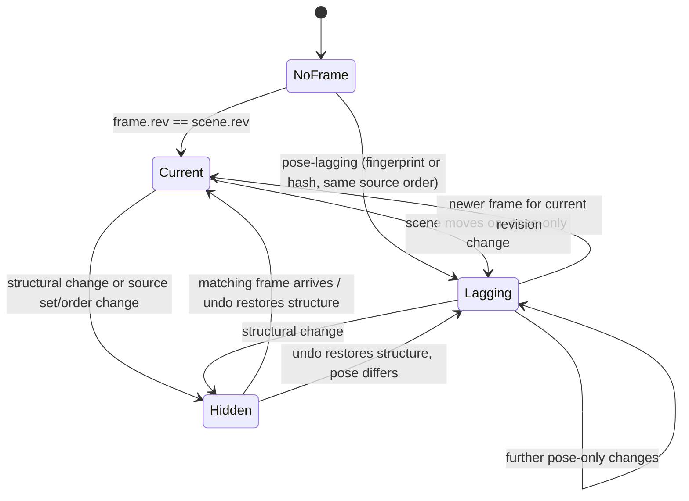

# 05 — Calculation runtime pipeline (scheduling, worker pools, frame acceptance)

This section specifies everything between **authoring state** and **output**: how an edit becomes a calculation request, how requests are coalesced and rate-limited, how they are sharded over compute threads, how results are validated and assembled into complete frames, which frames may be shown/heard, and how every failure degrades to a complete serial result.

It does not define acoustic formulas (see the *Classic acoustics* and *Hybrid 3D acoustics* sections), the authoring model, reducer, revision rules and projections (see *Domain model*), audio parameter application (see *Audio engine*), or UI layout (see *Frontend UI*). Test infrastructure beyond the budgets in §12 belongs to *Backend/AI/infra/tests*.

Terminology used throughout:

| Term | Meaning |
| --- | --- |
| UI thread | The single coordinator thread (browser main thread). All pools, validation, assembly, acceptance and derived main-thread calculations run here. |
| Compute thread | A Web Worker running a shard controller. Only Classic source shards and Hybrid source shards run here. |
| Pool | A UI-thread object that owns up to `capacity` compute threads, schedules one job at a time, validates and assembles results. One pool per mounted viewport mode. |
| Job | One dispatch of one scene snapshot to `activeCount` compute threads. Identified by `requestId`. |
| Shard | The ordered list of source IDs assigned to one compute thread for one job. |
| Frame | The complete assembled result for one scene snapshot (all sources). Classic: `AcousticFrame`. Hybrid: `HybridDirectFrame`. |
| Revision | Integer on the projected scene (`SceneSpec.revision`, `SceneDocumentV2.baseScene.revision`) copied from `WorkspaceProject.revision`. Bumped by acoustic edits (domain model section). **Not unique per content: undo/redo restores earlier revision numbers** (§10.5). |
| Static structure | The pose-independent part of a scene. Classic: `{schemaVersion, units, name, room, walls, portals, settings}`. Hybrid: see §7.3. |
| Pose | Listener position/heading and source positions (and, in Hybrid, listener/source heights). Anything not in the static structure, with the same ordered source IDs, is treated as "pose" by the acceptance rule. |
| Pose-lagging frame | A complete frame for revision R adopted while the scene is at R+k because the scene differs from the frame's input only in pose (ADR 0008). |

Units: distances metres, times milliseconds, angles degrees, rates Hz. Wall-clock timestamps come from `Date.now()` (integer ms).

---

## 1. Module map and connections

| Unit | Thread | Role |
| --- | --- | --- |
| `useWorkspaceProjects` | UI | Holds the two `WorkspaceProject`s and `dispatch`. Produces a new immutable project object per edit (domain model section). |
| `UnifiedWorkspace` | UI | Mounts exactly one adapter (`ClassicViewportAdapter` when mode is `classic-2d5d`, else `HybridViewportAdapter`). Owns the single `AudioEngine` and the status bar. Mode switch unmounts one adapter and mounts the other, which disposes one pool and creates the other. |
| `ClassicViewportAdapter` | UI | Projects `SceneSpec`, calls `useAcousticFrame`, pushes the accepted frame to overlay (`SceneEditor`) and audio, reports status. |
| `useAcousticFrame` + `AcousticFrameClient` | UI | Classic coordinator: pre-pool hop, acceptance, hold rule, Classic fallback. |
| `createClassicSourcePool` | UI | Classic pool. Exposes a Worker-shaped facade (`postMessage`/`onmessage`/`terminate`). |
| `classic-source.worker` | Compute | Classic shard controller. |
| `HybridViewportAdapter` | UI | Projects `SceneSpec` + `SceneDocumentV2`, compiles `HybridGeometry`, calls `useHybridDirectPaths`, runs Hybrid derived calculations (audible routes, reflection taps, path display, arrival label), acceptance, audio push, status. |
| `useHybridDirectPaths` | UI | Owns the Hybrid pool; stores the newest pool result unconditionally. |
| `createHybridDirectPool` | UI | Hybrid pool, including its own serial fallback. |
| `hybrid-direct.worker` | Compute | Hybrid shard controller. |
| `frame-acceptance` | UI | Pure helpers: `sameIdOrder`, `jsonEqual`, `sameClassicStaticStructure`, `isPoseLaggingClassicFrame`. |
| `worker-pool-policy`, `update-rate` | UI | Capacity formula and interval clamp. |
| `acoustics.worker` | — | **Never spawned.** Live code imports only its TypeScript types (`AcousticWorkerRequest`, `AcousticWorkerResponse`, `WorkerMetrics`); type-only imports are erased, so its runtime controller is not even bundled into the live app. Its `createAcousticWorkerController` (single-thread debounce + full serial compute) is exercised only by `tests/unit/acoustic-worker.test.ts`. A rewrite does not need it, except that the Classic pool's facade reuses its message shapes (§5.1). |

Source: `src/components/workspace/UnifiedWorkspace.tsx`, `src/components/workspace/ClassicViewportAdapter.tsx`, `src/components/workspace/HybridViewportAdapter.tsx`, `src/hooks/useAcousticFrame.ts`, `src/hooks/useHybridDirectPaths.ts`, `src/workers/*.ts`, `src/acoustics/frame-acceptance.ts`, `src/acoustics/update-rate.ts`.

---

## 2. End-to-end lifecycle

### 2.1 Steps (both modes)

1. **Edit.** A UI gesture dispatches a `ProjectAction` (for example `MOVE_SOURCE`, `UPDATE_LISTENER`, `UPDATE_WALL`). Each pointermove of a drag is one action, about 60 Hz. The reducer returns a new project. Acoustic edits set `revision = previous + 1`; presentation-only edits (selection, camera, overlays, notice, local audio metadata) do not (domain model section).
2. **Projection (UI thread, every render with a new project).** A one-entry projection cache returns the previous projection object if every non-presentation field of the project is reference-equal (`selection`, `view`, `notice`, `localAudioMetadata` are ignored). Otherwise it projects again. Classic: `projectClassicScene(project)` → `SceneSpec` (`revision = project.revision`). Hybrid: `projectHybridDocument(project)` → `SceneDocumentV2` (its `baseScene.revision = project.revision`, plus `compatibility.classicProjectionHash` = stable-JSON FNV-1a of the whole `baseScene`, revision included), then `geometryCompiler.compile(document)` → `HybridGeometry` (§7.3).
3. **Scheduling.** Classic: the hook forwards the scene through a one-animation-frame hop to the pool (§3.2). Hybrid: the hook calls `pool.update(document, geometry)` directly in a post-commit effect. Each pool keeps only the newest pending input and at most one job in flight; the next dispatch waits until `lastFrameCompletedAt + interval` (§3.3).
4. **Dispatch.** The pool grows its thread set lazily up to `activeCount = min(sourceCount, capacity)`, builds or reuses the static payload, builds a compact pose snapshot, assigns sources round-robin by authored index, arms a 2,000 ms watchdog, and posts to each active thread `INSTALL_STATIC` (only if that thread's installed fingerprint differs) followed by `COMPUTE_SHARD`.
5. **Static install (compute thread).** Replaces the thread's installed static payload and replies `STATIC_INSTALLED`.
6. **Shard compute (compute thread).** Checks the request and snapshot fingerprints against the installed payload, computes each requested source with the serial per-source function, replies `SHARD_RESULT` (or a typed `ERROR`).
7. **Result validation (UI thread).** Every reply is checked for identity (request ID, fingerprint, thread index, ack ordering) and every shard result for revision, assignment, bounds and path semantics (§6). Any violation fails the whole pool.
8. **Frame assembly.** When all active threads have replied, results are merged in authored source order into one frame. The frame is published unless a newer pending input exists that differs structurally (§8).
9. **Acceptance.** Classic: the hook accepts the frame for the newest scene if same revision, or pose-lagging by fingerprint; at render it is shown only while the hold rule passes (§10.1). Hybrid: the hook stores every result; the adapter decides `accepted`/`lagging` at render (§10.2).
10. **Output.** The accepted frame drives the overlay and the `AudioEngine`; status reports accepted revision, request sequence, compute time and worker count (§10.4). Hybrid additionally runs main-thread derived calculations on the accepted frame before audio (§11.2).
11. **Failure.** Any construction, protocol, message, compute, assembly or watchdog failure terminates all threads of that pool and switches it permanently (for the pool's lifetime) to complete serial computation on the UI thread at the same cadence (§9).

### 2.2 Classic sequence

```mermaid
sequenceDiagram
    autonumber
    participant UI as Editor (pointermove)
    participant WP as useWorkspaceProjects
    participant AD as ClassicViewportAdapter
    participant HK as useAcousticFrame / AcousticFrameClient
    participant PL as ClassicSourcePool (UI thread)
    participant W as Compute threads 0..activeCount-1
    participant AE as AudioEngine
    UI->>WP: dispatch(MOVE_SOURCE)
    WP-->>AD: new project (revision R)
    AD->>AD: projectClassicScene (cached by reference)
    AD->>HK: scene R (render)
    HK->>HK: render: holdsClassicFrame(held, structureScene, scene R)
    HK->>HK: effect: latestScene = R; updateScene(R)
    Note over HK: setTimeout(0) then requestAnimationFrame;<br/>newest scene wins
    HK->>PL: postMessage UPDATE_SCENE(scene R)
    PL->>PL: pending = R; timer at lastFrameAt + interval
    PL->>PL: dispatch: static context (cached), pose snapshot, room RT60, assignments, watchdog 2000 ms
    alt thread's installed fingerprint != context fingerprint
        PL->>W: INSTALL_STATIC(requestId, context)
        W-->>PL: STATIC_INSTALLED(requestId, fingerprint)
    end
    PL->>W: COMPUTE_SHARD(requestId, fingerprint, snapshot, sourceIds)
    W-->>PL: SHARD_RESULT(requestId, fingerprint, revision, sourceIds, results, timings)
    PL->>PL: validate shard (recomputes routes, §6.2)
    PL->>PL: all shards in: assemble in authored order
    alt pending exists and differs structurally
        PL->>PL: discard frame
    else
        PL-->>HK: FRAME(revision R, frame, staticFingerprint, metrics)
    end
    HK->>HK: acceptsClassicWorkerFrame(frame, fp, latestScene)
    HK-->>AD: frame, lagging, metrics (if held)
    AD->>AE: applyAcousticFrame(frame, {lagging})
    AD->>AD: SceneEditor overlay from same frame; status report
```

### 2.3 Hybrid sequence

```mermaid
sequenceDiagram
    autonumber
    participant WP as useWorkspaceProjects
    participant AD as HybridViewportAdapter
    participant GC as HybridGeometryCompiler
    participant HK as useHybridDirectPaths
    participant PL as HybridDirectPool (UI thread)
    participant W as Compute threads
    participant AE as AudioEngine
    WP-->>AD: new project (revision R)
    AD->>AD: projectClassicScene + projectHybridDocument (cached)
    AD->>GC: compile(document)
    GC-->>AD: geometry (static part reused if inputs jsonEqual)
    AD->>HK: (document, geometry)
    HK->>PL: effect: update(document, geometry)
    alt geometry.document !== document (identity)
        PL->>PL: activate fallback (serial on UI thread)
    else
        PL->>PL: pending = pair; timer at lastFrameAt + interval
    end
    PL->>W: [INSTALL_STATIC(structure)] + COMPUTE_SHARD(snapshot, sourceIds)
    W-->>PL: [STATIC_INSTALLED] + SHARD_RESULT
    PL->>PL: validate (§6.3), assemble, structural-obsolete check
    PL-->>HK: onresult(frame, staticFingerprint, source, metrics, notice)
    HK-->>AD: state (stored unconditionally)
    AD->>AD: resolveHybridAcousticPresentation → accepted, lagging
    AD->>AD: audible routes (2D Portal projection + 3D BVH checks), reflection taps
    AD->>AE: if accepted: applyHybridDirectState, applyHybridReflectionState
    AD->>AD: overlay paths only if frame.revision == project.revision; arrival label only if current
```

Source: `src/hooks/useWorkspaceProjects.ts`, `src/domain/workspace/projections.ts`, `src/components/workspace/*Adapter.tsx`, `src/hooks/useAcousticFrame.ts`, `src/hooks/useHybridDirectPaths.ts`, `src/workers/classic-source-pool.ts`, `src/workers/hybrid-direct-pool.ts`.

---

## 3. Update coalescing and rate limiting

### 3.1 Rate value and clamp

| Layer | Rule |
| --- | --- |
| Schema (zod and JSON Schema) | `settings.acousticUpdateHz`: integer, 5 ≤ value ≤ 20. |
| Semantic scene validation | Rejects values < 10 or > 15 (`acoustic_update_rate_out_of_range`). |
| Coordinators (all three: Classic pool, Hybrid pool, Classic fallback) | `intervalMs(hz) = 1000 / min(max(hz, 10), 15)`. So interval ∈ [66.67, 100] ms. Presets use 12 Hz → 83.33 ms. |
| Rate source | Classic pool and Classic fallback read the **pending/latest** scene's `settings.acousticUpdateHz`; Hybrid pool reads `pendingPair.document.baseScene.settings.acousticUpdateHz`. |

`NaN` is not handled: `min(max(NaN,10),15)` is `NaN`, the delay becomes `NaN` and the host timer treats it as 0 (UNVERIFIED in practice; schema prevents it).

Source: `src/acoustics/update-rate.ts`, `src/domain/scene/schema.ts:78`, `src/domain/scene/validate.ts:79-92`, `schemas/scene-spec.schema.json:225-229`, `tests/unit/acoustic-worker.test.ts:48-51`.

### 3.2 Classic pre-pool hop (`AcousticFrameClient.updateScene`)

The Classic client sits between the React hook and the pool facade. State: `pendingScene`, `postTimer`, `frameTimer`, `latestScene`, `usingFallback`, `disposed`.

```
updateScene(scene):
  if disposed: return
  latestScene = scene
  if usingFallback: scheduleFallback(); return          # §9.3
  if worker == null: return
  pendingScene = scene
  if frameTimer != null: return                         # an animation-frame callback is already armed; it will take the newest pendingScene
  if postTimer != null: cancel(postTimer)
  postTimer = setTimeout(0):
      postTimer = null
      if usingFallback or disposed: return
      frameTimer = requestAnimationFrame (fallback: setTimeout 16 ms):
          frameTimer = null
          s = pendingScene; pendingScene = null
          if s and worker and not usingFallback and not disposed:
              worker.postMessage({type: "UPDATE_SCENE", scene: s})
```

Effect: the pool receives at most one scene per animation frame, always the newest. `start(scene)` only constructs the pool and stores `latestScene`; the initial scene is posted by the hook's second effect, which calls `updateScene` on mount (React runs the construction effect first).

Hybrid has no such hop: `useHybridDirectPaths` calls `pool.update(document, geometry)` in an effect on every change of `[document, geometry]`.

Source: `src/hooks/useAcousticFrame.ts:76-140,206-225,267-308`, `tests/unit/use-acoustic-frame.test.ts:180-225`.

### 3.3 Pool cadence (identical in both pools)

State: `pending` (newest input or null), `timer` (null or armed), `inFlight` (null or job), `lastFrameAtMs` (initially −∞).

```
onInput(x):                      # Classic: postMessage(UPDATE_SCENE); Hybrid: update(doc, geom)
  pending = x
  if inFlight == null and timer != null: cancel(timer); timer = null   # re-evaluate delay with newest rate
  schedulePending()

schedulePending():
  if stopped/disposed or pending == null or inFlight != null or timer != null: return
  delay = max(0, lastFrameAtMs + intervalMs(rateOf(pending)) - now())
  timer = setTimeout(delay):
      timer = null
      x = pending; pending = null
      if alive and x: dispatch(x)            # Hybrid in fallback mode: compute serially instead (§9.3)
      (Hybrid only) schedulePending()        # no-op while a job is in flight

onJobFinished(completedAt):                 # after assembly, whether published or discarded
  lastFrameAtMs = completedAt
  inFlight = null
  schedulePending()
```

Properties:

- **Latest-wins:** intermediate inputs are overwritten; only the newest pending input is ever dispatched.
- **One in flight:** no second job starts until the current one finishes or the pool fails. Jobs are never cancelled; an obsolete job runs to completion and is then discarded.
- **Gap anchored to completion, not a debounce:** re-arming the timer recomputes the same due time `lastFrameAtMs + interval` (unless the rate changed), so continuous input never postpones dispatch indefinitely.
- **Idle edit:** if more than one interval has passed since the last completion, the delay is 0 (the timer still runs asynchronously).
- **Effective rate is below the configured rate.** Dispatch occurs `interval` after the previous *completion*, so the period is `interval + jobLatency` (12 Hz with a 20 ms job gives about 9.7 Hz). Discarded jobs also set `lastFrameAtMs`.
- Rate taken from the newest pending input at schedule time (tested: a pending 10 Hz scene after a 15 Hz frame dispatches at +100 ms).

Source: `src/workers/classic-source-pool.ts:373-386,430-442,444-482`, `src/workers/hybrid-direct-pool.ts:465-479,544-566,572-611`, `tests/unit/classic-source-pool.test.ts:437-470`, `tests/unit/hybrid-direct-pool.test.ts:438-465`.

### 3.4 Continuous drags

| Drag kind | Pool behaviour | Visible result |
| --- | --- | --- |
| Pose drag (source, listener, listener height, source height) | Each completed job is published if the pending input differs only in pose (§8). | Classic: overlay and audio advance at the coalesced rate using pose-lagging frames, trailing the pointer by about one update (unit test: 62.5 Hz pointer, 20 ms jobs, 3 s → at least 20 frames, each at most 2 pointer events behind the newest pose). Hybrid: audio advances; the 3D path overlay is **empty** and the arrival label shows "pending" while frames are lagging (§10.2, finding V2). |
| Structural drag (wall endpoint, Portal, primitive, any material/settings change) | A completed job is discarded whenever a newer, structurally different input is pending at completion. Every dispatch reinstalls static data. | Degrades to exact-revision acceptance: frames survive only if a job finishes before the next pointer input reaches the pool and before the hook sees a newer revision. With realistic latencies frames are mostly or entirely absent; overlay shows nothing, status shows "Stopped", audio holds its last state until the pointer pauses. Hybrid also recompiles patches + BVH on the UI thread per pointermove (§11.2). |

Source: `docs/adr/0008-adopt-pose-lagging-frames.md`, `tests/unit/classic-source-pool.test.ts:392-435`, `src/acoustics/hybrid3d/compile.ts:251-268`.

---

## 4. Pools

### 4.1 Capacity

```
capacity(hc) = 1                                  if hc is undefined, not finite, or <= 0
             = min(4, max(1, floor(hc) - 2))       otherwise
activeCount   = min(sourceCount, capacity)        per job
```

`hc` is `navigator.hardwareConcurrency` read once at pool construction. Table: 1→1, 2→1, 3→1, 4→2, 5→3, 6→4, 8→4, 128→4. The same function sizes both pools (named `classicSourcePoolCapacity`). Only one pool exists at a time (one adapter mounted), so at most 4 compute threads exist. Source count is bounded by the domain (≤ 4), so a thread gets at most 4 sources (capacity 1).

Source: `src/workers/worker-pool-policy.ts`, `tests/unit/classic-source-pool.test.ts:157-171`, `tests/e2e/workspace.spec.ts:382-394`.

### 4.2 Thread lifecycle

| Event | Behaviour |
| --- | --- |
| Pool construction | No threads are created. Classic: constructed by `AcousticFrameClient.start` in the hook's mount effect. Hybrid: constructed in `useHybridDirectPaths`' mount effect. |
| Dispatch | `while threads.length < activeCount: create thread`, index = current length; install handlers `onmessage → handleResponse(index, data)`, `onerror → fail`, `onmessageerror → fail`; push `installedFingerprint = null`. Construction errors fail the pool (§9). |
| Source count drops | Extra threads stay alive and idle (they receive nothing). Threads are never shrunk. |
| Source count rises again | Idle threads are reused; they receive `INSTALL_STATIC` if their recorded fingerprint is stale. |
| Zero sources | `activeCount = 0`: no threads touched, no watchdog; the job completes synchronously in `dispatch` and publishes a frame with an empty source list (Classic still contains `room`). |
| Dispose (unmount / mode switch / page unload) | Cancel timer, drop pending, cancel watchdog, drop in-flight job; for each thread post `DISPOSE{requestId: ++requestId}` (exceptions ignored) then `terminate()`. Idempotent. Late replies are ignored (`stopped`/`disposed` guard). |
| Failure | Cancel timer, drop pending, cancel watchdog, drop in-flight job, `terminate()` every thread **without** posting `DISPOSE`. |
| Restart policy | **None within a pool instance.** A failed pool stays in serial mode until its owner unmounts. The only recovery is a new pool: switching mode away and back (remounts the adapter) or reloading the page. |

Source: `src/workers/classic-source-pool.ts:392-428,549-561`, `src/workers/hybrid-direct-pool.ts:480-505,528-542,666-679`, `src/hooks/useAcousticFrame.ts:90-115,142-172,267-303`, `src/hooks/useHybridDirectPaths.ts:45-70`, `tests/unit/classic-source-pool.test.ts:244-280,1131-1158`, `tests/unit/hybrid-direct-pool.test.ts:302-318,968-984`.

### 4.3 Deterministic sharding

```
sourceIds   = scene.sources[].id in authored order (Hybrid: document.baseScene.sources)
assignments = for i in 0..activeCount-1: [sourceIds[j] for j in 0..len-1 if j mod activeCount == i]
```

Sharding is round-robin by **authored index**, not by hashing the ID: 4 sources on 2 threads → thread 0 `[s0, s2]`, thread 1 `[s1, s3]`. Assignment changes when sources are added, removed or reordered. Results are merged back in authored order regardless of completion order. Each shard result list must be in exactly the assigned order (§6).

Source: `src/workers/classic-source-pool.ts:565-567`, `src/workers/hybrid-direct-pool.ts:682-683`, `tests/unit/classic-source-pool.test.ts:200-242,472-515`.

---

## 5. Protocol

All messages are plain data. In the browser they cross threads by structured clone. Field types: `number` is IEEE double; IDs are strings.

### 5.1 Classic coordinator ↔ Classic pool facade (same thread)

The pool exposes the shape of the never-spawned `acoustics.worker`.

| Direction | Message | Fields |
| --- | --- | --- |
| hook → pool | `UPDATE_SCENE` | `scene: SceneSpec` |
| hook → pool | `DISPOSE` | — (equivalent to `terminate()`) |
| pool → hook | `FRAME` | `revision: number` (= `frame.revision`), `frame: AcousticFrame`, `staticFingerprint: string` (always present from the pool; optional in the type), `metrics: {computeMs, completedAtMs, requestSequence, workerCount, sourceComputeMsMax, sourceComputeMsTotal}` |
| pool → hook | `ERROR` | `revision` (= in-flight snapshot revision, else pending revision, else last posted revision), `code: "CLASSIC_POOL_FAILED"`, `message: string` |

The facade's `onerror`/`onmessageerror` slots exist but the pool never invokes them.

### 5.2 Classic pool ↔ Classic compute thread

| Direction | Type | Fields |
| --- | --- | --- |
| pool → thread | `INSTALL_STATIC` | `requestId`, `context: {fingerprint: string, scene: {schemaVersion, units, name, room, walls, portals, settings}}` |
| pool → thread | `COMPUTE_SHARD` | `requestId`, `staticFingerprint`, `snapshot: {revision, staticFingerprint, listener: {position:{x,y}, headingDeg}, sources: SceneSpec.sources[] (full source records, all sources)}`, `sourceIds: string[]` |
| pool → thread | `DISPOSE` | `requestId` |
| thread → pool | `STATIC_INSTALLED` | `requestId`, `staticFingerprint` (= installed `context.fingerprint`) |
| thread → pool | `SHARD_RESULT` | `requestId`, `staticFingerprint`, `revision` (= `snapshot.revision`), `sourceIds` (echo), `results: ClassicSourceResult[]` where each is `{sourceId, revision, staticFingerprint, frame: AcousticFrameSource}`, `computeMs`, `completedAtMs` |
| thread → pool | `ERROR` | `requestId`, `code ∈ {CLASSIC_STATIC_NOT_INSTALLED, CLASSIC_STATIC_FINGERPRINT_MISMATCH, CLASSIC_SHARD_COMPUTE_FAILED}`, `message` |

`AcousticFrameSource` fields: `sourceId, routeType ∈ {direct, portal, blocked}, directVisible, physicalDistanceM, effectiveDistanceM, dryGainDb, lowpassHz, reverbSendDb, virtualPosition{x,y}, occluderWallIds[], portalIds[], routePolyline[{x,y}], earlyReflections[]`. Reflection taps: `wallId, pathLengthM, delayMs, gainDb, lowpassHz, reflectionPoint`, optional `order (1|2), wallIds[], reflectionPoints[]` (Classic acoustics section).

Thread controller (state `disposed`, `installed`):

```
handle(req):
  if disposed: return
  DISPOSE:        disposed = true; installed = null; return          (no reply)
  INSTALL_STATIC: installed = req.context; reply STATIC_INSTALLED{req.requestId, req.context.fingerprint}; return
                  (no validation of the context or its fingerprint)
  otherwise (treated as COMPUTE_SHARD, no type check):
    if installed == null: reply ERROR CLASSIC_STATIC_NOT_INSTALLED
    elif req.staticFingerprint != installed.fingerprint or req.snapshot.staticFingerprint != installed.fingerprint:
         reply ERROR CLASSIC_STATIC_FINGERPRINT_MISMATCH
    else: t0 = now(); results = computeClassicSourceResults(installed, req.snapshot, req.sourceIds)
          (throws on snapshot/context fingerprint mismatch, duplicate requested ID, unknown ID)
          reply SHARD_RESULT{..., computeMs = now()-t0, completedAtMs = now()}
          on throw: reply ERROR CLASSIC_SHARD_COMPUTE_FAILED{message}
```

### 5.3 Hybrid hook ↔ Hybrid pool (same thread)

| Call | Contract |
| --- | --- |
| `update(document, geometry)` | `geometry` must be the compiled geometry of exactly this `document` (identity check, §9.1). |
| `dispose()` | Idempotent. |
| `onresult(result)` | `{frame: HybridDirectFrame, staticFingerprint, source: "worker"|"fallback", metrics: {computeMs, completedAtMs, requestSequence, workerCount, sourceComputeMsMax, sourceComputeMsTotal}, notice: string|null}`. Worker results have `notice = null`; fallback results have `notice = "Hybrid Worker pool unavailable; using deterministic serial fallback."` and `workerCount = sourceComputeMsMax = sourceComputeMsTotal = 0`. |

`HybridDirectFrame`: `revision, classicProjectionHash, computedAtMs, paths: DirectPath3D[] (authored order), firstOrderReflectionsBySource: {id → FirstOrderReflection3D[]}, secondOrderReflectionsBySource: {id → SecondOrderReflection3D[]}` (Hybrid 3D acoustics section).

### 5.4 Hybrid pool ↔ Hybrid compute thread

| Direction | Type | Fields |
| --- | --- | --- |
| pool → thread | `INSTALL_STATIC` | `requestId`, `structure: {staticGeometryHash, patches: AcousticPatch3[], bvh: {patches, root}}` (the thread uses only `bvh`) |
| pool → thread | `COMPUTE_SHARD` | `requestId`, `staticFingerprint`, `snapshot: {revision, staticFingerprint, classicProjectionHash, listenerPosition: Vec3, sources: [{id, position: Vec3}] (all sources)}`, `sourceIds` |
| pool → thread | `DISPOSE` | optional `requestId` |
| thread → pool | `STATIC_INSTALLED` | `requestId`, `staticFingerprint` (= `structure.staticGeometryHash`) |
| thread → pool | `SHARD_RESULT` | `requestId`, `staticFingerprint`, `revision`, `sourceIds`, `results: HybridDirectSourceResult[]` each `{sourceId, revision, staticFingerprint, classicProjectionHash, path: DirectPath3D, firstOrderReflections[], secondOrderReflections[]}`, `computeMs`, `completedAtMs` |
| thread → pool | `ERROR` | `requestId` (−1 if absent/non-finite), `code ∈ {HYBRID_STATIC_NOT_INSTALLED, HYBRID_STATIC_FINGERPRINT_MISMATCH, HYBRID_SHARD_COMPUTE_FAILED, HYBRID_UNSUPPORTED_REQUEST}`, `message` |

Controller as in §5.2, plus: a non-object or object without `type` → `ERROR HYBRID_UNSUPPORTED_REQUEST` with `requestId −1`; a `type` other than the three known → same error, echoing `requestId` if it is a finite number. Compute is `computeHybridDirectSources(snapshot, installed.bvh, sourceIds)` (throws on duplicate/unknown ID and on coincident source/listener positions).

Source: `src/workers/acoustics.worker.ts:7-32`, `src/workers/classic-source.worker.ts`, `src/workers/hybrid-direct.worker.ts`, `src/workers/hybrid-direct-pool.ts:48-75`, `src/acoustics/compute-frame.ts:36-53,175-197`, `src/acoustics/hybrid3d/direct.ts:19-58,114-151`, `tests/unit/classic-source-worker.test.ts`, `tests/unit/hybrid-direct-worker.test.ts`.

---

## 6. Response validation (UI thread)

Every reply goes through `handleResponse(threadIndex, payload)`. **Every** failed check throws and the catch calls `fail()` (§9). There is no "ignore and wait": a single bad, late, duplicate or unexpected message fails the whole pool.

### 6.1 Envelope checks (both pools, in order)

| # | Check | Failure |
| --- | --- | --- |
| 1 | pool alive (Hybrid: also not in fallback) | silently ignored |
| 2 | payload is an object with string `type` | fail "malformed response" |
| 3 | `type == "ERROR"` | fail (Classic carries the thread's message; Hybrid uses a generic message; codes are not inspected) |
| 4 | a job is in flight | fail "responded without an in-flight job" |
| 5 | `type ∈ {STATIC_INSTALLED, SHARD_RESULT}`, `payload.requestId == job.requestId`, `payload.staticFingerprint == job.snapshot.staticFingerprint`, `threadIndex < job.assignments.length` | fail "identity mismatch" |
| 6 | `STATIC_INSTALLED`: `threadIndex` must be in `expectedStaticAcks`; remove it | fail "unexpected static acknowledgement" (also catches duplicates) |
| 7 | `SHARD_RESULT`: thread not still awaiting its ack (ack must precede result) | fail "malformed shard" |
| 8 | `payload.revision == job.snapshot.revision` | ” |
| 9 | `sourceIds` is an array of bounded strings equal element-wise to the assignment | ” |
| 10 | no result yet from this thread for this job | ” |
| 11 | `computeMs` finite in [0, 60000]; `completedAtMs` finite in [0, 2^53−1] | ” |
| 12 | `results` is an array with `length == assignment.length`; each `results[k]` passes the per-result check for `assignment[k]` | ” |

On success: store `results` and `computeMs` for the thread; if every active thread has a stored result, assemble (§8).

Numeric comparison used below: `nearlyEqual(a, b) ⇔ |a − b| ≤ max(1e-5, 1e-6 · max(|a|, |b|))`. Points compare component-wise with `nearlyEqual`.

### 6.2 Classic per-result check

Constants: ID length 1..64; coordinates |x|,|y| ≤ 100; physical distance ≤ 150; effective distance ≤ 1600; route polyline 2..102 points; ≤ 6 reflections; reflection delay ≤ 80 ms; speed of sound 343 m/s.

`ClassicSourceResult`: object; `sourceId == assignment[k]`; `revision == snapshot.revision`; `staticFingerprint == snapshot.staticFingerprint`; `frame` passes:

1. Source `sourceId` exists in the snapshot.
2. Reconstruct `scene = context.scene + {revision, listener, sources}` from the job's static context and snapshot.
3. `occluderWallIds`: ≤ 100 unique known wall IDs. `portalIds`: ≤ 8 unique known Portal IDs.
4. `physicalDistanceM` ∈ [0, 150] and ≈ |source − listener|.
5. `effectiveDistanceM` ∈ [physicalDistanceM, 1600].
6. `routePolyline`: 2..102 bounded points. `dryGainDb` ∈ [−192, 0]; `lowpassHz` ∈ [20, 20000]; `reverbSendDb` ∈ [−120, 12]; `virtualPosition` bounded.
7. `earlyReflections`: array, ≤ 6, each valid (below), and path keys (`wallIds.join(">")` or `wallId`) unique.
8. **Recompute on the UI thread**: `trace = traceDirectPath`, `occlusion = estimateDirectOcclusion(trace)`, `portalRoute = trace.visible ? null : findBestPortalRoute(...)`. Then require exact `routeType` (`direct` if visible, `portal` if a route exists, else `blocked`), `directVisible == trace.visible`, `effectiveDistanceM ≈ route.effectiveDistance or physical`, `occluderWallIds` and `portalIds` equal in order, polyline ≈ expected, `virtualPosition` ≈ expected, `dryGainDb`/`lowpassHz` ≈ route or occlusion values, `reverbSendDb ≈ 0`.

Reflection tap: `wallId` bounded string; `pathLengthM` ∈ [0, 1600]; `delayMs` ∈ [0, 80]; `gainDb` ∈ [−120, 0]; `lowpassHz` ∈ [20, 20000]; `reflectionPoint` bounded.
- `order == 2`: `wallIds` = 2 distinct known walls; 2 bounded `reflectionPoints`; `wallId == wallIds[1]`; `reflectionPoint ≈ reflectionPoints[1]`; recomputed `solveSecondOrderReflectionPair2D` must exist; points, `pathLengthM`, `delayMs = max(0, (path − effectiveDistance)/343·1000)`, `gainDb`, `lowpassHz` all ≈ expected.
- otherwise `order` absent or 1; optional `wallIds` must be `[wallId]`; optional `reflectionPoints` must be one point ≈ `reflectionPoint`; wall known; `reflectionPoint` ≈ recomputed specular point; both legs visible (`reflectionLegIsVisible2D`); `pathLengthM` ≈ leg sum; `delayMs` ≈ `max(0, (path − effectiveDistance)/343·1000)`. **First-order `gainDb`/`lowpassHz` are only range-checked** (finding V6).

Not checked: that the reflection set is complete or correctly ranked/limited to `settings.maxEarlyReflections`; that second-order taps appear only for blocked direct paths.

### 6.3 Hybrid per-result check

Constants: ID length 1..128; |x|,|y|,|z| ≤ 100; distance ≤ 250; delays ≤ 2000 ms; unit-vector tolerance |‖v‖ − 1| ≤ 1e-3; patch-plane tolerance 1e-5; speed of sound 343.

`HybridDirectSourceResult`: source exists in snapshot; `path` passes the direct-path check; `sourceId`, `revision`, `staticFingerprint`, `classicProjectionHash` equal the snapshot's; `firstOrderReflections` array of length ≤ patch count, each valid; `secondOrderReflections` array of length ≤ 6, each valid; first-order `surfaceId`s unique; second-order `id`s unique; second-order list empty unless `path.directVisible == false`.

Direct path: `distanceM` ∈ [0, 250], > 0 and ≈ |source − listener|; `hits` array of length ≤ patch count, each a valid hit (patch exists by `patchId` and `wallId`/`surfaceId`/`materialId` match the patch; `thicknessM` ∈ [0, 50] and ≈ patch thickness; `distanceM` ∈ [0, pathDistance]; `point` bounded, on the patch plane and inside the patch, and ≈ `source + (listener − source)·distanceM/pathDistance`); hits sorted by non-decreasing `distanceM`; `routeType "direct"` ⇒ `directVisible true` and no hits; `"blocked"` ⇒ `directVisible false` and ≥ 1 hit; any other routeType fails; `delayMs` ≈ distance/343·1000; `directionToSource` unit and ≈ normalised (source − listener); `propagationDirection` unit and ≈ its negation, dot product ≈ −1 (1e-3); `azimuthDeg` ∈ [−180, 180] ≈ atan2(x, z); `elevationDeg` ∈ [−90, 90] ≈ asin(y); `occluderWallIds` unique, known (`wallId ?? surfaceId` of any patch) and equal in order to the unique `wallId ?? surfaceId` of the hits. **Visibility itself is not recomputed**, so an omitted hit is undetectable (finding V7).

First-order reflection: patch exists; `id == "first:" + (patch.wallId ?? patch.id)`; `surfaceId` equal to that; `materialId` matches; `reflectionPoint` bounded, on the patch, ≈ recomputed image-ray intersection; both legs visible in the BVH (excluding that surface); `pathLengthM` ∈ [0, 500] ≈ leg sum; `delayMs` ≈ path/343·1000; `excessDelayMs` ≈ (path − directDistance)/343·1000; `arrivalDirection` unit ≈ normalised (point − listener).

Second-order reflection: shape check (`id`, string pairs `surfaceIds`/`patchIds`/`materialIds`, Vec3 pair, `pathLengthM` ∈ [0, 750], delays ∈ [0, 2000], `estimatedMidGainDb` ∈ [−160, 6], unit `arrivalDirection`); both patches exist; recompute `solveSecondOrderReflectionPair` with the BVH; it must exist and every field must equal/≈ the recomputed value.

Source: `src/workers/classic-source-pool.ts:79-326,491-547`, `src/workers/hybrid-direct-pool.ts:105-428,613-664`, `tests/unit/classic-source-pool.test.ts:495-967`, `tests/unit/hybrid-direct-pool.test.ts:467-783`.

---

## 7. Static geometry caching

### 7.1 Classic static context vs pose snapshot

| Part | Contents | Built |
| --- | --- | --- |
| Static context | `fingerprint = FNV-1a-32(JSON.stringify({schemaVersion, units, name, room, walls, portals, settings}))` rendered as 8 lowercase hex digits; `scene` = that object | On the UI thread when the structure changes |
| Pose snapshot | `{revision, staticFingerprint, listener, sources}` (all sources, full records) | Every dispatch |

Note that `name` and all `settings` (`acousticUpdateHz`, `maxEarlyReflections`, `hrtfEnabled`) are structural: renaming the scene, changing the rate or toggling HRTF invalidates installs and blocks pose-lagging acceptance for that change. Source `gainDb`, `clipId`, `loop`, `name` are not structural (they are pose-equivalent for acceptance).

FNV-1a as implemented: `h = 0x811c9dc5; for each Unicode code point c of the string: h ^= (first UTF-16 code unit of c); h = (h × 0x01000193) mod 2^32`. (Iterating code points but hashing only the first unit means astral characters contribute only their high surrogate.) Fingerprints are cache keys only; they are not persisted.

Pool-side cache (one entry): `cachedStatic` is reused while `sameClassicStaticStructure(cachedStatic.scene, scene)` holds; that comparison is: same `schemaVersion`, `units`, `name` by `===` and `jsonEqual` on `room`, `walls`, `portals`, `settings`. `jsonEqual` is deep structural equality that treats a missing key and an `undefined` value as equal and compares primitives with `Object.is`; it is allocation-free. Only on a miss is the scene re-serialised and hashed. Unit test: 100 pose-only dispatches of the 100-wall preset call `JSON.stringify` zero times and post one `INSTALL_STATIC` per thread.

Thread-side cache: one installed context per thread. The pool records `installedFingerprints[i]` when it **posts** `INSTALL_STATIC` (not when the ack arrives) and re-posts whenever the recorded value differs from the job's fingerprint.

### 7.2 Classic fingerprint use in acceptance

The pool's obsolete check (§8) uses the structural comparison, never the hash. The hook's pose-lagging check (§10.1) hashes the latest scene once per arriving frame (`createClassicStaticContext(latest).fingerprint`), about 0.24 ms for 100 walls per ADR 0008.

### 7.3 Hybrid static geometry

`hybridStaticGeometryHash(document) = FNV-1a-32(JSON.stringify(inputs))` with

```
inputs = {
  room: baseScene.room,
  floorElevationM: spatial3d.floorElevationM,
  disabledSurfaceIds: sorted copy of spatial3d.disabledSurfaceIds (or []),
  walls: baseScene.walls.map(w => {...w, vertical: spatial3d.wallVerticalBoundsM[w.id] ?? null}),
  portals: baseScene.portals.map(p => {id, wallId, center, widthM, heightM, open, vertical: spatial3d.portalVerticalBoundsM[p.id] ?? null}),
  primitives: spatial3d.primitives ?? []
}
```

Excluded (pose-equivalent): sources, listener, `listenerHeightM`, `sourceHeightsM`, Portal `lossDb`, scene `name`, `settings`, revision.

`createHybridGeometryCompiler` (one per Hybrid adapter instance) keeps `{cached: HybridStaticGeometry, cachedInputs}`:

```
compile(document):
  inputs = hybridStaticGeometryInputs(document)          # rebuilt every call
  if cached == null or not jsonEqual(cachedInputs, inputs):
      hash = FNV(JSON.stringify(inputs))
      if cached == null or cached.staticGeometryHash != hash:
          cached = compileHybridStaticGeometry(document)  # schema-validates the document, builds patches + BVH
      cachedInputs = inputs
  return bindPoses(cached, document)   # {document, staticGeometryHash, patches, bvh, listenerPosition, sourcePositions}
```

Pose binding maps plan `(x, y)` to world `(x, height, y)`; source height = `sourceHeightsM[id] ?? listenerHeightM` (Hybrid 3D acoustics section). Unit test: 100 pose-only updates call `JSON.stringify` zero times and compile the static part once.

Install: the Hybrid pool records `installedFingerprints[i] = staticGeometryHash` at post time and sends `structure = {staticGeometryHash, patches, bvh}`; the thread stores it and uses `installed.bvh` for every shard until the next install.

Source: `src/acoustics/compute-frame.ts:55-95`, `src/acoustics/frame-acceptance.ts:34-85`, `src/workers/classic-source-pool.ts:351-360,590-596`, `src/acoustics/hybrid3d/compile.ts:31-77,193-268`, `src/workers/hybrid-direct-pool.ts:705-716`, `tests/unit/static-structure-cache.test.ts`, `tests/unit/classic-source-pool.test.ts:282-319`, `tests/unit/hybrid-direct-pool.test.ts:319-380`.

---

## 8. Frame assembly and publication

When `resultsByThread.size == assignments.length`:

1. `completedAt = now()`.
2. Assemble: flatten thread results in thread-index order and pass to the assembler, which rejects unknown IDs, duplicates, revision/fingerprint (Hybrid also projection hash) mismatches, payload `sourceId` mismatches, and missing IDs, then orders by `snapshot.sources`. Classic frame: `{revision: snapshot.revision, generatedAtMs: job.startedAtMs, room: job.room, sources}`. Hybrid frame: `{revision, classicProjectionHash, computedAtMs: completedAt, paths, firstOrderReflectionsBySource, secondOrderReflectionsBySource}`.
3. Metrics: `computeMs = completedAt − job.startedAtMs` (includes thread creation, posting, compute, transfer and UI-thread validation), `completedAtMs`, `workerCount = activeCount`, `sourceComputeMsMax = max(0, thread computeMs…)`, `sourceComputeMsTotal = Σ thread computeMs`, `requestSequence = job.requestId`.
4. Obsolete rule:
   - Classic: `obsolete = pending != null and not (sameIdOrder(job.snapshot.sources, pending.sources) and sameClassicStaticStructure(job.context.scene, pending))`.
   - Hybrid: `obsolete = pending != null and not (pending.geometry.staticGeometryHash == job.snapshot.staticFingerprint and sameIdOrder(job.snapshot.sources, pending.document.baseScene.sources))`.
5. `lastFrameAtMs = completedAt`; cancel watchdog; `inFlight = null`.
6. If not obsolete: publish (Classic `FRAME` with `staticFingerprint`; Hybrid `onresult` with `source "worker"`).
7. `schedulePending()`.
8. Any exception in 1–7 → `fail()`.

The Classic `room` (RT60 etc.) is computed on the UI thread at dispatch (`estimateRoomAcoustics(scene)`), not in the compute threads. It is pose-independent.

Source: `src/workers/classic-source-pool.ts:444-489`, `src/workers/hybrid-direct-pool.ts:572-611`, `src/acoustics/compute-frame.ts:199-237`, `src/acoustics/hybrid3d/direct.ts:153-199`.

---

## 9. Watchdog, failures and serial fallback

### 9.1 Failure triggers

| Trigger | Classic | Hybrid |
| --- | --- | --- |
| Thread constructor throws | in `dispatch` → fail | same |
| `onerror` / `onmessageerror` on any thread | fail | fail |
| Typed `ERROR` reply | fail | fail |
| Any envelope or result validation failure (§6) | fail | fail |
| Assembler throws (missing/duplicate/mismatch) | fail | fail |
| Any exception in `dispatch` (static context, snapshot, room estimate, posting) | fail | fail |
| Watchdog: job not complete `jobTimeoutMs` (default **2000 ms**) after dispatch | fail | fail |
| `update(document, geometry)` with `geometry.document !== document`, or differing `baseScene.revision` or `classicProjectionHash` | — | immediate fallback (no threads used) |

Watchdog: armed per job after `inFlight` is set and only when `activeCount > 0` and `jobTimeoutMs` is finite and > 0 (0 disables it; tests use 0 or 25). It covers install + compute of all shards. Its callback fails the pool only if that same job is still in flight. Cancelled on completion, failure and dispose. There is no per-thread or per-message timeout.

### 9.2 Classic fallback

`fail(error)` in the pool: capture `revision` (in-flight, else pending, else last posted), `stop(postDispose = false)`, emit `ERROR{revision, "CLASSIC_POOL_FAILED", message}`. The client treats **any** non-`FRAME` message, `onerror`, `onmessageerror`, or a throwing pool constructor as fatal:

```
activateFallback():
  if disposed or usingFallback: return
  usingFallback = true
  cancel postTimer, frameTimer, fallbackTimer; pendingScene = null
  worker.terminate(); worker = null
  deliverFallback()                                   # synchronous, inside the failing callback

deliverFallback():
  if latestScene == null: return
  t0 = now(); frame = computeAcousticFrame(latestScene)    # full serial Classic frame, generatedAtMs = 0
  lastFallbackAtMs = now()
  onFallback(frame, {source "fallback", computeMs, requestSequence: ++fallbackSequence (starts at 1),
                     workerCount 0, sourceComputeMsMax 0, sourceComputeMsTotal 0})

scheduleFallback():                                    # on each later updateScene
  if latestScene == null or fallbackTimer != null: return
  fallbackTimer = setTimeout(max(0, lastFallbackAtMs + intervalMs(latestScene rate) - now())):
      fallbackTimer = null
      if not disposed and usingFallback: deliverFallback()   # uses latestScene at fire time
```

The hook's `onFallback` stores the frame unconditionally with `structureScene = latestScene`, `fallbackNotice = "Worker unavailable; using deterministic main-thread acoustic updates."`. The fallback frame is always for the latest scene, so it is current; it may later be held as lagging under the hold rule (§10.1).

### 9.3 Hybrid fallback

```
fail() = activateFallback():
  if disposed or usingFallback: return
  usingFallback = true
  cancel timer; pending = null; cancel watchdog; inFlight = null
  terminate all threads (no DISPOSE)
  if latestPair == null: return
  result = fallbackResult(latestPair)        # newest pair, not the failed job's pair
  lastFrameAtMs = result.metrics.completedAtMs
  onresult(result)

fallbackResult(pair):
  t0 = now(); f = computeHybridDirectFrame(pair.geometry); t1 = now()
  return {frame: {...f, computedAtMs: t1}, staticFingerprint: pair.geometry.staticGeometryHash, source "fallback",
          notice: FALLBACK_NOTICE, metrics: {computeMs: t1-t0, completedAtMs: t1, workerCount 0,
          sourceComputeMsMax 0, sourceComputeMsTotal 0, requestSequence: ++requestId}}
```

After activation, `update` keeps feeding `pending` and the cadence timer computes `fallbackResult(pending)` on the UI thread at `lastFrameAtMs + interval`. Fallback results are not subject to the obsolete rule. Not guarded: if the serial computation throws (for example coincident source and listener positions), the exception escapes the message/timer callback and no result is published for that input (finding V5).

### 9.4 Hybrid initial serial frame

`useHybridDirectPaths` initialises its state synchronously during the first render with `computeHybridDirectFrame(geometry)` on the UI thread, `source "fallback"`, `notice null`, zero metrics and `requestSequence 0`. The adapter therefore shows status "Fallback" (header "Fallback") until the first worker frame arrives, and pushes this serial frame to audio. Classic has no initial frame (`frame null`, status "Stopped", header "Starting").

### 9.5 Recovery

Neither pool nor client ever leaves fallback. Recovery to compute threads happens only when a new pool is created: adapter remount (mode switch away and back) or page reload.

Source: `src/workers/classic-source-pool.ts:405-428,584-589`, `src/workers/hybrid-direct-pool.ts:424-428,465-471,507-570,699-704`, `src/hooks/useAcousticFrame.ts:19,93-115,159-203,272-278`, `src/hooks/useHybridDirectPaths.ts:32-43`, `tests/unit/classic-source-pool.test.ts:969-1129`, `tests/unit/hybrid-direct-pool.test.ts:785-966`, `tests/unit/use-acoustic-frame.test.ts:125-254`.

---

## 10. Frame acceptance (ADR 0008)

### 10.1 Classic: acceptance on arrival and hold at render

Hook state: `{revision, current: frame|null, structureScene: scene|null, fallbackNotice, metrics}`. `latestScene` is a reference updated in a post-commit effect.

```
onFrame(frame, metrics, staticFingerprint):                 # worker frames only
  latest = latestScene
  accept = frame.revision == latest.revision
        or isPoseLagging(frame, staticFingerprint, latest)
  if not accept: drop
  state = {revision: frame.revision, current: frame, structureScene: latest, fallbackNotice: null, metrics}

isPoseLagging(frame, fp, scene):
  frame.revision != scene.revision
  and fp present
  and sameIdOrder(frame.sources[].sourceId, scene.sources[].id)
  and createClassicStaticContext(scene).fingerprint == fp          # one hash per arriving frame

render(scene):                                             # every render
  held = current != null and (
           current.revision == scene.revision
           or (structureScene != null
               and sameIdOrder(current.sources[].sourceId, scene.sources[].id)
               and sameClassicStaticStructure(structureScene, scene)))   # cheap, no hashing
  return {frame: held ? current : null,
          lagging: held and state.revision != scene.revision,
          fallbackNotice: state.fallbackNotice,
          metrics: held ? state.metrics : null}
```

Consequences: after a structural edit the held frame disappears immediately (overlay empty, status "Stopped", audio not updated, so it holds its last targets). If the edit is undone and the structure matches again, the same held frame reappears. (`acceptWorkerFrame` is called inside `onFrame` but with `state.revision = frame.revision`, so it always returns the frame; it is a no-op.)

### 10.2 Hybrid: presentation at render

```
resolveHybridAcousticPresentation(direct, document, staticGeometryHash):
  current = direct.frame.revision == document.baseScene.revision
            and direct.frame.classicProjectionHash == document.compatibility.classicProjectionHash
  lagging = not current
            and direct.frame.revision != document.baseScene.revision
            and direct.staticFingerprint == staticGeometryHash
            and sameIdOrder(direct.frame.paths[].sourceId ?? "", document.baseScene.sources)
  if not current and not lagging: {accepted false, lagging false, worker "Stopped",
                                   header "Stopped · Waiting for matching acoustic frame"}
  elif direct.source == "fallback": {accepted true, lagging, worker "Fallback",
                                     header notice ? "Fallback · " + notice : "Fallback"}
  else: {accepted true, lagging, worker "Worker", header "Worker"}
```

Because `classicProjectionHash` covers the whole projected scene including revision, a same-revision frame with different content (revision reuse after undo) is neither current nor lagging and is rejected.

Per-output gating in the Hybrid adapter:

| Output | Condition |
| --- | --- |
| Audio direct state (`applyHybridDirectState(audible.audioState)`) | `accepted` (current or lagging). Re-applied whenever `audible` is recomputed, i.e. on every geometry change. |
| Audio reflection state (`applyHybridReflectionState`) | `accepted`. Re-applied whenever its memo changes (frame reflections, current listener position, current source list). |
| 3D path overlay | `accepted` **and** `frame.revision == project.revision` (inside `deriveHybridPathDisplay`): lagging frames draw **no paths**. |
| Arrival-direction label | `accepted and not lagging and frame.revision == project.revision`, else state `pending` ("Arrival direction pending · waiting for matching acoustic frame"). Selected source absent from frame → `empty`. |
| Status route/gain/RT60/metrics/accepted revision | `accepted`; RT60 is computed from the current scene, not the frame (§11.2). |

### 10.3 Data mixing for lagging frames

- Classic audio: `AudioEngine.applyAcousticFrame(frame, {lagging})` rejects `frame.revision != desiredScene.revision` unless `lagging` is true; directions are applied relative to the current listener; gains/filters are the frame's (audio engine section).
- Hybrid audio: the audible state is built from the **current** geometry (current source and listener positions, current Classic Portal projection) combined with the lagging frame's `directVisible`, `distanceM`, `directionToSource` and hits (§11.2). It is therefore neither the old pose nor the new pose.

### 10.4 Overlay/audio/status consistency

| Mode | Overlay | Audio | Status `acceptedRevision` |
| --- | --- | --- | --- |
| Classic | `SceneEditor` draws the held frame (route polyline, reflection points, Portal marker) — the same object audio received | `applyAcousticFrame(held, {lagging})` in an effect keyed on `[frame, lagging]` | `held.revision` |
| Hybrid | Only for current-revision frames | Any accepted frame | `direct.frame.revision` when accepted |

The status reports `requestSequence`, `computeMs`, `workerCount`, `sourceComputeMsMax/Total` only while a frame is accepted, and exposes them as `data-acoustic-revision`, `data-acoustic-sequence`, `data-worker-compute-ms`, `data-worker-count`, `data-worker-source` on the status bar (used by E2E). During drags the accepted revision may trail the editor revision by about one coalescing window.

### 10.5 Revision reuse (undo/redo)

Undo/redo applies recorded patches that include `revision`, so revision numbers repeat with different content (scene R → undo → R−1 → new edit → R'). Classic uses `revision` equality as content identity in three places: `acceptsClassicWorkerFrame`, `holdsClassicFrame`, and the audio gate. A held or in-flight Classic frame for (R, content X) is therefore treated as **current** for (R, content Y), even when Y has different walls, until the next frame arrives (finding V1). Hybrid is protected by `classicProjectionHash`.



Source: `src/hooks/useAcousticFrame.ts:67-74,227-321`, `src/acoustics/frame-acceptance.ts:87-96`, `src/components/workspace/ClassicViewportAdapter.tsx:18-76`, `src/components/workspace/HybridViewportAdapter.tsx:48-77,104-225`, `src/components/workspace/HybridPathOverlay.tsx:26-106,139-182`, `src/audio/AudioEngine.ts:148-180`, `src/domain/workspace/history.ts:170-198`, `tests/unit/use-acoustic-frame.test.ts:256-315`, `tests/unit/frame-acceptance.test.ts`, `tests/unit/hybrid-viewport-adapter.test.ts`, `tests/unit/hybrid-path-overlay.test.ts`.

---

## 11. UI-thread work per mode and cost risks

### 11.1 Classic

| When | Work |
| --- | --- |
| Every acoustic edit (≈ 60 Hz during drags) | `projectClassicScene` (deep clone of `project.scene`, filters, primitive footprint walls); a second projection for the audio scene in `UnifiedWorkspace`; hold rule (`jsonEqual` over room/100 walls/Portals/settings); client timer/rAF bookkeeping; the status effect re-runs because `scene.sources` is a new array, calling `setAcousticStatus` with a new object, which re-renders `UnifiedWorkspace` a second time per edit. |
| Every dispatch (≤ 15 Hz) | Static-structure comparison (hash + serialisation only on change), pose snapshot, `estimateRoomAcoustics(scene)`, posting (structured clone of snapshot; of the static context with up to 100 walls when installing, once per active thread). |
| Every shard result | Structured-clone decode; validation that **recomputes** the direct trace, occlusion and best Portal route per source, plus per reflection a specular point, two wall-visibility scans or a second-order solve (§6.2). The compute threads therefore save only the reflection search; routing is done twice. |
| Every frame | Assembly; obsolete check; in the hook one `JSON.stringify` + hash of the static scene for lagging candidates; `setState` → adapter + `SceneEditor` re-render; audio apply. |
| Fallback | Full `computeAcousticFrame` per interval. |

### 11.2 Hybrid

| When | Work |
| --- | --- |
| Every acoustic edit | Two Classic projections (adapter scene + document base) plus the audio projection; `classicProjectionHash` = key-sorted stable JSON + FNV of the whole base scene; compiler input rebuild + `jsonEqual`; pose binding; `resolveHybridAudibleDirectState` (per source: Classic 2D trace + occlusion + Portal search on the current scene; for Portal candidates, BVH segment queries per leg; for blocked paths, finite-patch occlusion with linear wall/material/patch lookups); reflection taps per source (`renderHybridEarlyReflections`, ≤ 6 ranked taps); path display (renders taps again per displayed source); arrival label; `estimateRoomAcoustics(scene, {ceilingEnabled})` in the status effect plus a parent re-render via `setAcousticStatus`; audio `applyHybridDirectState` and `applyHybridReflectionState`. |
| Every structural edit (each pointermove of a wall/Portal/primitive drag) | Full `compileHybridStaticGeometry`: schema validation of the document, patch generation, BVH build, JSON hash; reinstall to every active thread (structured clone of patches + BVH). |
| Mount (initial render, every mode switch to 3D) | One full serial `computeHybridDirectFrame` inside the state initialiser (§9.4). |
| Every shard result | Validation with linear `patches.find` per hit/reflection, image-ray recomputation and two BVH visibility queries per first-order reflection, full second-order re-solve per second-order reflection (§6.3). |
| Fallback | Full `computeHybridDirectFrame` per interval. |

Cost risks: per-pointermove whole-scene stable-JSON hashing and deep clones (Hybrid), double routing work (Classic validation), main-thread BVH rebuilds during structural drags (Hybrid), synchronous serial compute on 3D mount, and an extra parent render per edit from status reporting. Budgets in §12 cover only discrete listener switches in Hybrid; drags and mounts are not budgeted.

Source: `src/domain/workspace/projections.ts:38-137`, `src/components/workspace/ClassicViewportAdapter.tsx:49-76`, `src/components/workspace/HybridViewportAdapter.tsx:97-225`, `src/components/workspace/UnifiedWorkspace.tsx:76-93`, `src/acoustics/hybrid3d/audible-direct.ts:148-240`, `src/acoustics/hybrid3d/reflection-rendering.ts`, `src/workers/classic-source-pool.ts:237-311,549-579`.

---

## 12. Stress budgets in tests

### 12.1 "survives the full entity-limit project within Worker and interaction budgets" (`tests/e2e/workspace.spec.ts:288-522`)

Mode: Hybrid (`/lab`). Steps:

1. Load preset `stress-100-walls`; wait until the Hybrid cache holds 100 walls. Rewrite the cached project: 8 enabled listeners (`stress_listener_0..7`, active 0), 4 sources (`stress_source_0..3`, heights 1.0/1.4/1.8/2.2 m), 8 Portals on `stress_boundary_north` (0.6 m wide, 2 m tall, alternate open, `lossDb 3`), revision +1, empty history; install via init script; reload.
2. Assert entity limits in the Outliner and disabled Add buttons; press Play; require 1 AudioContext and 4 audio graphs.
3. Wait until `data-worker-compute-ms` is finite. Compute `expectedWorkerCount = min(4, capacity(navigator.hardwareConcurrency))` with the §4.1 formula and require `data-worker-count` to equal it.
4. Warm-up: click listeners 0, 1, 2 with 120 ms pauses.
5. Start a `PerformanceObserver` for `longtask` entries.
6. 24 iterations: click listener `i mod 8` in the Outliner (an active-listener change bumps the revision). Poll until the status bar shows `data-worker-source == "Worker"`, `data-worker-count == expected`, finite compute time, and accepted revision and request sequence both strictly greater than the previous sample. Record `computeMs` (Hybrid pool metric: dispatch start → assembled frame, including UI-thread validation, integer-ms clock). Sequences must be unique.
7. Budgets: exactly 24 samples and 24 distinct sequences; `p95 = sorted[ceil(24 × 0.95) − 1] = sorted[22]` (second-largest) **< 12 ms**; every observed long-task duration **≤ 50 ms** (the long-task API reports only tasks over 50 ms, so this means none were observed). Metrics are attached as `worker-stress-metrics.json`.
8. After a 2.5D → 3D round trip there must still be 1 AudioContext and 4 graphs; after each of two reloads the Outliner must still show 100 walls, 8 Portals, 4 sources and 8 listeners.

Measured: discrete listener switches only; not drags, mounts, structural edits or Classic mode. The suite runs with one worker and no parallelism because these are timing budgets; CI retries twice. `E2E_SINGLE_ACOUSTIC_WORKER=1` overrides `hardwareConcurrency` to 3 through CDP, selecting capacity 1. CI diagnostics record a failed extra repetition at exactly 12 ms against `< 12`.

### 12.2 "restores the 100-wall project and keeps Outliner selection within the interaction budget" (`tests/e2e/workspace.spec.ts:223-251`)

Classic mode: clicking a wall row in the Outliner must update `aria-pressed` within 50 ms (`performance.now`, MutationObserver). This is a presentation-only edit and must not trigger a new calculation (projection cache).

### 12.3 Unit timing simulations

Classic pool, fake clock: 62.5 Hz pose updates for 3 s, 20 ms jobs, 12 Hz → at least 20 published frames, maximum lag 2 pointer events at publish (ADR 0008 table: 31/26/14/0 frames at 2/5/10/20 ms before the change).

Source: `tests/e2e/workspace.spec.ts`, `tests/e2e/browser-evidence.ts:27-29`, `docs/testing/ci-diagnostics.md`, `tests/unit/classic-source-pool.test.ts:392-435`.

---

## 13. Disagreements with the docs

| Doc claim | Code | Location |
| --- | --- | --- |
| ADR 0008: "Overlay and audio adopt the same accepted frame, so they stay consistent." | True for Classic. Hybrid hides all 3D paths and the arrival label for lagging frames while audio uses them. | `HybridPathOverlay.tsx:34`, `HybridViewportAdapter.tsx:136,202-206` |
| ADR 0008: "Classic computes the pending scene's fingerprint once per completed job." | The pool's obsolete check uses the structural comparison and never hashes; the hook hashes once per arriving frame. | `classic-source-pool.ts:484-486`, `frame-acceptance.ts:95` |
| ADR 0008: "Directions of a lagging frame are applied relative to the current listener pose; gains and filters are the frame's." | Holds for Classic audio. Hybrid audio mixes current positions with the lagging frame's distance, visibility and directions. | `audible-direct.ts:148-204` |
| ARCHITECTURE / CLAUDE.md: "Pools shard by source ID." | Round-robin by authored index; IDs only label assignments. | `classic-source-pool.ts:565-567` |
| ARCHITECTURE: "coordinators coalesce effective calculation updates to 10–15 Hz." | Minimum gap of 1/Hz after each completion, so the effective rate is `1/(interval + latency)`, below 10 Hz for slow jobs at 10 Hz. Classic adds up to one animation frame of hop latency. | §3.3 |
| ARCHITECTURE: "complete serial fallback" | Complete, but Hybrid starts every mount with a serial frame labelled "Fallback", and neither mode recovers to workers without a remount. | §9.4–9.5 |
| CLAUDE.md: live code "imports its protocol exports" (`acoustics.worker`). | Type-only imports; nothing of it runs in the app. | `useAcousticFrame.ts:13-16`, `classic-source-pool.ts:22-25` |
| "stale results cannot satisfy a current scene" (ADR context) | Classic accepts any frame whose revision equals the current revision, regardless of content (§10.5). | `useAcousticFrame.ts:236,250` |

---

## Review findings

### Verified (read in code; line references to the repository)

- **V1** `src/hooks/useAcousticFrame.ts:236` and `:250`, `src/audio/AudioEngine.ts:150` — Classic treats equal revision as equal content, but undo/redo restores revision numbers (`src/domain/workspace/history.ts:180-198`), so a frame for different walls can be accepted, held and heard as current until the next frame. Hybrid avoids this with `classicProjectionHash`.
- **V2** `src/components/workspace/HybridPathOverlay.tsx:34` — `deriveHybridPathDisplay` returns no paths unless `frame.revision == project.revision`, so the Hybrid overlay goes blank during every pose drag while audio follows lagging frames. This contradicts ADR 0008 and no test covers overlay behaviour with a lagging frame.
- **V3** `src/acoustics/hybrid3d/audible-direct.ts:153-165,193-203` with `HybridViewportAdapter.tsx:106` — the Hybrid audible state combines current geometry positions with a lagging frame's `distanceM`/`directVisible`/`directionToSource`/hits, producing a state that matches neither pose.
- **V4** `src/hooks/useAcousticFrame.ts:159-161`, `src/workers/hybrid-direct-pool.ts:528-530` — fallback is permanent for the pool's lifetime. One transient failure (for example a 2 s watchdog under load) leaves serial computation on the UI thread until mode switch or reload.
- **V5** `src/workers/hybrid-direct-pool.ts:507-509,539,558` with `src/acoustics/hybrid3d/direct.ts:75` — the serial fallback is unguarded. Coincident source/listener positions make the worker fail, then make the fallback throw inside the failing callback, with no result for that input. The same throw in the `useState` initializer (`src/hooks/useHybridDirectPaths.ts:33`) would fail the first render. Whether the authoring UI can produce exactly coincident 3D positions is UNVERIFIED.
- **V6** `src/workers/classic-source-pool.ts:198-235` — first-order Classic taps have only range-checked `gainDb`/`lowpassHz`, while second-order taps are checked exactly (`:192-196`). Classic also does not enforce "second-order only when the direct path is blocked", which Hybrid enforces (`hybrid-direct-pool.ts:416`).
- **V7** `src/workers/hybrid-direct-pool.ts:199-259` — Hybrid direct-path validation never recomputes visibility, so a "direct" claim with omitted hits passes. Classic recomputes the trace (`classic-source-pool.ts:290-310`). The two pools validate with inconsistent strength.
- **V8** `src/workers/classic-source-pool.ts:290-294` — Classic validation repeats the trace, occlusion and Portal search per source on the UI thread for every frame, which halves the benefit of offloading.
- **V9** `src/hooks/useHybridDirectPaths.ts:32-36` — every Hybrid mount runs a full synchronous serial compute and labels it "Fallback". As a result `tests/e2e/workspace-failures.spec.ts:28-41` ("keeps authoring available when Workers cannot start") passes even if worker-failure fallback were broken: a weak test.
- **V10** `src/components/workspace/ClassicViewportAdapter.tsx:58-76`, `HybridViewportAdapter.tsx:207-225` — status effects depend on per-projection arrays/objects, so they call the parent's `setAcousticStatus` on every edit, adding a second `UnifiedWorkspace` render per pointermove. Hybrid also recomputes `estimateRoomAcoustics` each time.
- **V11** `src/workers/classic-source-pool.ts:432-435,474` — the cadence is anchored to completion, so the effective rate is below the documented 10–15 Hz floor for non-trivial job latency, and discarded jobs still consume a full interval.
- **V12** `src/hooks/useAcousticFrame.ts:284-287` — `acceptWorkerFrame` is called with the frame's own revision and is a no-op. Its unit tests (`tests/unit/acoustic-worker.test.ts:53-63`) give false assurance.
- **V13** `src/workers/acoustics.worker.ts:49-128` — the runtime controller is dead code: never spawned, type-only imports, tested only in isolation.
- **V14** `src/workers/hybrid-direct-pool.ts:529` with `:467-470` — once in fallback, an identity-mismatched `update` changes `latestPair` but produces no result. Not reachable from the live adapter, which always passes matching pairs.
- **V15** `src/hooks/useAcousticFrame.ts:184` vs `src/workers/classic-source-pool.ts:467` — Classic `requestSequence` restarts at 1 after fallback, while Hybrid's shares the dispatch counter (`hybrid-direct-pool.ts:523`), so the sequence is non-monotonic across a Classic worker→fallback switch.
- **V16** `src/acoustics/compute-frame.ts:64-77` — `name` and all `settings` are part of the Classic static fingerprint. Renaming the scene or toggling HRTF discards in-flight frames, blanks the overlay and reinstalls static data.
- **V17** `src/workers/classic-source.worker.ts:58-94` — no runtime type check: any unknown request is processed as `COMPUTE_SHARD`. The Hybrid controller validates (`hybrid-direct.worker.ts:74-98`).
- **V18** `src/workers/hybrid-direct-pool.ts:705-709` — `INSTALL_STATIC` sends `patches` in addition to `bvh.patches`, but the thread uses only `bvh` (`hybrid-direct.worker.ts:138`).
- **V19** `src/components/workspace/HybridViewportAdapter.tsx:210` — Hybrid RT60 comes from the current scene, not the accepted frame, unlike Classic (`frame.room`).
- **V20** `src/acoustics/hybrid3d/compile.ts:193-210,262-263` — each structural pointermove in Hybrid triggers schema validation plus patch/BVH rebuild on the UI thread, and a reinstall to up to 4 threads. Not budgeted by any test.

### Suspected (plausible from code; not demonstrated)

- **S1** `src/acoustics/compute-frame.ts:55-62`, `src/acoustics/hybrid3d/compile.ts:31-38` — 32-bit FNV-1a fingerprints are the only static cache keys. A collision would leave a thread with stale geometry and admit a wrong-structure frame as pose-lagging. The hash also iterates code points but uses only the first UTF-16 unit.
- **S2** `src/acoustics/frame-acceptance.ts:39-65` vs `compute-frame.ts:75` — `jsonEqual` ignores key order and `JSON.stringify` does not. Scenes with equal content but different key order would keep the pool's cached context yet fail the hook's fingerprint check, conservatively rejecting lagging frames.
- **S3** `src/hooks/useAcousticFrame.ts:212-217` — the Classic hop uses `requestAnimationFrame`, which is paused in hidden tabs, so Classic stops computing while hidden. Hybrid continues on throttled timers.
- **S4** `src/workers/*-pool.ts` use `Date.now` for metrics. The integer-ms wall clock against a `< 12 ms` p95 budget is a likely flake source (CI already recorded a 12 ms failure).
- **S5** `src/workers/hybrid-direct-pool.ts:179,269,356-357` — linear `patches.find` per hit and reflection during validation scales with patch count × hits. This may approach the 50 ms long-task budget for larger primitive sets.
- **S6** A pool reply can be processed between a React commit and its post-commit effect. The pool then publishes against an outdated `pending`. The render-time checks (§10) catch it, but the Hybrid hook overwrites its previous frame with the rejected one, briefly showing "Stopped".

### Do not copy

- Hostile-payload re-validation that duplicates the computation (V7/V8). Trusted in-process threads need cheap invariant checks, not a second solve.
- Revision-as-content-identity (V1); permanent fallback without retry (V4); unguarded fallback compute (V5); the Worker-shaped facade with dead `onerror` slots; the setTimeout(0)+rAF hop; dead `acoustics.worker` and `acceptWorkerFrame`.

---

## Rewrite notes

### Preserve for behavioural parity

1. **Complete frames only.** A frame is published only when every source of one snapshot has a result. Merge in authored order. Partial results are never shown or heard.
2. **Scheduling semantics.** Latest-wins pending input; one job in flight; next dispatch at `lastCompletion + 1000/clamp(hz, 10, 15)` using the pending input's rate; no cancellation of running jobs. Decide deliberately whether to keep the "completion-anchored" period (V11) and document the choice.
3. **Obsolete rule at completion.** Discard only if a pending input differs in static structure or in ordered source IDs. Otherwise publish as pose-lagging.
4. **Acceptance rules.** Current = same content identity. Pose-lagging = same static key and same ordered source IDs. Hold while the structure and source order still match. Hide immediately on structural change, and let audio hold its last state. Defer the arrival-direction label for lagging frames. Fix V1 by using a content identity (for example a monotonically increasing *acoustic generation* that undo also advances, or a projection hash) instead of the raw revision. Decide V2/V3 explicitly; ADR 0008 intends Hybrid overlay continuity.
5. **Static/pose split.** Install static structure once per change per thread, and send compact pose snapshots per job. Compute must refuse when the installed static key differs from the request's.
6. **Failure → complete serial result.** Any thread start, panic, protocol, assembly or timeout failure (2,000 ms per job) tears down the pool and publishes a complete serial frame for the newest input, with visible "Fallback" status and notice texts. Serial and parallel results must be identical (unit tests assert equality with the serial frame).
7. **Capacity formula** `min(4, max(1, cores − 2))`, `activeCount = min(sources, capacity)`, and round-robin assignment by authored index (the E2E derives the expected worker count from the same formula).
8. **Metrics contract:** `computeMs` (dispatch → assembled), `completedAtMs`, `requestSequence` (unique, increasing per published frame), `workerCount`, shard max/total. These feed the status bar and the stress budget (§12).
9. **Pose vs structure definitions** exactly as §7.1/§7.3, including the non-obvious members (Classic `name` and `settings`; Hybrid sorted `disabledSurfaceIds`, vertical bounds, primitives) unless an ADR changes them.
10. **Main-thread-derived Hybrid outputs** (audible Portal routes, ≤ 6 ranked reflection taps, path display) are part of the observable behaviour. Where they run is free; their inputs and gating are not.

### Incidental to Web Workers / structured clone (free to change)

- Structured-clone message envelopes, `requestId` echo checks, the ack-before-result ordering, and `DISPOSE` messages. With native threads use typed channels and a job generation counter. Share static geometry as an immutable reference-counted value (`Arc`) instead of copying it to each thread. An install becomes a pointer swap keyed by a generation ID, which also removes the FNV-collision risk (S1).
- Deep validation of results (§6.2–6.3). In-process compute is trusted. Keep debug-build invariant assertions (finite values, ID sets, ordering) and treat a violation as a failure that triggers fallback. Do not recompute routes on the coordinator (V8).
- The Classic setTimeout(0)+animation-frame hop and the Worker-shaped facade. A single coordinator with a bounded "latest value" slot (capacity-1 channel or atomic swap) gives the same latest-wins semantics.
- Running the pool and the serial fallback on the UI thread. A native rewrite can run the fallback on a dedicated thread, provided the publication order and the "complete frame for the newest input" rule hold.
- Lazy thread creation and never shrinking. A fixed pool sized at startup is equivalent, provided `workerCount` reports `activeCount`.
- `Date.now()` timing. Use a monotonic clock (keep milliseconds as the reported unit).
- The watchdog mechanism (a timer) can become `recv_timeout` on the result channel with the same 2,000 ms per job.
- Recovery policy. The current code never leaves fallback without a remount. A rewrite may add bounded retry, but should record it as an intentional behaviour change.
