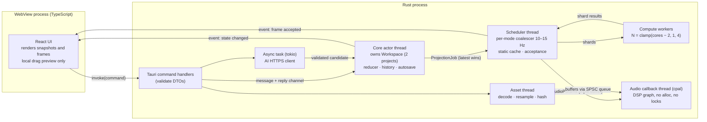

# 08 — Target architecture: Echo Canvas Desktop (Rust)

This section defines what to build. Sections 01–07 define what the existing web app does; this section says where each behavior lives in the desktop app and how the parts talk to each other. Section 09 defines the UI and section 10 the order of work.

## 1. Goals and non-goals

### Goals

| ID | Goal | How it is checked |
| --- | --- | --- |
| G1 | Same acoustic numbers as the web app for the same scene | Parity runner against the golden corpus (section 07, "Fixed corpus"), field by field with the frozen tolerances |
| G2 | Opens files exported by the web app | Import tests for every web export format and version in section 01 |
| G3 | Native, offline desktop app for Windows, macOS and Linux | Packaged builds start, edit, save, reopen and play audio with the network disconnected |
| G4 | Native audio with the same audible behavior as the web engine | Offline-render tests (section 04 parameters) plus the manual listening checklist |
| G5 | A clearer, faster UI | The UX acceptance list in section 09 |
| G6 | Interactive while editing | Performance budgets in §11 |

### Non-goals for version 1

- Web deployment, a server, accounts, collaboration or cloud sync.
- Any change to acoustic formulas, constants, ranking or tie-breakers. A model change is a separate, recorded decision after parity is proven.
- True diffraction, certification-grade architectural acoustics, or a claim that the HRTF matches a named dataset unless that dataset is actually bundled.
- Wiring the data-only P5/P6/P7 helpers (receiver connection, six-band materials, atmosphere, directional late field) into audio. Port them as data-only modules or leave them out.
- Recording or rendering to file. Leave room for it in the audio design (§7.6), but do not build it.

## 2. Stack decision

| Layer | Choice | Why | Rejected alternative |
| --- | --- | --- | --- |
| App shell | **Tauri 2** | Native window, menus, file dialogs, OS keychain, updater, signing. Rust backend. Small binaries using the system WebView | Electron: ships Chromium and a Node backend, so it isn't a Rust app |
| UI rendering | **React 19 + TypeScript (strict) + Vite**, inside the Tauri WebView | The redesigned UI (section 09) needs dense inspectors, menus, dialogs, typography and accessibility. That is cheapest and most reliable with the web platform. The UI holds no acoustics and no authoritative state | **egui/eframe** (all Rust): fast to start, but its custom look, text layout and screen-reader support (AccessKit) fall short of the section 09 target. Reconsider only if "no TypeScript at all" becomes a hard requirement. **Leptos/Dioxus in Tauri**: all Rust, but the 3D and canvas ecosystem is thin and would call into JS anyway |
| Plan view (2.5D) | SVG, rendered by React | Crisp at any zoom, DOM hit-testing, ≤ 100 walls is small | Canvas2D: more code for hit-testing and accessibility |
| 3D view | **three.js** via `@react-three/fiber`, with HTML label overlay | Real orbit camera, depth and picking. The web app's 3D view is a hand-written projection | wgpu rendered by Rust into the window: far more work, and it fights the WebView |
| Domain and state | Rust crate `ec-domain` (authoritative) | One source of truth, testable without UI, same validation for files, IPC and AI output | State in the UI (as in the web app): it would duplicate validation and undo across the IPC boundary |
| Acoustics | Rust crate `ec-acoustics`: pure functions, `f64`, no I/O, no threads, no clock | Parity testing and reuse (CLI, future WASM) | — |
| Scheduling | Rust crate `ec-runtime`: `std::thread` + `crossbeam-channel`. `rayon` only if measurements show a gain | Replaces Web Workers with threads that share immutable data (`Arc`) instead of copying it | tokio for compute: async adds nothing for CPU-bound work |
| Audio | Rust crate `ec-audio`: `cpal` (device I/O), `symphonia` (decoding), `rubato` (resampling), a hand-written DSP graph | No Web Audio in a native app. Section 04 lists every Web Audio behavior to reproduce | Running Web Audio in the WebView: behavior differs per OS WebView (WebKitGTK is weakest), and it puts audio on the UI thread |
| HRTF | Phase 2 of audio (milestone M7): SOFA HRIR set loaded with the `sofar` crate, partitioned convolution | Has to be implemented because Web Audio's built-in HRTF is gone | Only after its license allows redistribution (see §7.5) |
| AI (optional) | Rust crate `ec-ai`: `reqwest` (HTTPS, rustls), `serde`, the same validation as `ec-domain` | Keeps the key and the model output on the Rust side. The UI only sees validated candidates | Calling the provider from the UI: would expose the key |
| Rust → TS types | **`specta` + `tauri-specta`** generate TypeScript bindings for every command, event and DTO | No hand-written duplicate types; a type drift fails the build | `ts-rs`: also fine; pick one |
| Persistence | `serde_json` with a canonical writer; atomic write (temp file, fsync, rename) | Readable, diffable, compatible with web exports | Binary formats: no gain at these sizes |
| Secrets | `keyring` crate (Windows Credential Manager, macOS Keychain, Secret Service) | API key never in plain files | `.env` files: not suitable for an installed app |

Pin every dependency version in `Cargo.lock` and `pnpm-lock.yaml`. Pin the Rust toolchain in `rust-toolchain.toml` and Node/pnpm in `.nvmrc` and `packageManager`.

## 3. Process and thread model



Rules:

1. **One owner per piece of state.** The core actor thread owns the authoring state. Nothing else mutates it. Other threads get immutable snapshots (`Arc<ProjectSnapshot>`).
2. **Latest wins, one in flight per mode.** The scheduler keeps at most one job running and one pending per mode (Classic, Hybrid). A newer job replaces the pending one. This reproduces the web coalescing rules (section 05) with threads instead of Workers.
3. **Complete frames only.** The scheduler publishes a frame only when every source shard for that job finished and validated, and only if the acceptance rule in section 05 (current revision, or a pose-lagging frame per the web app's ADR 0008) allows it. Partial or stale results are discarded.
4. **Serial fallback.** If a shard panics (`catch_unwind`), times out (same watchdog values as section 05), or returns non-finite values, the scheduler recomputes the whole frame serially on the scheduler thread and publishes that. Log the failure and expose it in Diagnostics.
5. **Audio thread is real-time.** It never allocates, locks, logs, does file I/O or blocks. It reads the newest `AudioParams` from a triple buffer and smooths toward it per sample. New buffers and graph changes arrive through a bounded SPSC queue (`rtrb`), and retired objects go back through a second queue to be dropped off the audio thread.
6. **UI never blocks Rust and Rust never waits on UI.** Events are fire-and-forget. If the UI falls behind, it renders the newest state it received.

## 4. Repository layout

```text
echo-canvas-desktop/
├─ Cargo.toml                 # [workspace]
├─ rust-toolchain.toml
├─ crates/
│  ├─ ec-domain/              # schemas, IDs, limits, validation, reducer, history,
│  │                          # projection, migration, file formats, materials, presets
│  ├─ ec-acoustics/           # pure: classic/ (2.5D) and hybrid3d/ (3D)
│  ├─ ec-runtime/             # scheduler, coalescing, static cache, sharding,
│  │                          # frame acceptance, serial fallback
│  ├─ ec-audio/               # dsp/ (graph, filters, panner, reverb), engine (cpal),
│  │                          # params mapping, offline renderer for tests
│  ├─ ec-assets/              # built-in sounds, user library, decode/resample, relink
│  ├─ ec-ai/                  # optional provider client, content policy, repair loop
│  └─ ec-parity/              # CLI: run corpus cases, compare with expected outputs
├─ apps/desktop/
│  ├─ src-tauri/              # Tauri app: commands, events, menus, capabilities
│  │  ├─ capabilities/        # least-privilege permission files
│  │  └─ tauri.conf.json
│  └─ ui/                     # Vite + React + TS
│     ├─ src/bindings.ts      # GENERATED by tauri-specta. Never edit
│     ├─ src/app/             # shell, layout, routing between Start and Workspace
│     ├─ src/features/        # outliner, inspector, plan-view, spatial-view,
│     │                       # analysis, transport, ai, files, preferences
│     ├─ src/design/          # tokens.css, components (Button, Field, Menu…)
│     └─ src/ipc/             # thin wrappers, mock backend for tests
├─ fixtures/
│  ├─ corpus/v1/              # golden fixtures copied from the web repo (section 07)
│  └─ web-exports/            # sample web authoring JSON files for import tests
├─ assets/audio/              # built-in loops + LICENSE.md (section 04)
├─ docs/                      # this spec, ADRs, testing notes
└─ .github/workflows/         # CI (section 10)
```

Dependency direction (enforced by crate boundaries; never import upward):

```text
ec-acoustics  ←  ec-domain  ←  ec-runtime  ←  src-tauri
      ↑               ↑             ↑
   ec-parity      ec-ai         ec-audio ← ec-assets
```

`ec-acoustics` depends on nothing in the workspace (only `serde` for DTOs, behind a feature). `ec-domain` depends on `ec-acoustics` only for shared value types if needed; prefer the reverse (acoustics consumes the projected `SceneSpec`/`SceneDocumentV2` types defined in a small shared module inside `ec-acoustics`).

## 5. Where each web module goes

| Web module (sections 01–07) | Desktop location | Port style |
| --- | --- | --- |
| `src/domain/scene` (SceneSpec v1), `src/domain/scene-document` (SceneDocumentV2) | `ec-domain::scene`, `ec-domain::scene_document` | Exact port. Same field names in JSON (`#[serde(rename_all = "camelCase")]` where the web uses camelCase) |
| `src/domain/workspace/*` (project, reducer, history, persistence, transfer, validation, constraints, projections) | `ec-domain::workspace::*` | Exact port of rules and limits. Persistence moves from localStorage to files (§8) |
| `src/domain/materials`, `src/domain/presets`, registries | `ec-domain::materials`, `ec-domain::presets` | Exact data. Generate a test that checks every coefficient against the table in section 01 |
| `src/domain/editor` | UI-local state (selection, tool, hover) plus `ec-domain` for anything stored in the file | Split: presentation state stays in the UI |
| `src/acoustics/*` (Classic) | `ec-acoustics::classic` | Exact numeric port (section 02) |
| `src/acoustics/hybrid3d/*` | `ec-acoustics::hybrid3d` | Exact numeric port (section 03). P5/P6/P7: data-only, optional |
| `src/acoustics/frame-acceptance.ts` | `ec-runtime::acceptance` | Exact rule |
| `src/acoustics/runtime/engine-router.ts` | Not ported | Only tests use it in the web app |
| `src/workers/*` | `ec-runtime::{scheduler, pool, protocol}` | Same semantics (coalescing, sharding by source ID, static cache by fingerprint, validation, fallback). Messages become Rust enums on channels; there is no structured clone |
| `src/workers/acoustics.worker.ts` | Not ported | Never spawned in the web app |
| `src/hooks/useAcousticFrame`, `useHybridDirectPaths` | `ec-runtime` + a UI hook that subscribes to `frame://accepted` | Logic moves to Rust |
| Main-thread Hybrid extras (audible Portal routing, reflection tap projection in the Hybrid viewport adapter) | `ec-runtime` (run after shard assembly, before publishing) | Moves off the UI thread |
| `src/audio/*` | `ec-audio` | Reimplement Web Audio semantics (section 04) |
| `src/domain/audio-assets` (IndexedDB library) | `ec-assets` (files on disk + index JSON) | New storage, same metadata and relink rules |
| `src/ai/*`, `src/app/api/scene/*` | `ec-ai` + `ai_*` commands | Same contracts, rules, content policy and single-repair limit. No HTTP server |
| `src/app/api/health` | Not ported | Server-only |
| `src/components/*`, `src/app/*` pages | `apps/desktop/ui` | Redesigned (section 09). Keep every function listed in section 06 |
| Docker, Next config, Vercel, CSP headers for the web | Not ported | Replace with Tauri CSP and capabilities (§9) |

## 6. IPC contract

All commands and events are generated into `bindings.ts`. Every payload is versioned with `ipcVersion: 1`. Rust validates every incoming payload with `#[serde(deny_unknown_fields)]`, then with the same domain validation used for files. Bound every string, list and number.

### 6.1 Commands (UI → Rust)

| Command | Input | Output | Notes |
| --- | --- | --- | --- |
| `app_info` | — | version, build, platform, ai_available | |
| `prefs_get` / `prefs_set` | `Preferences` | `Preferences` | Theme, units display, audio device, buffer size, panning model, AI enabled |
| `project_new` | `{ template: PresetId \| "empty" }` | `WorkspaceSnapshot` | Creates both Classic and Hybrid projects from the template, as the web app does |
| `project_open_dialog` | — | `WorkspaceSnapshot \| null` | Rust shows the native dialog. The UI never sends a file path |
| `project_open_recent` | `{ recentId }` | `WorkspaceSnapshot` | `recentId` indexes Rust's own recent list |
| `project_save` / `project_save_as_dialog` | — | `SaveResult` | Atomic write |
| `project_import_web_json_dialog` | — | `ImportReport` | Accepts every web export version (section 01), reports what was migrated |
| `project_export_web_json_dialog` | `{ mode }` | `SaveResult` | Writes the web authoring format so files round-trip |
| `dispatch` | `{ mode, action: ProjectAction, gestureId? }` | `{ revision, errors: ValidationError[] }` | `ProjectAction` = every reducer action in section 01. Rejected actions change nothing |
| `preview_pose` | `{ mode, entityId, pose, gestureId }` | — | Transient pose during a drag: updates the scene for calculation and audio, not history |
| `end_gesture` | `{ mode, gestureId, commit: bool }` | `{ revision }` | Commits the gesture as one history entry, or reverts it |
| `undo` / `redo` | `{ mode }` | `{ revision }` | Same history rules as section 01 |
| `audio_start` / `audio_stop` / `audio_retry` | — | `AudioStatus` | Starting audio is a user action, as in the web app |
| `audio_set` | `{ listenMode: "room" \| "dry", panning: "hrtf" \| "speakers", masterDb }` | `AudioStatus` | "room" = web "Simulated", "dry" = web "Raw" |
| `audio_source_set` | `{ sourceId, mute?, solo? }` | — | New (section 09). Does not change the scene |
| `audio_devices` / `audio_set_device` | `{ deviceId }` | device list / `AudioStatus` | New |
| `assets_list` / `assets_import_dialog` / `assets_remove` | — | `AssetInfo[]` | |
| `assets_relink_dialog` | `{ assetRef }` | `RelinkResult` | |
| `ai_status` | — | `{ enabled, keyPresent, model }` | |
| `ai_set_key` / `ai_clear_key` | `{ key }` | — | Stored in the OS keychain. Never returned to the UI |
| `ai_compile` | `{ mode, prompt }` | `AiCandidate` (validated scene + report) | Never applied automatically. The UI previews it, then the user applies it via `dispatch(ReplaceScene)` |
| `ai_explain` | `{ mode, selection }` | `AiExplanation` | Explains the current accepted frame snapshot |
| `diagnostics_get` | — | runtime counters, fallbacks, timings | |

### 6.2 Events (Rust → UI)

| Event | Payload | Rate |
| --- | --- | --- |
| `state_changed` | `{ mode, revision, snapshot }` (full snapshot; switch to patches only if profiling shows a need) | On every applied action or preview |
| `frame_accepted` | `{ mode, revision, poseLagging: bool, frameView }`. `frameView` = per-source metrics, path polylines, six taps, RT60 bands, arrival direction | ≤ 15 Hz per mode |
| `runtime_status` | `{ mode, state: "idle" \| "computing" \| "fallback" \| "error", lastComputeMs, pending }` | On change |
| `audio_status` | `{ state, device, sampleRate, bufferSize, error? }` | On change |
| `audio_meters` | `{ master: [peakL, peakR], sources: { id: peak } }` | ≤ 30 Hz while playing |
| `assets_changed` | `AssetInfo[]` | On change |
| `autosave` | `{ at, ok }` | On change |

### 6.3 Dragging without lag

1. On pointer down the UI creates a `gestureId`.
2. During the drag the UI draws the entity at the pointer position at once (local preview) and sends `preview_pose` at most once per animation frame.
3. Rust updates the transient pose, bumps the revision as a pose-only change and schedules calculation (coalesced to 10–15 Hz). Accepted frames may be pose-lagging, which the acceptance rule allows.
4. On pointer up the UI sends `end_gesture(commit: true)`. Rust records one history entry. Escape sends `commit: false` and Rust restores the pose from before the gesture.

## 7. Native audio engine

Section 04 is the behavioral source of truth. This is the native structure.

### 7.1 Graph

Section 04 §2 has the authoritative diagram and every parameter. In short:

```text
per source:  looping mono player → envelope (0→1 in 15 ms) → sourceGain
               ├─ rawModeGain ("Dry": mono, up-mixed equally to L/R, no other processing) ─────────┐
               ├─ distanceGain → low-pass biquad → panner (HRTF | equal-power, rolloff 0) ──┐       │
               └─ early-reflection bank: 6 × (delay → gain → low-pass → panner) ────────────┤       │
                                                     simulatedModeGain ("Room") ◄───────────┘       │
                                                     └─ reverbSend ─► shared Schroeder reverb       │
shared:      reverb (pre-delay → 4 combs → 2 all-pass → wet 0.28) → reverb return (Room 1 / Dry 0)  │
master:      compressor (browser-default settings) → master gain (30 ms fades) → device  ◄──────────┘
```

Facts the native engine must keep, because each one changes the sound (section 04 §2):

1. The direct path has **no propagation delay**. Only reflection taps are delayed.
2. Dry is the mono source after `sourceGain` only.
3. Reflection taps are fed before distance gain and the obstruction filter, are summed into the Room path, and also feed the reverb.
4. The Room/Dry crossfade is per source, equal-power, 80 ms. The reverb return has its own Room/Dry gain.
5. There is no limiter. The master has a compressor with Chromium's default `DynamicsCompressorNode` settings, which section 04 lists.
6. Section 04's review findings include a suspected reverb instability and Hybrid-mode reverb that never updates. Treat them as section 04 says, and record any audible difference in `docs/evidence/known-differences.md`.

### 7.2 Parameter flow

1. The scheduler converts each accepted frame into `AudioParams` with the mapping formulas in section 04 (dB→linear, cutoff clamps, delays in ms).
2. It writes `AudioParams` into a triple buffer. The audio thread reads the newest value once per callback.
3. Each parameter is smoothed per sample with a one-pole filter, equivalent to Web Audio `setTargetAtTime(target, t, τ)`: `y[n] = y[n−1] + (target − y[n−1]) · (1 − e^(−1/(τ·fs)))`. Use the τ values from section 04. Delays use a fractional, interpolated delay line whose delay time is also smoothed, so moving sources do not click.
4. Graph structure (sources added or removed, buffer changes) arrives by message, applied at callback start, preallocated where possible: up to 4 sources and 6 taps, matching the scene limits.

### 7.3 Device handling

- Default output device at the preferred sample rate. Fall back to the device default.
- Hot-plug and device loss: stop, report `audio_status.error`, offer Retry and device selection. Never panic.
- Buffer size preference: 128 / 256 / 512 / 1024 frames, default 256.

### 7.4 Decoding and assets

- Decode with `symphonia` on the asset thread, resample to the device rate with `rubato`, store as interleaved or planar `f32` in `Arc<[f32]>`.
- Built-in loops ship in `assets/audio` with their license (section 04).
- User audio: copy or reference (preference). The project file stores a reference `{ assetId, name, sha256, sizeBytes, durationMs, sampleRate, channels, lastKnownPath }`, never the audio bytes. A missing file triggers the relink flow (section 09).

### 7.5 Panning and HRTF

- **Milestone M6:** equal-power panning, reproducing the Web Audio PannerNode `equalpower` model, distance model and listener orientation exactly as section 04 states.
- **Milestone M7:** HRTF through a bundled SOFA HRIR set and partitioned convolution (`sofar`). Before bundling any dataset, record its name, source, version and license in `THIRD_PARTY_NOTICES.md`, and confirm the license allows redistribution in a commercial binary. Until then the "HRTF" option stays hidden. Do not describe the result as matching the browser's HRTF; the browser dataset is unspecified.

### 7.6 Reserved for later

Offline render to WAV and recording go through a non-real-time writer thread fed by a bounded SPSC queue. Design the engine so a second "offline" backend can run the same graph without a device. The offline renderer is needed for tests anyway (§10).

## 8. Files and persistence

| What | Where | Format |
| --- | --- | --- |
| Project file | User-chosen path, extension `.echocanvas` | JSON: `{ "format": "echo-canvas-desktop", "formatVersion": 1, "classic": <WorkspaceProject>, "hybrid": <WorkspaceProject>, "assets": [AssetRef…], "view": { per-mode camera, panel layout } }`. The two `WorkspaceProject` objects use the exact web schema from section 01 |
| Web authoring JSON | Import/export only | Exactly the web transfer format and versions in section 01 |
| Autosave | `<app data dir>/autosave/<project-id>.echocanvas` | Every 30 s and on blur when dirty. Offer recovery on next launch if the last session did not close cleanly |
| Recent files | `<app config dir>/recent.json` | `[ { id, path, name, openedAt } ]`, max 12 |
| Preferences | `<app config dir>/preferences.json` | Versioned JSON |
| User audio library index | `<app data dir>/library/index.json` + optional copied files | Asset metadata (section 04) |
| AI key | OS keychain, service `echo-canvas`, account `openai` | Never on disk in plain text |

Writes are atomic: write `path.tmp`, `fsync`, rename over the target, `fsync` the directory where the OS supports it. On a failed write the previous file stays intact and the UI shows the error with the path.

Migration: reading any older `formatVersion` or web transfer version runs the migration chain from section 01, and the import report lists what changed. Writing always uses the newest version.

## 9. Security

- **Tauri capabilities:** the UI window gets only the app's own commands. No `fs`, `shell`, `http` or `process` plugins are exposed to the WebView. Rust shows every file dialog.
- **CSP:** `default-src 'self'; script-src 'self'; style-src 'self' 'unsafe-inline'; img-src 'self' data: blob:; connect-src ipc: http://ipc.localhost`. No remote content in the WebView.
- **Treat IPC as untrusted:** strict DTOs, bounded sizes, IDs checked against the current project, numbers checked for finiteness and range, rate limits on `preview_pose`.
- **AI:** off by default. When enabled: HTTPS only, the key in the keychain, the request contains only the prompt or the snapshot fields that section 07 allows, and the same content policy and limit of one repair. AI output is never applied without user confirmation and never sets audio parameters directly.
- **Updates:** signed by the Tauri updater with a key kept outside the repository. Code signing on Windows and macOS (notarization) before any public release.

## 10. Testing (details in section 10)

| Layer | Tool | What |
| --- | --- | --- |
| `ec-domain` | `cargo test`, `proptest`, `insta` snapshots | Every reducer action, validation rule, limit, migration, round trip |
| `ec-acoustics` | `cargo test` + `ec-parity` | Every corpus case, field by field with the frozen comparison rules. Unit tests ported from the web suite (section 07 inventory) |
| `ec-runtime` | `cargo test` with fake clocks | Coalescing, latest-wins, acceptance, stale rejection, fallback on panic, timeout or non-finite values |
| `ec-audio` | Offline renderer tests | Gains, delays, filters, crossfade times, no NaN/denormals, no allocation on the audio thread (`assert_no_alloc` in debug builds) |
| UI | Vitest + Testing Library; Playwright against Vite with the mock backend | Each feature, keyboard paths, focus, the UX acceptance list (section 09) |
| End to end | `tauri-driver` (WebDriver) on Windows and Linux | Open, edit, save, reopen, import a web file, play. macOS has no WebDriver for WKWebView: manual checklist |
| Performance | `criterion` benches + an in-app timing log | The budgets in §11 |
| Listening | Manual checklist (section 04) | Before each release |

## 11. Performance budgets (initial targets; confirm on reference hardware in M10)

| Measure | Target |
| --- | --- |
| Pose change → accepted frame, full-limit scene (100 walls, 8 portals, 4 sources, 8 primitives) | p95 ≤ 100 ms (coalescer period included) |
| One full-limit frame compute, warm cache, release build | p95 ≤ 20 ms |
| UI frame time while dragging in the plan view | p95 ≤ 16.7 ms; no main-thread task > 50 ms (same limit as the web stress test) |
| Audio | 0 underruns in 10 minutes at 256 frames / 48 kHz with 4 sources playing while dragging |
| Cold start to interactive | ≤ 2 s on reference hardware |
| Idle CPU, not playing | < 1 % |

Record hardware, OS, build profile and commit with every measurement. Do not loosen a budget to get a pass; record the miss.
