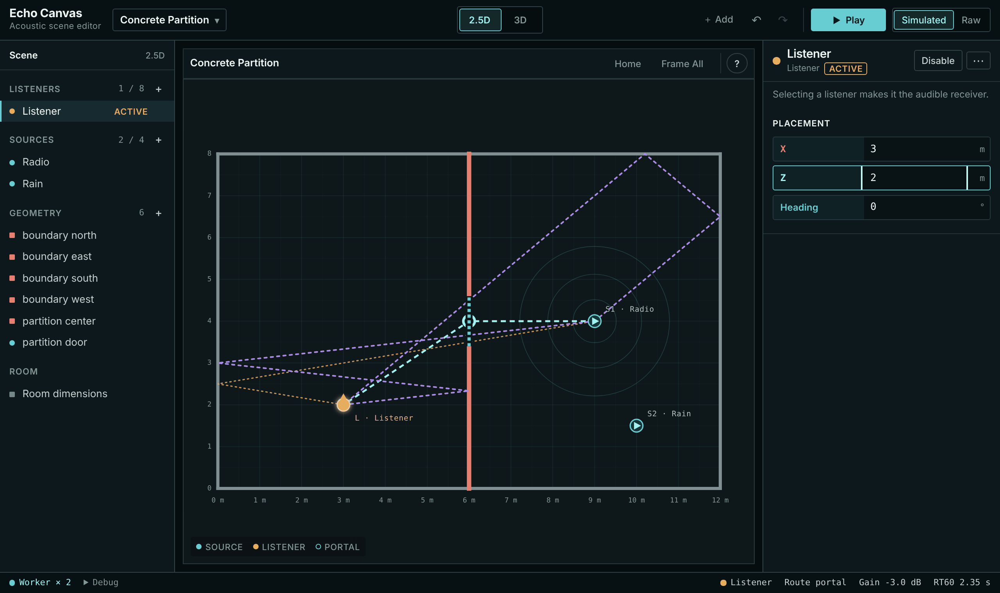
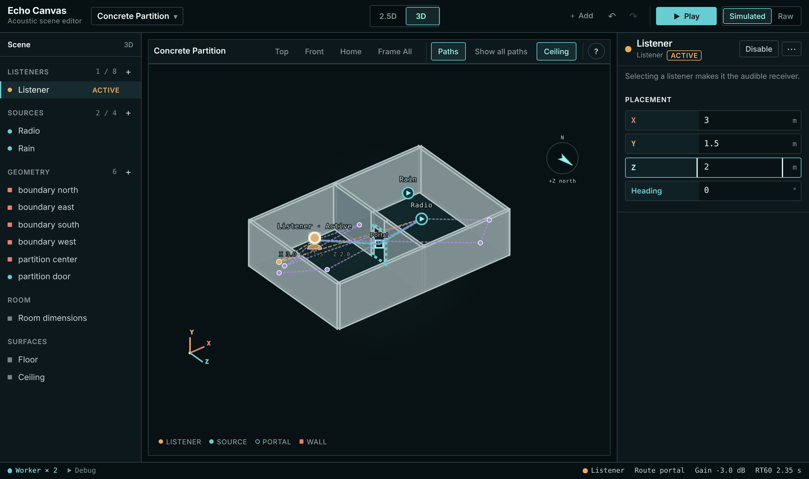

# Portal walkthrough: Concrete Partition in Classic (2.5D) and Hybrid (3D)

This walkthrough shows how the workbench chooses between a **direct** path, a **Portal** route, and a **blocked** (transmission) fallback, using the built-in Concrete Partition preset. It needs no API key, no Docker, and no local audio. Start the app as described in [CONTRIBUTING](../../CONTRIBUTING.md) (`pnpm dev`, or `pnpm build && pnpm start`) and open http://localhost:3000 in current desktop Chrome or Edge.

> **Model boundary.** Portal routing is a geometric/perceptual approximation ("portal-aware sound propagation"), not edge diffraction. It does not certify architectural-acoustics accuracy. See [Acoustics §8](../ACOUSTICS.md#8-portal-aware-route-approximation) for the route cost and rendering rules.

## The scene

[`src/domain/presets/concrete-partition.ts`](../../src/domain/presets/concrete-partition.ts) defines a 12 m × 8 m room, 3 m high, with hard concrete walls. Units are metres. Plan coordinates are `(x, y)`; the Inspector shows the same plan axes as **X** and **Z** (in 3D, **Y** is height).

| Object | Plan position (m) | Notes |
| --- | --- | --- |
| `partition_center` wall | x = 6, y = 0 → 8 | Splits the room into a west and an east half |
| `partition_door` Portal | centre (6, 4) | 1.2 m wide, 2.1 m high, open, 3 dB loss |
| Radio source (S1) | (9, 4) | East half, −3 dB |
| Rain source (S2) | (10, 1.5) | East half, −8 dB |
| Listener | (3, 4) | West half, heading 0° |

The acoustic readout at the right of the bottom status bar reports **Route**, **Gain** and **RT60** for the selected source, or the first source (Radio) when no source is selected. Every step below reads that readout.

## Fixtures

Two exported authoring projects hold the unmodified preset, one per editor mode. They contain no local audio blobs, no local-asset metadata, and no credentials; both sources use built-in clips.

- [`fixtures/concrete-partition-classic.authoring.json`](fixtures/concrete-partition-classic.authoring.json): 2.5D
- [`fixtures/concrete-partition-hybrid.authoring.json`](fixtures/concrete-partition-hybrid.authoring.json): 3D

A project can be imported only into the mode it was exported from. Importing the 3D file in 2.5D is rejected with "Import rejected: 3D project cannot be imported into this mode." [`tests/unit/portal-walkthrough-fixture.test.ts`](../../tests/unit/portal-walkthrough-fixture.test.ts) checks that both files import through `parseWorkspaceProject`, that they still match the preset geometry, and that the Classic route states in this guide hold.

## Part 1: Classic (2.5D)

1. **Choose the mode.** In the toolbar's **Editor mode** group, press **2.5D**. (`/classic` opens directly in 2.5D.)
2. **Load the scene.** Click the scene-name button at the left of the toolbar (accessible name "Project: …") to open the project menu. Under **Scene**, set **Preset** to **Concrete Partition**; choosing a preset closes the menu. Or, under **Authoring file**, use **Import authoring JSON** and pick `concrete-partition-classic.authoring.json`; the menu then shows "Authoring project imported." Close it with Escape.
3. **Observe the direct path.** The listener at (3, 4) sees the Radio at (9, 4) straight through the open doorway. The status bar shows `Route direct` and `Gain 0.0 dB`.
4. **Start audio.** Press **Play** in the toolbar. The browser creates audio only after this user gesture. The button changes to **Stop**.
5. **Compare Simulated and Raw.** Use the **Simulated** / **Raw** pair next to Play. *Simulated* renders the computed route, reflections and reverb. *Raw* equal-power crossfades to a bus that carries each clip at its source gain, with no distance gain, route filtering, panning, reflections or reverb. The overlays and status bar do not change. *Listening step (for you):* switch between them with headphones and note what changes. This guide makes no claim about what you will hear.
6. **Move the listener off the doorway line.** In the **Scene Outliner**, under **Listeners**, select **Listener**. In the **Inspector** under **Placement**, set **Z** to `2` and press Enter. You can also drag the listener in the viewport, or focus it and use the arrow keys. The listener at (3, 2) no longer has a direct line to the Radio. The status bar shows `Route portal` and `Gain -3.0 dB`, which is the Portal's 3 dB loss.
7. **Find the listener-facing Portal.** The cyan dashed route goes Radio → doorway centre (6, 4) → listener. A ring marks the doorway centre. That ring is the *last listener-facing Portal*: the final Portal on the route when it is read from source to listener. The audio engine places the Radio's virtual (panner) direction at that point and applies the full route length for distance gain, plus a mild low-pass. *Listening step (for you):* with Simulated on, check whether the Radio appears to come from the doorway direction rather than from its true position.

   

8. **Close the Portal.** In the Scene Outliner, under **Geometry**, select **partition door**. In the Inspector's **Acoustics** section, press **Close Portal**. A closed Portal is removed from the route graph, so the only remaining option is transmission through the concrete. The status bar shows `Route blocked` and `Gain -24.0 dB` (the Classic transmission-loss cap). The doorway ring disappears. RT60 rises from 2.35 s to 3.16 s because the open-door area no longer counts as near-total absorption in the room estimate.
9. **Reopen and return.** Press **Open Portal**: `Route portal` returns. Select the listener again and set **Z** back to `4`: `Route direct` returns.
10. Press **Stop** when finished.

## Part 2: Hybrid (3D)

The Hybrid engine has its own 3D project. Changes made in 2.5D do not carry over.

1. Press **3D** in the **Editor mode** group.
2. Load **Concrete Partition** from the project menu's **Preset**, or import `concrete-partition-hybrid.authoring.json`.
3. With the listener at X 3, Y 1.5 (ear height), Z 4, the status bar shows `Route direct`. The 3D viewport draws the direct line and up to six rendered early reflections. In the viewport header's **Overlays** group, use **Paths** to hide or show path overlays, and **Show all paths** to include every source.
4. Press **Play**, and compare **Simulated** and **Raw** as in Classic. *Listening step (for you):* this guide records no listening result.
5. Select **Listener** and set **Z** to `2`. The status bar shows `Route portal` and `Gain -3.0 dB`. The cyan path bends at the doorway: source → last listener-facing Portal → listener. Hybrid lifts the planar Portal candidate into 3D and checks every leg against the finite 3D geometry, so a route through the doorway must also pass between the Portal's **Bottom** and **Top** (0 m and 2.1 m here).

   

6. Select **partition door** and press **Close Portal**. The status bar shows `Route blocked`. In this build the Gain read `-34.5 dB`, because Hybrid uses its own transmission model with a 36 dB cap. The overlay keeps only the blocked direct line. RT60 changes from 2.35 s to 3.16 s.
7. Press **Open Portal**, set the listener **Z** back to `4`, and press **Stop**.

To experiment further, select **partition door** and move the Portal along its wall (**Offset on Wall**, in the Inspector's **Placement** section) or change **Width** and, in 3D, **Bottom** / **Top** (all in **Shape**). Watch when the route switches between `direct`, `portal` and `blocked`.

## Evidence for this guide

| Kind | What was checked | Environment |
| --- | --- | --- |
| Numerical (Vitest) | Fixtures import in their own mode and are rejected in the other; geometry matches the preset; Classic Radio route is `direct` at (3, 4), `portal` through `partition_door` with virtual position (6, 4) at (3, 2), and `blocked` with the Portal closed | Node 22, `pnpm test` |
| Rendered browser (visual) | Every label and status-bar value quoted above, in both modes, after importing each fixture through **Import authoring JSON** against `pnpm build && pnpm start`. Re-checked, and both screenshots retaken, after the desktop workspace redesign (#38), on `main` at 480e9c6 | Headless Chrome for Testing 153.0.8010.12, Linux, 1280 × 760 viewport, device scale factor 2 (screenshots) |
| Listening | **Not run.** All listening steps are instructions for the reader. | — |

Gain and RT60 values are display values rounded by the status bar. They are observations from this build, not tolerances. The Vitest checks cover route types and the Portal ID only.
