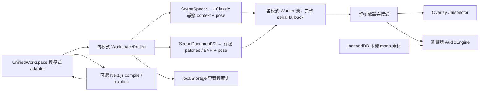

# 現行 Web 架構稽核

研究基準為 GitHub `main` 的 `98a4374fa839aa5dee7c6c35e575b8003f7f1a31`，於 2026-11-06 以程式、設定、測試與既存報告交叉核對。下文的 **Verified Fact** 指該提交的程式或設定已檢查。**Measured Result** 指另有具名環境、版本與測試紀錄。GitHub workflow 配置和測試程式僅說明覆蓋範圍，執行結果依各自的 run 或本輪驗證記錄判讀。原始 HEAD、分支、worktree 與擷取歷史見下列索引。[版本化證據索引](../../raw/sources/repository.md)

## 入口與模組邊界

| 狀態 | 入口／責任 | 實作證據 |
| --- | --- | --- |
| Verified Fact · 產品 | Next.js 16.4.2 App Router、React 19.3.1、TypeScript 5.9.3 strict、Zod 4.6.7。CI 與部署工具鏈固定 Node 22.23.3、pnpm 11.7.0。 | [package.json](../../../package.json)、[tsconfig](../../../tsconfig.json)、[Node 版本](../../../.nvmrc)、[CI](../../../.github/workflows/ci.yaml) |
| Verified Fact · 產品 | `/`、`/classic` 與 `/lab` 都進入 `UnifiedWorkspace`，後兩者指定起始模式。Classic/Hybrid 各有專案、歷史和視角，透過工具列、Outliner、Inspector、視圖介面及共用音訊控制操作。Classic adapter 仍使用 `SceneEditor`。 | [首頁](../../../src/app/page.tsx)、[Classic](../../../src/app/classic/page.tsx)、[Lab 路由](../../../src/app/lab/page.tsx)、[UnifiedWorkspace](../../../src/components/workspace/UnifiedWorkspace.tsx)、[Classic adapter](../../../src/components/workspace/ClassicViewportAdapter.tsx)、[Hybrid adapter](../../../src/components/workspace/HybridViewportAdapter.tsx) |
| Verified Fact · 產品 | `domain` 管資料契約、驗證、登錄表、持久化與投影。`acoustics` 管可獨立測試的純計算，`workers` 管協定與池，`hooks` 管生命週期，`audio` 管瀏覽器圖與自動化。`app/api` 與 `ai` 提供伺服器控制面。 | [維護架構](../../../docs/ARCHITECTURE.md)、[專案 hooks](../../../src/hooks/useWorkspaceProjects.ts)、[Classic hook](../../../src/hooks/useAcousticFrame.ts)、[Hybrid hook](../../../src/hooks/useHybridDirectPaths.ts)、[AudioEngine](../../../src/audio/AudioEngine.ts) |
| Verified Fact · 相容性基礎 | 泛用 `EngineRouter`、`AcousticFrameEnvelope` 與預設關閉的 Hybrid 研究旗標供隔離合約使用。工作台模式切換走各 adapter。 | [Router](../../../src/acoustics/runtime/engine-router.ts)、[Envelope](../../../src/acoustics/runtime/frame-envelope.ts)、[旗標](../../../src/acoustics/runtime/feature-flags.ts)、[模式入口](../../../src/components/workspace/UnifiedWorkspace.tsx) |

## 場景契約與運算生命週期

- **Verified Fact · 作者模型。** `WorkspaceProject` 保存多 listener、選取、停用物件、房間、牆與 Portal、primitive、聲音參照及顯示狀態。兩個投影只輸出一個啟用的 active listener，濾除停用幾何與其附屬 Portal。相機、選取、notice 和 local audio metadata 改動會復用投影。比較投影輸入依賴不可變欄位身分，因為 undo/redo 可重用 revision。外部匯入和 AI 候選須經驗證，熱路徑投影依賴 reducer 已維護的不變量。[作者型別](../../../src/domain/workspace/types.ts) · [reducer](../../../src/domain/workspace/project-reducer.ts) · [投影](../../../src/domain/workspace/projections.ts) · [投影測試](../../../tests/unit/workspace-projections.test.ts)
- **Verified Fact · 相容性。** `SceneSpec` 版本 `1.0` 保留平面欄位，`SceneDocumentV2` 版本 `2.0` 保留 `baseScene`、`extensions` 與 `compatibility.classicProjectionHash`。Hybrid 世界座標採 X 向右、Y 向上、Z 向前，`baseScene` 平面 x/y 對應世界 X/Z，Y 高度和有限牆、Portal 垂直資料由 extension 保存。上限含 100 牆、8 Portal、4 音源、8 listener 與 8 primitives。房間平面維度上限 50 m，牆長下限 0.1 m。Classic primitive 投影也消耗牆預算。維持登錄表 ID、停用狀態、驗證與匯入遷移語意。[SceneSpec schema](../../../schemas/scene-spec.schema.json) · [V2 型別](../../../src/domain/scene-document/types.ts) · [V2 驗證與 hash](../../../src/domain/scene-document/validate.ts) · [契約](../../../docs/API_CONTRACTS.md) · [維護政策](../../../AGENTS.md)
- **Verified Fact · Classic 2.5D。** 啟用 primitive 投影成全高 footprint 牆，採平面 segment 交會、遮蔽與牆體穿透近似、可開關 Portal 路由、一階 image-source 與直達受阻時的有界二階。每幀組裝房間 Eyring 估計與有序聲源結果。[幀組裝](../../../src/acoustics/compute-frame.ts) · [幾何](../../../src/acoustics/geometry.ts) · [遮蔽](../../../src/acoustics/occlusion.ts) · [Portal](../../../src/acoustics/portal.ts) · [反射](../../../src/acoustics/image-source.ts)
- **Verified Fact · Hybrid 3D。** 矩形房間、有限牆與 Portal 及盒、柱、球的有限 facets 編成 BVH。直達與穿透保留命中清單，反射可見性使用遇到第一個有效遮擋即結束的查詢。一階有限反射與直達受阻時的有界二階均已接入。投影寫出的 `propagation3d.maxReflectionOrder: 1` 屬於文件欄位，實際二階觸發條件在 `computeHybridDirectSources`。Hybrid 將 Classic 平面 Portal 候選抬升為 3D，並用有限 BVH 驗證每一段。Hybrid adapter 另做音訊映射和房間估計。[Hybrid compile](../../../src/acoustics/hybrid3d/compile.ts) · [BVH](../../../src/acoustics/hybrid3d/bvh.ts) · [Hybrid 求解](../../../src/acoustics/hybrid3d/direct.ts) · [Portal 音訊映射](../../../src/acoustics/hybrid3d/audible-direct.ts) · [adapter](../../../src/components/workspace/HybridViewportAdapter.tsx)
- **Verified Fact · 既有聲學語意。** 延遲採 `343 m/s`，維持三個頻帶、數值容差與材質能量不變量。穿透及低通映射、Portal 路由成本和曲面 facets 為近似。二階搜尋最多 24 個代表面、552 個有序配對，依路徑長度及估計能量剪枝。一、二階路徑共用每來源六個可聽 tap。Classic 音訊 tap 以有效直達路徑為參考並夾至非負，Hybrid tap 則維持絕對傳播毫秒值。遷移須保留此差異、排序、tie-break、路徑識別及材質係數。[聲學公式與限制](../../../docs/ACOUSTICS.md) · [材料登錄表](../../../src/domain/materials/registry.ts) · [Hybrid tap 映射](../../../src/acoustics/hybrid3d/reflection-rendering.ts)
- **Verified Fact · Worker 池。** 兩模式皆依來源 ID 分片，池上限為 `min(4, max(1, floor(hardwareConcurrency) - 2))`，未知或無效 concurrency 採 1，有效數量再受啟用來源數限制。場景 schema 接受 5–20 Hz，協調器 coalesce 到 10–15 Hz。以 `INSTALL_STATIC` 安裝可重用的 Classic context 或 Hybrid 結構與 BVH，`COMPUTE_SHARD` 傳 request、fingerprint、pose snapshot、source IDs。主端驗證安裝回覆、請求、revision、fingerprint、來源分配、資料界限及路徑語意，依原 source 順序原子合併。建構、協定、訊息、求解或 watchdog 失敗時，丟棄部分結果並以完整 serial frame fallback。Pose-only 變更利用結構比對重用靜態資料與 hash，靜態編輯觸發重裝。[Classic pool](../../../src/workers/classic-source-pool.ts) · [Hybrid pool](../../../src/workers/hybrid-direct-pool.ts) · [容量政策](../../../src/workers/worker-pool-policy.ts) · [更新率](../../../src/acoustics/update-rate.ts) · [結構快取測試](../../../tests/unit/static-structure-cache.test.ts)
- **Verified Fact · 幀接受與顯示。** 整幀可按當前 revision 接受。連續拖動時，當且僅當靜態結構及來源 ID 順序相容，已驗證的舊 pose 幀仍供 overlay/audio 使用。實作已存在，ADR 0008 的治理狀態仍為 Proposed。Hybrid 選取音源的 arrival label 額外要求當前 revision 及 Classic projection hash，lagging 時顯示 pending。標籤的世界座標角度由 listener 指向來源，0° 為 +Z、90° 為 +X，並區分受阻直線與可聽的 Portal 路由。[ADR 0008](../../../docs/adr/0008-adopt-pose-lagging-frames.md) · [接受規則](../../../src/acoustics/frame-acceptance.ts) · [Hybrid adapter](../../../src/components/workspace/HybridViewportAdapter.tsx) · [標籤](../../../src/components/workspace/HybridPathOverlay.tsx) · [回歸](../../../tests/unit/hybrid-path-overlay.test.ts)

## 音訊、持久化與 AI

| 狀態 | 執行契約 | 實作證據 |
| --- | --- | --- |
| Verified Fact · 瀏覽器音訊 | 一個 `AudioEngine` 跨模式存活。Play 手勢建立 AudioContext，重用 Raw/Simulated bus、來源 graph、HRTF/equal-power panner、六個 tap 與 Schroeder late reverb。作者端 gain/HRTF 隨 scene reconcile 更新，求解參數維持最後接受值，首次收幀前採自由場估計。穩定 path ID 保留 tap 槽，換路徑靜音重調，重複的 automation target 跳過重排。模式 crossfade、停止、恢復、失敗重試與退場 tail 均由音訊層協調。 | [AudioEngine](../../../src/audio/AudioEngine.ts)、[SourceGraph](../../../src/audio/SourceGraph.ts)、[tap bank](../../../src/audio/EarlyReflectionBank.ts)、[smoothing](../../../src/audio/parameter-smoothing.ts)、[Schroeder](../../../src/audio/SchroederReverb.ts) |
| Verified Fact · 專案儲存 | localStorage 使用每模式專案鍵和共用模式選擇鍵，快取版本 `3.0`，每個歷史方向至多 50 筆。閒置 2 秒寫入，切換模式與 `pagehide` flush。舊資料可遷移，損毀時保留原始資料供復原下載。作者 JSON 使用 `echo-canvas-authoring-project` 版本 `1.0`，保存 relink metadata。 | [persistence](../../../src/domain/workspace/persistence.ts)、[project hook](../../../src/hooks/useWorkspaceProjects.ts)、[歷史](../../../src/domain/workspace/history.ts)、[transfer](../../../src/domain/workspace/transfer.ts) |
| Verified Fact · 素材儲存 | mono WAV/MP3/Ogg 本機解碼與 IndexedDB `echo-canvas-audio`/ `assets` 保管，單檔 25 MiB、整庫 100 MiB。庫不可用時提示只存在記憶體。缺少的素材保留 ID 和 metadata，來源在重新連結前靜音。伺服器 API 的輸入為 prompt、scene 或 snapshot。 | [local library](../../../src/domain/audio-assets/local-library.ts)、[library hook](../../../src/hooks/useLocalAudioLibrary.ts)、[保存回歸](../../../tests/e2e/local-audio-persistence.spec.ts)、[AI 契約](../../../docs/API_CONTRACTS.md) |
| Verified Fact · AI 控制面 | `POST /api/scene/compile` 產生嚴格驗證的 Classic 候選或 Hybrid `{scene, spatial3d}`，最多一次修復。使用者接受後才套用到目前模式。`POST /api/scene/explain` 接收有限欄位的已算快照並做內容檢核，前端以 source ID、revision、nonce 控制過時回覆。Provider key 及模型設定在伺服器，production 要 `AI_ENABLED=true`。公開共享金鑰服務需要操作者設置經過身分驗證的 TLS gateway 與配額。 | [compile](../../../src/app/api/scene/compile/route.ts)、[explain](../../../src/app/api/scene/explain/route.ts)、[provider](../../../src/ai/provider.ts)、[client](../../../src/ai/client.ts)、[安全政策](../../../SECURITY.md) |

## 功能成熟度

| 分類 | 範圍 | 證據 |
| --- | --- | --- |
| Verified Fact · 已接入 | 兩種編輯與可聽工作模式、有限幾何與反射、三頻帶 RT60 顯示、持久瀏覽器 audio graph、版本化快取、可選 AI。 | [目前架構](../../../docs/ARCHITECTURE.md)、[聲學](../../../docs/ACOUSTICS.md) |
| Verified Fact · 資料研究 | P5 receiver connection 含 Fibonacci 取樣、可見連線、累計及 stationary benchmark。P6 六頻帶投影、能量及有界大氣吸收／傳播時間 helper。P7 方向 × 延遲的中頻能量 histogram。產品音訊維持三頻帶診斷與 Schroeder 拓樸。 | [P5](../../../src/acoustics/hybrid3d/receiver-connection.ts)、[P6 材料](../../../src/acoustics/hybrid3d/six-band-materials.ts)、[P6 大氣](../../../src/acoustics/hybrid3d/atmosphere.ts)、[P7](../../../src/acoustics/hybrid3d/directional-late-field.ts)、[研究導覽](../../../docs/RESEARCH.md) |
| Verified Fact · 實驗／診斷 | CDP render-capacity 拖動實驗為 opt-in。Chromium CPU traces 及單 Worker 壓力跑法屬於診斷，結果與一般驗收分列。泛用 router 旗標只作相容性基礎。 | [CDP benchmark](../../../tests/e2e/audio-render-capacity.spec.ts)、[CI 診斷](../../../docs/testing/ci-diagnostics.md)、[router 測試](../../../tests/unit/engine-router.test.ts) |
| Obsolete Information · 歷史 | 早期計算專用 Lab 預覽與 legacy `EchoWorkbench` shell 已退出目前入口。Build Week 提交流程、展示與證據保留於 archive。 | [目前路由](../../../src/app/lab/page.tsx)、[維護歷史](../../../CHANGELOG.md)、[歷史索引](../../../docs/archive/build-week/INDEX.md) |
| Verified Fact · 目前能力邊界 | Rust/WASM 核心、Tauri 桌面、原生音訊裝置與正式錄音管線屬於後續工作。FDN、全波／繞射、三階以上、任意房間 mesh、校準量測及具名外部 HRTF 資料集均未接入現行 runtime。 | [聲學範圍](../../../docs/ACOUSTICS.md)、[部署](../../../docs/deployment/docker.md)、[維護架構](../../../docs/ARCHITECTURE.md) |

## 部署、測試與技術債

- **Verified Fact · 部署。** `next.config.ts` 使用 `output: "standalone"`，並關閉 Next dev 自動寫入 maintainer instructions。Native 與 Compose Watch 都走 frozen lockfile，production image 使用 non-root multi-stage 與 runtime assets，`GET /api/health` 提供服務存活。Vercel 為可選部署。瀏覽器執行聲學與音訊，不依賴容器聲卡或主機音訊掛載。README 上的 demo 屬上游舊部署。[Next 設定](../../../next.config.ts) · [Dockerfile](../../../Dockerfile) · [Docker 手冊](../../../docs/deployment/docker.md) · [README](../../../README.md) · [ADR 0002](../../../docs/adr/0002-browser-server-boundary.md)
- **Verified Fact · 配置中的測試。** Ubuntu/Windows application CI 跑 immutable provenance、真實 Next Client/Server boundary、lint、production advisory audit、TypeScript、Vitest、production build、Chromium E2E。另有 Linux production Docker job 做 smoke、runtime 隔離、report-only Grype 與 graceful shutdown。Windows 故障時附帶 instrumented 診斷，原壓力閾值仍為 24 個 distinct accepted sequences、Worker p95 嚴格小於 12 ms、全部觀測 Long Tasks ≤50 ms。可聽輸出與裝置行為需要 host-browser listening 證據。[Workflow](../../../.github/workflows/ci.yaml) · [壓力測試](../../../tests/e2e/workspace.spec.ts) · [瀏覽器渲染測試](../../../tests/e2e/audio-rendering.spec.ts) · [人工聆聽](../../../docs/testing/browser-listening.md) · [ADR 0007](../../../docs/adr/0007-report-only-image-vulnerability-scan.md)
- **Verified Fact · 已有基準素材。** Classic 十場景 JSON 是精確回歸 oracle。MVP 音訊 JSON 記錄 source-era offline render。P5 stationary benchmark 驗證研究資料的可重複性。現行驗收應並讀 AGENTS 與 CONTRIBUTING。ACCEPTANCE_TESTS 混合目前工作台、視圖及聆聽檢查和歷史提交 Gate。提交影片、比賽報告及 source-era 測試數屬於歷史證據。[AGENTS](../../../AGENTS.md) · [CONTRIBUTING](../../../CONTRIBUTING.md) · [ACCEPTANCE_TESTS](../../../docs/ACCEPTANCE_TESTS.md) · [Classic oracle](../../../benchmarks/results/mvp-baseline.json) · [Classic oracle 測試](../../../tests/unit/classic-baseline-capture.test.ts) · [MVP offline audio](../../../benchmarks/results/mvp-baseline-audio.json) · [P5 benchmark 測試](../../../tests/unit/hybrid3d-receiver-connection-benchmark.test.ts)
- **Measured Result · 歷史測量。** 2026-11-03 CDP 報告在四邏輯核心 Linux 容器、headless Chrome、2 Classic Workers、無實體音訊裝置下記錄三輪交錯測試。每輪約有 39 個拖動取樣，`renderCapacity` 記錄每個 render quantum 花費的預算比例。拖動平均值由舊基準的約 0.21 降至後續兩組的約 0.15–0.18。取樣中可見的 accepted frame 從每輪 0 升至 39/39。對應提交與原始資料均列於報告。這組數據只涵蓋該負載與虛擬輸出。[CDP 測量與環境](../../../docs/maintenance/evidence/audio-render-capacity/README.md) · [原始結果](../../../docs/maintenance/evidence/audio-render-capacity/runs.json)
- **Measured Result · 尚待重測。** 既存 Windows 與 macOS 歷史證據中，有第一輪載入 timeout、低核心配置的 stress 失敗及受 trace 影響的時序。診斷確認 Hybrid 反射查詢中的 BVH/交會、配置/GC，以及 Playwright DOM snapshot 曾佔用 CPU，因果不能推廣至每次 stall。macOS 已移出現行 CI，ARM64 production 容器和實體裝置／聆聽仍缺驗證。維護另追蹤本地補丁、開發依賴版本型 advisory 及 base image 掃描 triage。[CI 診斷與量測](../../../docs/maintenance/CI_REMEDIATION.md) · [歷史回歸報告](../../../docs/maintenance/ACOUSTIC_REGRESSION.md) · [技術債](../../../docs/maintenance/REMAINING_TECHNICAL_DEBT.md)

來源擷取鎖定上游 `v1.0.0-build-week` peeled commit `c8fe24700b67861e2f64fbb8950e9281c0e13a3c`。保留 MIT、第三方授權、第二個目的端初始化根與原始 archive。ADR 0001–0006 為 Accepted，0007–0008 為 Proposed。聲學公式、場景及部署決策仍走原維護流程。[來源與歷史](../../../docs/ORIGIN.md) · [MIT](../../../LICENSE) · [第三方授權](../../../THIRD_PARTY_NOTICES.md) · [ADR 索引](../../../docs/adr/README.md) · [社群 issue 索引](../../../docs/community/INITIAL_ISSUES.md)
