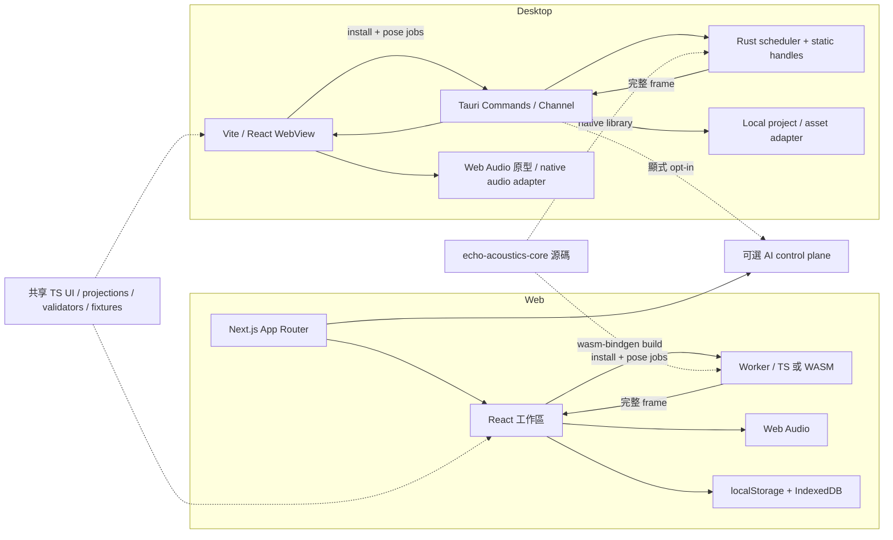

# Web 與 Desktop 架構提案

- Status: Proposed Design
- Reviewed: 2026-11-06
- Baseline: [GitHub main `98a4374`](https://github.com/kekekewww/Echo-Canva-Web/commit/98a4374fa839aa5dee7c6c35e575b8003f7f1a31)
- Evidence: [現行架構](../architecture/current.md) · [平台來源](../../raw/references/platforms.md) · [平台與 Core ADR](../decisions/0001-platform-and-core.md) · [Rust 移植可行性](rust-core.md)

## 現況與打包邊界

**Verified Fact.** Web 版的 `next.config.ts` 設定 `output: "standalone"`。Compile/Explain 是依賴請求內容、執行期設定與服務端金鑰的 POST 路由。Tauri v2 的 Next.js 指南要求靜態輸出，該指南的 Next.js 設定以 14.2.3 為參考。現有 Next.js 16 專案的 Node runtime、動態 route handlers 與 Docker health endpoint 不能直接隨靜態前端生效。Tauri 的 sidecar 是另外打包與管理的程序。 [Next 設定](../../../next.config.ts) · [Compile 路由](../../../src/app/api/scene/compile/route.ts) · [Explain 路由](../../../src/app/api/scene/explain/route.ts) · [平台來源 P01、P02、P07](../../raw/references/platforms.md)

| 前端策略 | 重用與代價 | 研究結論 |
| --- | --- | --- |
| Desktop React + Vite | 以獨立靜態入口重用 React 工作區、樣式與領域模組。需驗證模組 alias、CSS、內建音檔 URL、Worker 資產和瀏覽器 API | Proposed Design。優先做最薄的載入殼 |
| 共享 React packages | 兩邊可共用元件和行為測試。先切出純 domain、ports 和依賴穩定的元件，再以兩個實際使用端決定 package 邊界 | Proposed Design。避免先搬動整個 `src/` |
| Desktop 專用 Next.js static export | 可保留 App Router 的部份結構，但仍須拆出依賴 Request 的路由、執行期服務及 build 限制。產生第二套 Next 配置 | 暫緩。若 Desktop 的共享 UI 實測深度依賴 Next，才重新比較 |
| 本機 Node sidecar | 可保留服務端 handler，但增加安裝、可執行檔生命週期、localhost 權限、埠衝突、更新與資安成本 | 暫緩。只有必須離線使用且既有原生路徑無法支援的服務才立項 |
| Tauri Commands 與可選遠端服務 | 本機檔案與計算走受限 Commands。遠端 AI 可重用 Web 服務端驗證與 provider 管理 | Proposed Design。手動場景編輯、預設、音訊與求解在離線狀態可用 |

## Repository 選擇

| 結構 | 維護、版本與知識 | CI、發布與貢獻 |
| --- | --- | --- |
| 單一平坦 Monorepo | 一個 PR 更新 Web、Desktop、schema、fixtures 與 ADR，版本協調容易。共同根目錄與全量移動提高起步 churn | 初始 CI 易耦合，需明確路徑觸發與 ownership |
| Web／Desktop 分離 | 團隊、權限、發布可獨立。UI、schema 和測試易分歧，跨 Agent 需協調多 PR | 公開貢獻入口分散，跨產品修正的版本矩陣較貴 |
| 獨立 Shared Rust Core repo | Core 可有獨立發布及使用者。兩端同步 adapter／contract 與 benchmark evidence 需三個 repo 協作 | 必須發行相容套件和記錄跨 repo 測試結果，短期增加 CI 維護 |
| **單一 repo 內的混合 workspace** | 保留 Web 根目錄，按需加入 Desktop 與 Cargo workspace，共用 `knowledge/`、schema、fixtures，原子審查跨端變更 | 分離 Node／Rust 鎖檔、CI 與發行。共享路徑觸發兩線；Desktop-only 開發可獨立於 Web deploy |

**Proposed Design.** 採最後一項。先保持現有 Next app 位置與部署。Phase 2 才以隔離的原型 Cargo workspace 驗證 `echo-acoustics-core`，Phase 4 在 `apps/desktop/` 建 Vite 與 `src-tauri`。共用 package 名稱只在兩端已出現實際需求時確立。Web frozen pnpm gate 沿用，Rust 則以固定工具鏈和 `Cargo.lock` 驗證。後續 Desktop 分 OS／arch 產生簽章安裝包與測試紀錄，和 Web deploy 各自版本、回滾與發布權限。WebView2／WKWebView 的真實安裝包、離線載入及音訊裝置需分開驗證，Linux 在定義支援範圍後再納入。 [平台來源 P06、P08、P09、P10](../../raw/references/platforms.md)

若出現獨立發布、權限或外部 Core 使用者等足以承擔多 repo 成本的條件，以具名 ADR 重審。分拆後以 Echo Canvas 主 repo 的 `knowledge/` 為唯一綜合記憶，其他 repo 用連結與固定提交引用。Core 發行以 SemVer tag／commit、Cargo lock、WASM npm artifact checksum、`protocolVersion` 和 fixture digest 建相容矩陣。跨 repo 變更用同一 task ID 串接，consumer 的 pinned update PR 通過相容性測試後才宣告支援，證據與 ADR 回填主 wiki。

## 模組與資料流

- **UI 重用。** 以 [UnifiedWorkspace](../../../src/components/workspace/UnifiedWorkspace.tsx) 為重用入口，先盤點 [Inspector](../../../src/components/workspace/ContextInspector.tsx)、[Classic viewport](../../../src/components/workspace/ClassicViewportAdapter.tsx)、[Hybrid viewport](../../../src/components/workspace/HybridViewportAdapter.tsx)、Outliner、數值控制及 [Workspace transfer](../../../src/domain/workspace/transfer.ts) 的 imports。抽出 `AcousticsRuntime`、`ProjectStore`、`AssetResolver`、`AudioPreview`、`AiClient` ports 時，沿用現有 adapter 入參與 user-gesture 音訊流程。以 snapshot fixtures 驗證拖曳、場景切換、Undo／Redo、音訊控制、缺檔 relink 與匯入錯誤。Vite spike 以相同 React、domain、樣式和 viewport 資產建立 offline build。
- **Web runtime。** Next 保留服務端 API，瀏覽器保留本地儲存、現有 TS serial/worker 路徑和 Web Audio。WASM 可選擇由現行 Worker 生命週期與協定包裹，A/B 切換在 adapters 完成而非通用 `EngineRouter`，因 live workspace 直接選用 Classic／Hybrid adapters。 [現行工作區](../../../src/components/workspace/UnifiedWorkspace.tsx) · [EngineRouter](../../../src/acoustics/runtime/engine-router.ts)
- **Desktop runtime。** Tauri WebView 內的同一套 UI 透過窄 Commands 執行 open/save/install/compute/cancel。native scheduler 對每個 workspace mode 管理 bounded jobs 與 generation handles，計算 off the UI/event loop，回傳可完整驗證的 frame。Core 計算只讀幾何和 pose，WebView 保留 authoring、選取、paths 和簡潔 diagnostics。初期仍可用 Web Audio 作產品行為對照。Native audio 後續使用獨立 adapter 消費已驗證的參數，系統音訊 callback 與 IPC/solver 分離。 [平台來源 P21](../../raw/references/platforms.md)
- **本機檔案。** 首先維持現有可交換 project JSON 與 relink metadata。Desktop 的本機 path 或 bookmark 存在 Desktop 專屬 metadata，由檔案選擇器授權，採 scope 限制、來源 canonicalization 和檔案大小界線。儲存先寫同目錄暫存檔並驗證，再以平台支援的原子替換提交。故障時保留上一份可用文件與暫存復原線索。Web ↔ Desktop 的本機資產需由使用者 relink。Studio recording 與長時 PCM 串流需獨立驗收資料完整性。
- **AI 與安全。** Web 續用服務端環境金鑰與 opt-in。Desktop 手動模式先交付，遠端 AI 若啟用經明確同意、HTTPS、身分驗證與配額，傳目前允許的 prompt 或 snapshot 欄位；權杖由原生安全儲存管理。Local AI 是後續隔離的 provider adapter，保留同一 schema/domain/content policy，禁止把 AI 輸出交給 AudioParams、任意路徑、Shell 或執行器。Native Commands 以本機可信 bundled view 及用途授權，用 `AppManifest::commands` 納入各 WebView capability 的允許清單，IPC 仍視為不受信任並驗證長度、型別、座標及 ID。配置 CSP，拒絕遠端 content 獲得本機檔案／計算能力。 [現行 AI 邊界](../../../SECURITY.md) · [平台來源 P05、P07](../../raw/references/platforms.md)

## Desktop 試作的升級門檻

1. 用 fixture 測試 web shell 與靜態 shell 產生相同 authoring 投影和匯入結果。先以同一 TS backend 執行基本工作區流程，確認 UI 重用真實可行。
2. 接入 native JSON IPC 的 shadow adapter。追蹤 submit→dispatch→compute→decode→accept；用相同資料比較 TS 路徑，保持 Worker 或 serial fallback。先確保完整 frame、離線可用、取消及 stale rejection。
3. 在 Windows/WebView2 和 macOS/WKWebView 的打包版重跑 offline CRUD、匯入/重開、裝置播放、功能切換、惡意 IPC、連續拖曳與安全錯誤回復。區分 browser 環境和真實 WebView。Tauri v2 文件有專用測試 build 的 embedded WebDriver 方案。若採用，測試服務與權限只存在 test build。 [平台來源 P06、P08](../../raw/references/platforms.md)
4. Desktop installer 和 updater 在發布階段獨立驗收。驗證上一版開啟本版保存的相容專案、離線安裝、簽章／macOS notarization 與更新簽章政策。原生路徑未達標時，保持 fallback 與既有 Web 發行線。 [平台來源 P09](../../raw/references/platforms.md)
